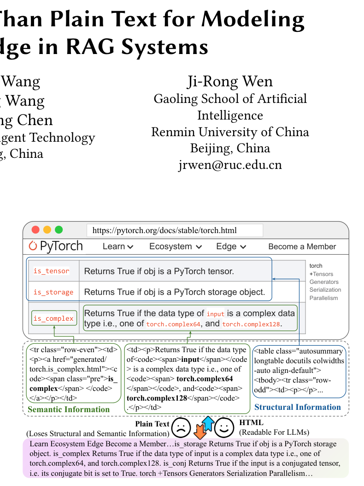
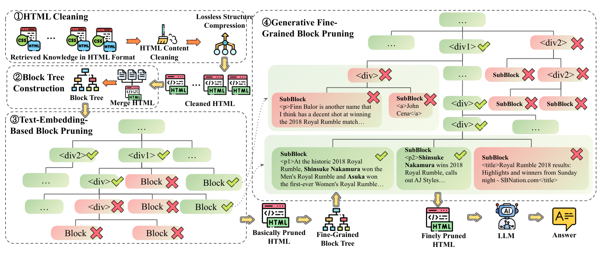
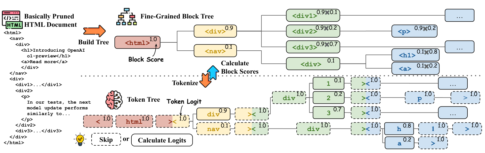
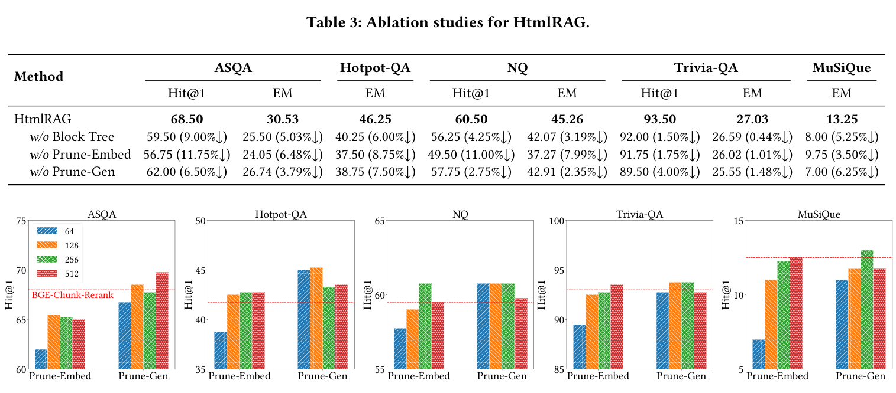
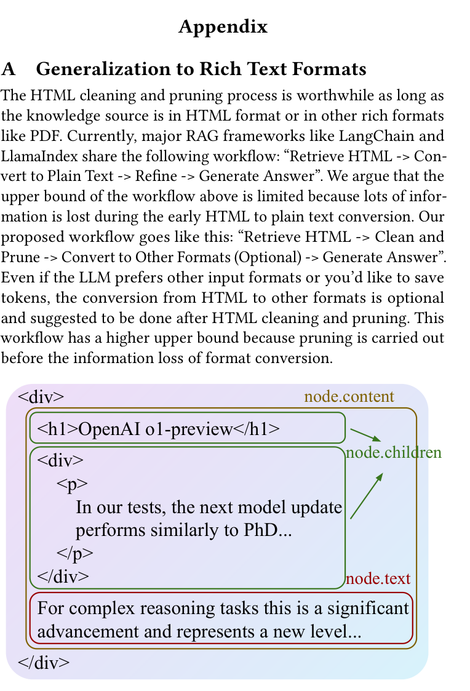

# HtmlRAG：在 RAG 系统中，HTML 比纯文本更适合表示检索到的知识

原题：HtmlRAG: HTML is Better Than Plain Text for Modeling Retrieved Knowledge in RAG Systems。

作者：Jiejun Tan、Zhicheng Dou、Wen Wang、Mang Wang、Weipeng Chen、Ji-Rong Wen。Tan、Dou、Wen 就职于中国人民大学高瓴人工智能学院（中国北京）；Wang、Wang、Chen 就职于百川智能（中国北京）。Tan 的工作在百川实习期间完成；Dou 为通信作者。原文联系邮箱：zstanjj@ruc.edu.cn、dou@ruc.edu.cn、jrwen@ruc.edu.cn。

出处：WWW 2025，2025 年 4 月 28 日至 5 月 2 日，澳大利亚悉尼，14 页。DOI：10.1145/3696410.3714546。翻译版本：[arXiv v2，2025-02-07](https://arxiv.org/abs/2411.02959v2)。arXiv 页面标注 [CC BY 4.0](https://creativecommons.org/licenses/by/4.0/)。本文件为非官方中文翻译及排版改编，原作者未为译文背书。原 PDF 的出版声明保留于随附原件。

译文日期：2026-09-21。正文、附录、公式、表格及图注按原文组织；参考文献完整保留英文书目信息以便检索。chunk 译为“文本块”，block 译为“结构块”，pruning 译为“剪枝”。译者注与原文分开。各图按原 PDF 裁剪嵌入正文对应位置,原始布局可对照原 PDF 页码核对。

## 摘要

检索增强生成（RAG）已被证明能够增强大语言模型的知识能力并缓解幻觉。Web 是 RAG 外部知识的重要来源，许多商业 RAG 系统以 Web 搜索引擎作为主要检索系统。通常，这些系统检索搜索结果，下载结果对应的 HTML 源码，再从中提取纯文本，将纯文本文档或文本块输入大语言模型以增强生成。然而，在这一基于纯文本的过程中，HTML 固有的许多结构与语义信息，例如标题和表格结构，会丢失。

为缓解这一问题，我们提出 HtmlRAG，使用 HTML 而非纯文本表示 RAG 检索到的知识。我们认为，HTML 更适合表示外部文档中的知识，而且多数大语言模型具有较强的 HTML 理解能力。但使用 HTML 也带来新挑战：标签、JavaScript 和 CSS 等额外内容会增加输入 token 和噪声。为此，我们提出 HTML 清理、压缩以及基于结构块树的两阶段剪枝策略，在尽可能减少信息损失的同时缩短 HTML。在六个问答数据集上的实验验证了在 RAG 中使用 HTML 的优势。代码和数据集见 https://github.com/plageon/HtmlRAG。

CCS 分类：信息系统 → Web 搜索引擎。关键词：HTML；检索增强生成；大语言模型。

## 1 引言

大语言模型在多种自然语言处理任务中表现出强大能力 [51,53,55]，但同时存在遗忘长尾知识 [32]、提供过时知识 [3]、产生幻觉 [46,47,83] 等不足。检索增强生成利用检索系统获取外部知识，增强语言模型，已证明能够有效缓解幻觉 [50,85]。Perplexity [56]、SearchGPT [52] 等系统通常使用 Web 搜索引擎作为底层检索系统。

传统 RAG 流水线通常以纯文本表示检索知识 [24,72]：将 Web HTML 转成纯文本，与用户查询拼接后输入模型。我们发现，这种转换会丢失结构和语义信息。图 1 中的表格网页转成纯文本后变得混乱；更严重的是，表示重要信息的 `<code>`、`<a>` 等标签也被丢弃。因此，本文研究一个直观想法：能否直接用 HTML 表示外部知识，从而更充分地保留 HTML 文档中的信息？

这样做的优势不止于保留信息。模型预训练时已接触 HTML [6,18,20]，因而无需额外微调就具有理解 HTML 的能力 [30,82]。近期闭源和开源模型支持越来越长的上下文，使输入较大的 HTML 文档成为可能 [14,78,81]。此外，LaTeX、PDF 和 Word 文档可以以较小损失转换为 HTML，扩大这种知识表示的应用范围 [7,70,73]。

但 HTML 也带来更长序列和噪声上下文。初步实验表明，真实网页的 HTML 平均超过 80K tokens，超过 90% 属于 CSS、JavaScript、注释或其他无意义内容。相对于当时常见的 32K～128K 上下文窗口，单篇 80K 的长度不可接受；无意义 token 还会影响生成质量。我们因此设计 HTML 清理模块，删除语义无关内容并保留主体，且在不损失语义的情况下调整树结构，例如合并多层单一嵌套标签、删除空标签。这些处理将 HTML 缩减至原长度的约 6%。

清理后的单篇 HTML 仍较长，超过 4K。已有 RAG 系统用检索后精炼器，根据查询及模型偏好保留相关文本块或关键句，丢弃其他内容 [22,26,75,84]。这些基于纯文本的工具不能直接用于 HTML，因为不顾结构的切分可能产生不合理片段。我们进一步设计直接作用于 HTML 树结构的剪枝模块：

1. **构造结构块树。** HTML 可解析成 DOM 树 [67]，但 DOM 粒度过细 [19,71]，直接剪枝成本较高。我们将 DOM 节点合并成分层结构块，以合并程度控制粒度。
2. **基于文本 embedding 的剪枝。** 用现成 embedding 模型计算块与查询的相似度，再贪心删除低分块。小块的 embedding 常含义模糊、不够准确，因此此阶段主要处理粗粒度块树。
3. **生成式细粒度剪枝。** 展开剩余树的叶节点，得到更细的块树。生成模型的长上下文能从全局建模，而不局限于逐块处理。模型利用唯一标识结构块的序列生成概率给块评分：序列从根标签沿路径到达该块，并附带块文本，如 `<html><body><div><p>块内容……`。随后按评分贪心剪枝，得到最终 HTML。

我们在歧义问答、自然问答、多跳问答和长答案问答等六个数据集上进行了大量实验，结果支持 HTML 相对于纯文本作为外部知识表示的优势。

贡献有三点：（1）提出将 HTML 作为 RAG 知识格式，保留原有信息；（2）提出简单有效的 HTML 清理算法；（3）提出兼顾效率与效果、可用于多数 RAG 系统的两阶段 HTML 剪枝算法。



**图 1：HTML 转纯文本时的信息丢失。** 示例来自 PyTorch 文档。表格将 `is_tensor`、`is_storage`、`is_complex` 分别对应到“对象是否为 PyTorch tensor”“对象是否为 PyTorch storage”“输入类型是否为 complex64 或 complex128”。纯文本会把导航、表格和内容混在一起。图中文字：Structural Information＝结构信息；Semantic Information＝语义信息；Plain Text (Loses Structural and Semantic Information)＝纯文本（丢失结构和语义信息）；HTML (Readable For LLMs)＝HTML（语言模型可读）；Learn／Ecosystem／Edge／Become a Member＝学习／生态／边缘计算／成为会员；Tensors／Generators／Serialization／Parallelism＝张量／生成器／序列化／并行。

## 2 相关工作

### 2.1 检索增强生成

RAG 用外部知识增强模型。典型流程包含查询改写器 [64]、检索器 [11,37,48,62]、重排器 [62,72]、精炼器 [22,26,75] 和阅读器 [5,86]，广泛用于 LangChain [8]、LlamaIndex [43] 等框架。许多工作优化其中组件，也有工作通过新框架提升效果，例如内部知识不足时主动检索 [5,23,64]，或由模型以线性或树形方式规划检索 [31,61]。但多数现有系统仍以纯文本表示外部知识 [12,13,25,38]。我们提出使用 HTML，以保留检索结果中更丰富的语义。

### 2.2 RAG 的检索后处理

系统通常用精炼器提取有用内容，缩短送给模型的上下文。常用方案先按规则切分文本，再用重排模型选择高相关块 [29,36,49]。另一类生成式精炼器用文本到文本模型生成结果摘要 [17,22,75]：有的使用现成摘要模型 [79,80] 或微调模型 [22] 分段、分层总结；有的利用语言模型 logits 判断词的重要性 [41,45]。

上述方法都基于纯文本。忽视 HTML 结构的分块可能不合理；生成式精炼器还可能难以处理过长 HTML、计算昂贵或 HTML 理解不足。为缓解这些问题，本文依据 DOM 结构进行 HTML 剪枝。

### 2.3 结构化数据理解

已有研究表明，HTML [9,77]、Excel 表格 [35,66,68] 等结构化数据比纯文本包含更丰富的信息。这些工作为结构化数据设计专门任务 [34,68]，或微调模型理解结构 [4,71]。我们的研究不局限于理解某一种格式，而是建议在通用 RAG 中使用更丰富的数据格式。据我们所知，这是首次提出将 HTML 作为 RAG 输入。

## 3 方法

HtmlRAG 使用 HTML 而非纯文本表示检索知识，以保留纯文本缺失的语义和结构信息。HTML 是知识库中常见的文档格式，其他格式也容易转换为 HTML。

HTML 带来的新挑战是上下文过长，因此我们逐步将原始 HTML 缩短：先通过清理模块（3.2 节）移除无用元素和标签，再以两阶段结构感知剪枝（3.4 节）细化结果，先删除与查询 embedding 相似度低的块，再用生成模型做更细剪枝。图 2 展示整体流程。

### 3.1 问题定义

检索器从 Web 获取 HTML 文档集合 D，总长度为 L。阅读器 M 生成答案 a，其兼顾效率和质量的最大上下文长度为 l。压缩算法将 D 映射为较短 HTML 文档 d，满足 |d|≤l。目标是找到最优映射，使模型输出的答案 a 质量最高。

### 3.2 HTML 清理

原始 HTML 单篇超过 80K，且这一阶段不必引入语义特征，因此不适合使用模型方法。我们首先设计与用户查询无关的规则清理，删除无关内容并压缩冗余结构，保留原始 HTML 的语义信息。清理结果适用于配备长上下文模型、不希望在生成前损失信息的系统，也是后续剪枝的基础。

#### 3.2.1 内容清理

网页 HTML 含有大量用户不可见的额外内容，如标签、CSS、JavaScript 等。多数标签提供有助于模型理解的结构，而 CSS 和 JavaScript 帮助有限。因此采用近乎无损的清理：（1）删除 CSS 样式、注释、JavaScript；（2）清除冗长的标签属性。

#### 3.2.2 无损结构压缩

多数 HTML 的结构存在冗余，可以：（1）合并多层单一嵌套标签，例如将 `<div><div><p>一些文本</p></div></div>` 简化为 `<p>一些文本</p>`；（2）删除 `<p></p>` 等空标签。

### 3.3 可调粒度的结构块树构建

为整体剪枝所有检索文档，先将其拼接，用 Beautiful Soup [59] 解析为一棵 DOM 树。直接操作 DOM 很自然，但节点过细、数量多且树深，计算成本较高。

我们提出粒度可调的“结构块树”，以每块最大词数 maxWords 控制粒度。从 DOM 出发，将细碎子节点合并到父节点，视为一个块；只要不超过 maxWords，就递归合并块或子节点。不能合并的原叶节点也视为块。算法详见附录 F。

### 3.4 基于结构块树的 HTML 剪枝

两个阶段均在块树上进行。第一阶段用 embedding 模型剪枝清理结果，第二阶段用生成模型进一步剪枝。

#### 3.4.1 基于文本 embedding 的结构块剪枝

精炼要缩短结果并尽量保留关键信息。直观方法是提取每块纯文本，用 embedding 计算其与查询的相似度，再贪心删除低分块、保留高分块。实际执行时，不断删除相关性最低的块，直到 HTML 总长度满足设定窗口。删除后若再次出现冗余结构，则合并多层单一嵌套标签并删除空标签。算法见附录 F。

该方法轻量有效，比纯文本精炼器更适应 HTML，但有两个局限：（1）每次 embedding 只看块内文本，不能在一次推理中直接比较候选块，缺乏文档全局视角；（2）很细的块往往文本太短，难以提取有效语义特征。

#### 3.4.2 生成式细粒度结构块剪枝

展开已剪枝块树的叶节点，得到细粒度块树。生成模型具有长上下文，可覆盖整棵树，不限于单块建模。但直接处理清理后平均约 60K 的 HTML 仍成本过高，因此放在 embedding 剪枝之后。

受 CFIC [57] 和生成式检索 [39,40] 启发，我们用标识块的标签序列的生成概率给块评分。该序列从根标签到目标块标签，称为“块路径”。推理时模型沿块树计算由 token logits 导出的块分数（图 3），随后使用 3.4.1 节相同的贪心操作得到精炼 HTML。

**（1）训练感知路径的生成模型。** 长上下文模型能理解 HTML 输入并遵循指令 [10,44]。考虑成本，选用已有轻量长上下文模型。输入为 HTML、查询与指令的拼接（图 4）。即使设计了专门指令，未经微调的模型仍不满足要求，我们认为是因为预训练和指令数据中没有这种首次提出的路径生成任务。

因此，我们微调模型，使其生成最相关块的路径。输出由块路径和块内容组成；附加内容提供额外监督，帮助模型学习相关块的特征。对同名兄弟标签，在名称末尾追加编号，例如 `<div1>`、`<div2>`。

按照常规监督微调流程 [58]，我们从多个开源 QA 数据集的训练集抽取查询；用 Bing 获取相关 HTML，清理并用 embedding 剪枝。调整剪枝输出长度，得到 2K～32K tokens 的样本。对每个样本构建块树，计算块内容与标准答案的精确匹配分数。若所有块都无法精确匹配标准答案，说明未检索到高度相关内容，便丢弃该样本以保障质量。更多细节见附录 B。



**图 2：HtmlRAG 流水线。** 检索到的 HTML 知识→合并 HTML→①内容清理和无损结构压缩→②构建结构块树→③基于文本 embedding 的块剪枝→④生成式细粒度剪枝→精剪 HTML→LLM→答案。Block／SubBlock＝结构块／子块；Cleaned HTML＝清理后 HTML；Basically Pruned HTML＝初步剪枝 HTML；Fine-Grained Block Tree＝细粒度块树。图中案例文本依次为：“在具有历史意义的 2018 年 Royal Rumble 中，中邑真辅赢得男子赛事，明日华赢得首届女子赛事……”；“芬恩·巴洛尔是我认为有不错机会赢得 2018 年 Royal Rumble 的另一人……”；“中邑真辅赢得 2018 Royal Rumble，并向 AJ Styles 叫阵……”；“2018 Royal Rumble 结果：周日晚的精彩片段与获胜者 - SBNation.com”；“约翰·塞纳”。



**图 3：结构块得分计算。** 分词器将块树转换为 token 树，对应标签和 token 用相同颜色标示。token 右上角为生成概率，虚线框中的 token 不需推理；块树右上角显示从 token 概率得到的块概率。Build Tree＝建树；Tokenize＝分词；Skip＝跳过；Calculate Logits＝计算 logits；Block Score＝块得分。示例内容：“介绍 OpenAI o1-preview”“了解更多”“在我们的测试中，下一次模型更新表现接近于……”。

**图 4：生成模型提示词（完整中文对应）。**

```text
输入：
**HTML**：“{HTML}”
**问题**：**{Question}**
你的任务是识别 HTML 文档中与给定问题最相关的一段文本。
它可以是对事实的直接改述，也可以是用来推断该事实的支持证据。
文本总长度应大于 20 个词且小于 300 个词。
你应提供这段文本在 HTML 文档中的路径。
输出示例：<html1><body><div2><p>一些关键信息……

输出：
<html1><body><div2><p>在具有历史意义的 2018 年 Royal Rumble 中，
中邑真辅赢得了男子 Royal Rumble……
```

**（2）带动态跳过的高效树形推理。** 结构块 b 的得分记为 Score(b)。对其路径分词得到 t₁,…,tₙ，例如 `<html><div>` 分成 `<`、`html`、`><`、`div`、`>`。给定输入 input 和已生成的 n−1 个 token，模型对下一 token 的 logit 为：

$$\operatorname{Logits}(t_n)=\operatorname{GenModel}(t_n\mid input,t_1,\ldots,t_{n-1}).\tag{1}$$

给定分词器，将各块的路径按共享前缀合并为 token 树。例如 `<,html,><,nav,>` 和 `<,html,><,div,>` 共享前三个 token。路径第 i 个 token 位于 token 树第 i 层。概率计算遵循：（1）根节点概率为 1.0，通常对应 `<`；（2）没有兄弟的唯一子节点概率为 1.0；（3）其他节点由模型得到 logits，再在同级候选之间做 softmax。若第 n 层共有 K 个兄弟候选，则：

$$P(t_n^k)=\begin{cases}1.0,&n=1\text{ 或 }K=1;\\\dfrac{\exp(\operatorname{Logits}(t_n^k))}{\sum_{i=1}^{K}\exp(\operatorname{Logits}(t_n^i))},&\text{其他情况}.\end{cases}\tag{2}$$

前两种情况无需模型推理，因而可跳过许多 token。计算顺序也影响成本：使用深度优先遍历，使连续处理的节点共享尽可能长的前缀，从而最大化复用 KV cache。细节见附录 F。

最后将 token 概率映射回块树。为防止数值精度溢出，以路径 token 概率的对数之和定义块得分：

$$\operatorname{Score}(b)=\sum_{i=1}^{N}\log P(t_i).\tag{3}$$

得到分数后，复用贪心剪枝算法生成精剪 HTML。

## 4 实验

在六个 QA 数据集上模拟工业 Web 搜索场景，并与不同范式的基线比较。

### 4.1 数据集

ASQA [63] 包含有歧义、可由不同知识来源支持多个答案的问题；HotpotQA [76] 是多跳问答；NQ [33] 含 Google 收集的真实用户查询；TriviaQA [28] 含真实用户问题；MuSiQue [65] 是合成多跳问答；ELI5 [16] 是来自 Reddit 的长答案问答。每个数据集从测试集（如存在）或验证集随机抽取 400 个问题。

为模拟真实工业环境，需要真实 HTML 网页，但常用维基百科语料主要是预处理纯文本段落。因此使用 US-EN 地区 Bing 搜索 API，按结果 URL 抓取静态 HTML。实验公开 URL 和对应 HTML 以支持复现。

### 4.2 评估指标

目标是提升端到端 RAG，因此评估模型回答。HotpotQA 和 MuSiQue 每问有一个短答案，报告 EM（精确匹配）；ASQA、NQ、TriviaQA 标注多个短答案，报告 EM 和 Hit@1，后者指模型回答精确包含至少一个标注答案。ELI5 有长答案，报告 ROUGE-L [42] 和 BLEU [54]。

### 4.3 基线

据我们所知，本文首次将 HTML 作为检索知识格式，故与主要输出纯文本或 Markdown 的检索后精炼方法比较。三种基于块的精炼器统一采用 LangChain 切分，重排模块可替换为：（1）稀疏方法 BM25 [60]；（2）encoder-only 的 BGE-Large-EN [74]；（3）基于 Mistral-7B [21]、decoder-only 的 E5-Mistral [69]。另选两种生成式精炼器：LongLLMLingua [22] 使用 Llama7B 选择有用上下文；JinaAI Reader [27] 是在 HTML 转 Markdown 数据上微调的 1.5B 轻量模型。

### 4.4 实验设置

为公平比较，端到端 QA 使用 Llama-3.1-70B-Instruct 和 Llama-3.1-8B-Instruct [15]，上下文为 4K。embedding 剪枝前的块树粒度为 256 words，生成式剪枝前为 128 words；embedding 模型用 BGE-Large-EN，生成骨干用轻量 Phi-3.5-Mini-Instruct，原文称其参数为 3B。微调数据为 2,635 个自动构造样本，长度 2K～32K。更多细节见附录 B。

### 4.5 实验结果

主要结果见表 1。作者概述 HtmlRAG 在六个数据集各指标上达到或超过基线，说明 HTML 剪枝有效，并作如下观察。

（1）块精炼器遵循 LangChain 的 h1、h2 等标题切分规则，虽利用部分 HTML 结构，却不如本文充分；最终转纯文本仍丢失结构语义。BM25 不如两种稠密检索器；稠密方法中，encoder BGE 优于参数更多的 decoder E5-Mistral。

（2）LongLLMLingua 未针对 HTML 优化，抽取能力受到影响，纯文本输出又丢失结构。JinaAI Reader 从 HTML 生成精炼 Markdown，长输入／输出下逐 token 解码既困难又昂贵。

> 译者注：上述“各指标均达到或超过”保留作者原意，但表 1 中存在反例，例如 8B 下的 MuSiQue 和 ELI5。应以具体数值判断，不将概述当作逐列事实。所有表格及原文 † 标记完整列于后文。

### 4.6 进一步分析

#### 4.6.1 HTML 清理的有效性

比较仅清理、不剪枝的 HtmlRAG 与原始 HTML、BeautifulSoup 提取的纯文本、Markdownify [2] 转换的 Markdown。token 数实验显示，清理删除 94.07% 的原始 token，纯文本转换删除 96.71%，Markdown 转换删除 90.32%。

由于清理后仍长，采用 128K 设置（表 2）。不剪枝 HtmlRAG 在多数数据集上达到或超过纯文本／Markdown，支持这种表示的有效性。进一步观察：（1）原 HTML 含大量无关内容，所有清理方法均优于它；（2）有限窗口下标签占用额外 token，HTML 能容纳的文档更少、参考内容 EM 更低，却仍取得相当或更好的回答表现，说明结构信息具有积极作用。

#### 4.6.2 消融实验

表 3 分别移除块树、embedding 剪枝和生成式剪枝。（1）用 DOM 代替块树时，单位过细，embedding 难以捕获语义，路径过长也影响生成模型。（2）移除 embedding 阶段，只用生成模型处理清理 HTML，输入超过 32K，成本高且效果差。（3）只用 embedding 剪枝也不如完整方案，因为其全局理解和细粒度处理能力较弱。

#### 4.6.3 块树粒度的影响

粒度是最关键超参数。过粗限制剪枝灵活性；过细则难以获得小块 embedding，且生成路径过长，需要折中。图 5 比较 64、128、256、512 words。Prune-Embed 指仅 embedding 阶段的结果，Prune-Gen 指继续生成式细剪结果；红虚线为 BGE 块精炼强基线。生成模型适应更细粒度且总体表现更好，支持两阶段设计。



**图 5 图注译文：块树粒度的影响。** 五个子图分别为 ASQA、HotpotQA、NQ、TriviaQA、MuSiQue；柱形表示两阶段的结果，图例为 64／128／256／512。纵轴原图标为 Hit@1；红虚线为 BGE-Chunk-Rerank。原图数值曲线保留于原页图，未把目测柱高伪写为精确数据。

#### 4.6.4 轻量 HTML 剪枝

为说明使用 3B 模型并未显著增加计算量，表 4 比较剪枝、基线和回答模型的成本。embedding 剪枝与块精炼器成本同一量级；作者描述生成式阶段成本略高于基线但远低于回答模型。超过 45% 的节点可跳过，解释了生成模型额外成本较低。

假设检索 20 个 HTML，原知识平均 1.6M tokens；清理后 135K，embedding 剪枝后 8K，生成式剪枝后 4K。在典型 RAG 中，剪枝比回答推理便宜得多，建议使用完整流程；资源受限、连剪枝成本也需考虑时，可以只用 embedding 阶段。图 5 显示这种初剪结果也能达到或超过基于块的精炼器。

> 译者注：表 4 的延迟数值为 BGE 10.5ms、Prune-Embed 30.8ms、Prune-Gen 6.15ms，和上述“生成模型略高于基线”的文字不能简单逐项对应。本文照录，解读报告单独讨论。

## 5 结论与未来工作

本文提出以 HTML 表示 RAG 外部知识，并设计清理和剪枝，在保留关键信息的同时减少额外 token。实验表明 HtmlRAG 优于已有纯文本检索后处理方法，支持 HTML 作为检索知识格式的优势。这一工作开辟新方向，并提供简单有效方案。随着模型能力提高，我们相信 HTML 会更加适合表示外部知识，也期待未来研究提出更好的 RAG HTML 处理方法。

## 致谢

通信作者为 Zhicheng Dou。本工作受国家自然科学基金 62272467、北京市自然科学基金 L233008、北京市科技项目 Z231100010323009，以及中国人民大学建设世界一流大学（学科）经费支持。部分工作在教育部下一代智能搜索与推荐工程研究中心完成。

## 附录 A：推广到富文本格式

只要知识来源是 HTML 或 PDF 等富格式，清理与剪枝就值得进行。当前 LangChain、LlamaIndex 等主流框架通常采用“检索 HTML→转纯文本→精炼→生成答案”。我们认为，过早转换丢失大量信息，限制了这条流程的上限。建议改为“检索 HTML→清理和剪枝→可选地转其他格式→生成答案”。即使模型偏好其他输入格式，或希望节省 token，也建议把格式转换放到清理和剪枝之后。这条流程在转换的信息损失发生之前剪枝，因而具有更高上限。

## 附录 B：生成模型训练细节

模型最大训练上下文为 35,000 tokens，训练 3 个 epoch，使用 4 个计算节点、32 张 80G Nvidia A800 GPU。单设备训练 batch size 为 1，梯度累积步数为 8，以在反向传播中模拟更大 batch，同时控制内存和计算效率。

序列并行大小设为 8，表示条件允许时将计算分布到 8 个设备。学习率为 2e-5，以平衡收敛速度与避免发散；学习率调度器为 constant，意味着除手动调整外维持不变。Adam 的 beta1、beta2、epsilon 分别为 0.9、0.98、1e-8，保障更新稳定。最大梯度范数为 1.0，超出时裁剪以防梯度爆炸。权重衰减为 1e-4，用于正则化和防止过拟合。

warmup_ratio 为 0.01，即训练最初 1% 的阶段逐步提升学习率到基准值。启用梯度检查点，以额外计算换取显存节省。

采用 DeepSpeed 进行分布式训练。ZeRO 优化为 stage 3，即最高级别的参数分片和卸载。gradient_clipping 为 1.0，避免梯度过大。wall_clock_breakdown=false，不提供训练各组件耗时的详细分解，以免增加性能分析开销。bfloat16 混合精度设为 auto，由 DeepSpeed 按系统能力和模型需求决定是否启用。

## 附录 C：信息损失分析

用参考文本的答案精确匹配分数评估剪枝过程中的信息损失，见表 5。表中列出关键步骤与基线。128K 的 Plain Text、Markdown、HtmlRAG w/o Prune 是规则清理后的长上下文，对应表 2 的端到端结果；它们是三种无损压缩技术，但上下文特别长时，128K 限制仍会导致少量信息损失。纯文本最大程度移除格式 token，因此保留的内容最多；HTML 有更多格式 token，相对损失更多。

BM25、BGE、E5-Mistral、LongLLMLingua、JinaAI Reader 的 4K 设置对应表 1 基线。HtmlRAG 8K 为 embedding 初剪，4K 为 embedding 和生成模型共同剪枝。最终 4K 结果中，HtmlRAG 保留最多信息；作者随后提及结合高性能 embedding 的 HtmlRAG 剪枝方法。

> 译者注：“无损”在本段主要指文本内容抽取，不代表纯文本完整保留 HTML 结构。表 5 是答案字符串的 EM，不是全部证据或表格关系的无损率。

## 附录 D：剪枝器规模分析

我们对生成剪枝器的规模做了非常初步的实验：使用相同 HTML 剪枝训练数据，微调 Phi-3.5-mini-instruct（3.8B）和 Llama-3.2-1B-Instruct（原文括注 1.5B），得到 HTML-Pruner-Phi-3.8B 和 HTML-Pruner-Llama-1B。Phi-3.8B-Pruner 略胜，结果见表 7。

> 译者注：保留原文 3B／3.8B、Llama-1B／1.5B 等不一致标法；不要根据这些标法推断准确模型参数量。表 7 的若干“EM”表头也与主表的 Hit@1 数值对应。

## 附录 E：HTML 清理分析

按照表 2 设置，补充 Llama-3.1-8B-Instruct 实验，见表 6。多数数据集上 70B 优于 8B，但少数数据集出现 8B 更好的反直觉结果。检查这些案例发现，70B 被噪声分散了注意力，我们认为这说明 HTML 剪枝有必要。

## 附录 F：关键算法

本附录用伪代码给出块树构造、embedding 剪枝和生成式剪枝相关算法。

先定义节点内元素：node.content 是节点下全部内容；node.children 是由子标签包裹的内容；node.text 是直接附着于节点的文本。图 6 给出例子。同名兄弟标签追加数字区分，如 `<div1>`、`<div2>`。



**图 6：节点内容说明。** HTML 示例含标题“OpenAI o1-preview”、子段落“在我们的测试中，下一次模型更新表现接近博士……”以及直接挂在外层 div 的文字“对于复杂推理任务，这是显著进步，代表了一个新的水平……”。图分别标出 node.text、node.content、node.children。

算法 1 把 DOM 树 T 转成块树 T′。块是后续可以剪去的最小单位。广度优先遍历 DOM：叶节点直接视为块；若某节点全部内容短于阈值，则合并其全部后代作为一个块；否则继续遍历子节点，并把节点直属文本作为一个块。只有子节点而没有直属文本的节点，不额外构成块。这样可以合并细碎节点直到达到粒度限制。

**算法 1：从 DOM 树构造块树（逐步骤中文对应）**

```text
过程 ConstructBlockTree(T)
  声明队列 nodeQueue
  R ← T 的根节点；将 R 入队
  当队列非空：
    node ← 出队
    若 node 为叶节点：
      node.block ← node.content
      node.isLeaf ← True
    否则：
      若 node.content < maxTokens：
        合并 node 的后代节点
        node.block ← node.content
        node.isLeaf ← True
      否则：
        展开 node 的子节点
        将每个子节点入队
        若 node.text 非空：
          node.block ← node.text
          node.isLeaf ← False
  返回 T
```

> 译者注：原文正文称 maxWords，附录文字交替使用 words／tokens，伪代码写 maxTokens；原算法第 11 行直接将 content 与数字比较，第 27 行返回 T。这里保留原符号，不能将它视为可直接执行的严格代码。

贪心块剪枝见算法 2。不断删除最低分块，直到 HTML 满足上下文窗口。若块对应叶节点，删除整个节点；否则只删除父节点直属文本。每次删除后递归检查父节点，若为空则继续删除。

**算法 2：贪心块剪枝（保留原伪代码表达）**

```text
过程 GreedyBlockTreePruning(T)
  nodes ← T 中所有带 block 的节点
  对每个 node：
    node.score ← Rel(q, node.block)  // 计算节点与查询的语义相关性
  将 nodes 按 score 升序排序
  对 nodes 中各 node 循环：
    node ← 最低分节点
    若 node.isLeaf：
      parent ← node.parent
      删除 node
      当 parent.content 为空：
        parent ← parent.parent
        删除 parent
    否则：
      删除 node.text
```

> 译者注：原伪代码未写正文所述“达到预算则停止”的条件；空父节点处理的赋值／删除顺序也有歧义。译文不偷偷修正，实际实现需回到代码验证。

最后，算法 3 用深度优先遍历 token 树，使连续访问 token 共享尽可能长的前缀。根 token 和唯一子 token 的概率直接置 1.0，无需模型计算。

**算法 3：token 概率计算（中文对应）**

```text
过程 TraverseTokenTree
  声明 nodeStack
  t₁ ← T 的根节点
  t₁.score ← 1.0；压栈 t₁
  当栈非空：
    tₙ₋₁ ← 弹栈
    children ← 展开节点 p，得到 tₙ¹,…,tₙᴷ
    若 K=0（p 为叶节点）：继续
    否则若 K=1：
      tₙ¹.score ← 1.0
      将唯一子节点压栈
    否则：
      prefix ← {input,t₁,…,tₙ₋₁}
      对每个子节点 tₙᵏ：
        score ← exp(Logits(tₙᵏ)) / Σᵢ exp(Logits(tₙⁱ))
        将 tₙᵏ 压栈
```

> 译者注：原算法把 nodeStack 称为 queue，并混用 p 与弹栈变量、tₙ⁰ 与 tₙ¹；中文保留流程含义，符号不一致可由原页核对。

## 全部数值表（按原编号）

### 表 1：4K 短上下文实验

Hit@1 表示至少一个短答案匹配的比例。† 按原文表示 t 检验 p<0.05 的显著性标记；原文粗体／下划线分别标最好／次好，本表保留数值和 †，不重新判定显著性。

#### Llama-3.1-8B-Instruct-4K

| 方法 | ASQA Hit@1 | ASQA EM | HotpotQA EM | NQ Hit@1 | NQ EM | TriviaQA Hit@1 | TriviaQA EM | MuSiQue EM | ELI5 ROUGE-L | ELI5 BLEU |
| --- | --- | --- | --- | --- | --- | --- | --- | --- | --- | --- |
| BM25 | 45.00 | 19.84 | 36.25 | 40.75 | 30.66 | 84.75 | 26.17 | 5.75 | 15.90 | 6.56 |
| BGE | 68.50 | 31.47 | 43.25 | 59.00 | 44.59 | 92.25 | 27.50 | 10.00 | 15.87 | 6.30 |
| E5-Mistral | 62.50 | 28.51 | 38.50 | 56.50 | 41.73 | 90.00 | 27.05 | 9.00 | 15.77 | 5.85 |
| LongLLMLingua | 59.25 | 26.34 | 40.75 | 55.25 | 41.82 | 90.00 | 27.02 | 9.00 | 16.08 | 6.45 |
| JinaAI Reader | 53.50 | 23.14 | 34.00 | 47.25 | 34.41 | 84.75 | 24.83 | 6.75 | 15.80 | 5.65 |
| HtmlRAG | 71.75† | 33.31† | 43.75† | 61.75† | 45.90† | 91.75† | 27.82† | 8.75 | 15.51 | 5.84 |


#### Llama-3.1-70B-Instruct-4K

| 方法 | ASQA Hit@1 | ASQA EM | HotpotQA EM | NQ Hit@1 | NQ EM | TriviaQA Hit@1 | TriviaQA EM | MuSiQue EM | ELI5 ROUGE-L | ELI5 BLEU |
| --- | --- | --- | --- | --- | --- | --- | --- | --- | --- | --- |
| BM25 | 49.50 | 21.95 | 38.25 | 47.00 | 35.56 | 88.00 | 25.63 | 9.50 | 16.15 | 6.99 |
| BGE | 68.00 | 30.57 | 41.75 | 59.50 | 45.05 | 93.00 | 27.04 | 12.50 | 16.20 | 6.64 |
| E5-Mistral | 63.00 | 28.75 | 36.75 | 59.50 | 44.07 | 90.75 | 26.27 | 11.00 | 16.17 | 6.72 |
| LongLLMLingua | 62.50 | 27.74 | 45.00 | 56.75 | 42.89 | 92.50 | 27.23 | 10.25 | 15.84 | 6.39 |
| JinaAI Reader | 55.25 | 23.73 | 34.25 | 48.25 | 35.40 | 90.00 | 25.35 | 9.25 | 16.06 | 6.41 |
| HtmlRAG | 68.50† | 30.53† | 46.25† | 60.50† | 45.26† | 93.50† | 27.03 | 13.25† | 16.33† | 6.77† |


### 表 2：70B、128K 下无剪枝实验

指标和 † 标记定义同表 1。

| 方法 | ASQA Hit@1 | ASQA EM | HotpotQA EM | NQ Hit@1 | NQ EM | TriviaQA Hit@1 | TriviaQA EM | MuSiQue EM | ELI5 ROUGE-L | ELI5 BLEU |
| --- | --- | --- | --- | --- | --- | --- | --- | --- | --- | --- |
| Vanilla HTML | 44.00 | 17.52 | 28.00 | 46.75 | 36.06 | 81.50 | 22.58 | 3.25 | 15.69 | 5.16 |
| Plain Text | 59.75 | 25.16 | 41.00 | 59.75 | 44.11 | 93.50 | 26.75 | 8.75 | 16.88 | 7.44 |
| Markdown | 56.00 | 24.00 | 39.00 | 57.00 | 42.00 | 92.00 | 26.43 | 8.25 | 16.91 | 6.74 |
| HtmlRAG w/o Prune | 58.75† | 25.28† | 42.25† | 58.00† | 43.65† | 95.00† | 27.21† | 10.75† | 16.57 | 6.32 |


### 表 3：消融实验

括号内下降幅度、百分号及箭头按原表保留。

| 方法 | ASQA Hit@1 | ASQA EM | HotpotQA EM | NQ Hit@1 | NQ EM | TriviaQA Hit@1 | TriviaQA EM | MuSiQue EM |
| --- | --- | --- | --- | --- | --- | --- | --- | --- |
| HtmlRAG | 68.50 | 30.53 | 46.25 | 60.50 | 45.26 | 93.50 | 27.03 | 13.25 |
| w/o Block Tree | 59.50 (9.00% ↓) | 25.50 (5.03% ↓) | 40.25 (6.00% ↓) | 56.25 (4.25% ↓) | 42.07 (3.19% ↓) | 92.00 (1.50% ↓) | 26.59 (0.44% ↓) | 8.00 (5.25% ↓) |
| w/o Prune-Embed | 56.75 (11.75% ↓) | 24.05 (6.48% ↓) | 37.50 (8.75% ↓) | 49.50 (11.00% ↓) | 37.27 (7.99% ↓) | 91.75 (1.75% ↓) | 26.02 (1.01% ↓) | 9.75 (3.50% ↓) |
| w/o Prune-Gen | 62.00 (6.50% ↓) | 26.74 (3.79% ↓) | 38.75 (7.50% ↓) | 57.75 (2.75% ↓) | 42.91 (2.35% ↓) | 89.50 (4.00% ↓) | 25.55 (1.48% ↓) | 7.00 (6.25% ↓) |


### 表 4：ELI5 推理成本

比较 BGE 块精炼、embedding 剪枝、生成式剪枝及回答模型；tokens 为原表平均值。

| 方法 | 参数量 | 存储 | 输入 tokens | 输出 tokens | 延迟 |
| --- | --- | --- | --- | --- | --- |
| BGE | 200M | 2.5G | 93.54K | 740.3 | 10.5ms |
| Prune-Embed | 200M | 2.5G | 152.5K | 2653 | 30.8ms |
| Prune-Gen | 3B | 7.2G | 6750 | 28.70 | 6.15ms |
| LLM Chat | 70B | 131G | 3661 | 182.9 | 915ms |


### 表 5：用参考文本 EM 衡量信息损失

| 数据集 | 128K 纯文本 | 128K Markdown | 128K HtmlRAG无剪枝 | 8K HtmlRAG无生成式剪枝 | 4K BM25 | 4K BGE | 4K E5-Mistral | 4K LongLLMLingua | 4K JinaAI Reader | 4K HtmlRAG |
| --- | --- | --- | --- | --- | --- | --- | --- | --- | --- | --- |
| ASQA | 70.90 | 67.72 | 69.49 | 59.72 | 25.99 | 52.17 | 50.65 | 35.77 | 38.39 | 52.80 |
| HQA | 70.00 | 65.75 | 66.75 | 54.75 | 37.50 | 48.75 | 49.00 | 43.75 | 38.25 | 51.00 |


### 表 6：8B、128K 下无剪枝补充实验

指标和 † 标记定义同表 1。

| 方法 | ASQA Hit@1 | ASQA EM | HotpotQA EM | NQ Hit@1 | NQ EM | TriviaQA Hit@1 | TriviaQA EM | MuSiQue EM | ELI5 ROUGE-L | ELI5 BLEU |
| --- | --- | --- | --- | --- | --- | --- | --- | --- | --- | --- |
| Vanilla HTML | 47.75 | 20.08 | 28.75 | 47.25 | 36.09 | 85.00 | 24.85 | 6.00 | 16.13 | 6.28 |
| Plain Text | 61.50 | 27.82 | 39.25 | 59.25 | 44.31 | 94.00 | 28.23 | 7.75 | 16.02 | 6.35 |
| Markdown | 61.75 | 26.70 | 37.50 | 57.50 | 42.85 | 91.50 | 26.67 | 7.50 | 16.12 | 5.91 |
| HtmlRAG w/o Prune | 61.00 | 26.70† | 39.50† | 59.00† | 43.46† | 92.00† | 27.50† | 8.75† | 15.62 | 5.87 |


### 表 7：Phi-3.8B 与 Llama-1.5B 剪枝器比较

规模和指标名称按原表保留，见附录 D 的译者注。

| 规模 | ASQA EM | HotpotQA EM | NQ EM | TriviaQA EM | MuSiQue EM | ELI5 ROUGE |
| --- | --- | --- | --- | --- | --- | --- |
| 3.8B | 68.50 | 46.25 | 60.50 | 93.50 | 13.25 | 16.33 |
| 1.5B | 66.50 | 45.00 | 60.75 | 93.00 | 10.00 | 16.25 |

