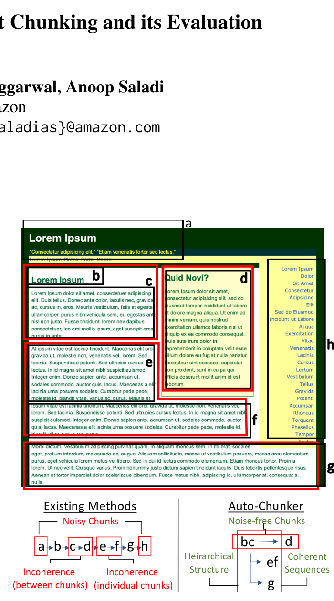
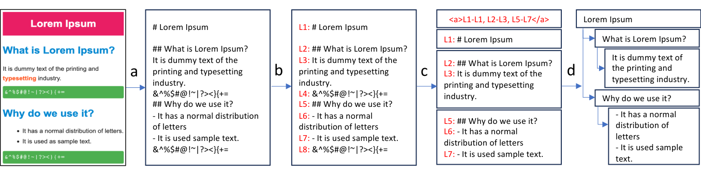

# AutoChunker：结构化文本切分及其评估

原题：AutoChunker: Structured Text Chunking and its Evaluation。

作者：Arihant Jain、Purav Aggarwal、Anoop Saladi；单位：Amazon；邮箱：{arihanta, aggap, saladias}@amazon.com。

出处：ACL 2025 Industry Track，第 983–995 页，2025 年 7 月 28–30 日。原文：[论文页面](https://aclanthology.org/2025.acl-industry.69/)、[PDF](https://aclanthology.org/2025.acl-industry.69.pdf)。©2025 ACL，[CC BY 4.0](https://creativecommons.org/licenses/by/4.0/)。本文件为非官方中文翻译及排版改编，原作者未为译文背书。译文日期：2026-09-21。

译文覆盖全部正文、附录 A/B、4 张表、2 幅图的图注及图中文字、全部 7 个提示词。参考文献保留完整英文书目以方便检索；作者观点与译者注分开。chunk 统一译为“文本块”。

## 摘要

文本切分是现代检索增强系统的基础。然而，现有方法在处理文档结构和噪声时，常难以维持块内及块间的语义连贯性。我们提出 AutoChunker，一种将文档结构感知与噪声消除结合的自底向上切分方法。它使用语言模型识别并分离逻辑信息单元，通过树形表示保留文档层次。

为评估切分算子，我们提出基于五项核心原则的综合框架：噪声减少、完整性、上下文连贯性、任务相关性和检索表现。在产品支持和维基百科文章上的实验表明，AutoChunker 显著优于已有方法，相比先进基线减少噪声、提高块完整性。集成到在线产品支持系统后，它改善了检索表现和客户退货率。本工作既推进文本切分，也提供标准化评估框架，弥补领域中的关键缺口。

## 1 引言

检索增强系统的普及使有效切分对信息访问和利用越来越重要。但现有方法在处理真实文档复杂性时，仍难维持语义连贯。传统方法产生的块可能割裂逻辑单元，或混入无关内容，导致生产系统检索性能下降和用户体验变差。

这些局限在在线产品支持等工业应用中尤其明显：文档同时具有标题、章节、列表等丰富结构，以及导航、广告、模板文字等噪声（图 1）。近期 embedding 或语言模型方案虽尝试解决问题，但通常自顶向下处理，仍难有效保留层次并去除噪声。

本文提出 AutoChunker，将文档先转为标准 Markdown，再用语言模型识别、聚合逻辑信息单元，利用树保留文档层次。这不仅维持块内与块间连贯性，还支持层次结构上的上下文感知检索。

为系统评价效果，我们提出涵盖噪声、完整性、上下文连贯性、任务相关性、检索表现的框架。在支持文档和维基百科上的实验显示，该方法在各维度优于已有方法；在线产品支持部署也改善了检索表现和退货率。



**图 1：现有方法的局限及 AutoChunker 的处理。** Existing Methods＝现有方法；Noisy Chunks＝含噪块；Incoherence (between chunks)＝块间不连贯；Incoherence (individual chunks)＝单块内部不连贯；Noise-free Chunks＝无噪声块；Hierarchical Structure＝层次结构；Coherent Sequences＝连贯序列。图中文字母 a～h 表示示意单元。原图注末尾写作“coherent and not well entailed”，与前后语义不协调，不能据此引申方法具有某种“不蕴含”保证。

## 2 相关工作

### 2.1 切分方法

传统静态方法常使用句子、段落等固定粒度（Gao et al., 2024），难以保持单元内外逻辑连贯。LangChain 的 Recursive 切分器（Chase, 2022）等较先进静态方法使用有优先级的分隔符，如段落和换行。它们容易实现，但缺乏维持跨块语义连贯所需的上下文理解。

动态智能切分则识别上下文转换，以语义连贯性而非任意边界划块。基于 embedding 的语义切分（Chase, 2022；Smith and Troynikov, 2024）聚合语义相似片段，能够把跨段落或章节的相关概念组合起来，但依赖 embedding 模型质量。Bayomi and Lawless（2018）、Eisenstein（2009）、Kazantseva and Szpakowicz（2014）等探索了依赖词汇和句法特征的传统机器学习分段。

近期方法利用 LLM 实现更智能切分。LLMSemantic（Smith and Troynikov, 2024）要求模型找出主题一致的章节边界；LumberChunker（Duarte et al., 2024）寻找发生上下文转换的段落边界；LGMGC（Liu et al., 2025）则利用模型内部 logits，具体是句末 [EOS] token 的概率决定切点。这些方法采取自顶向下思路，从全文递归寻找边界，虽改善连贯性，但仍可能难以处理噪声及复杂布局。

### 2.2 现有方法的局限

表 1 从以下维度比较：（1）结构利用：用标题、子标题指导切分；（2）噪声消除：识别和删除无关内容；（3）上下文感知检索：利用语义匹配有效检索块。此外比较是否识别上下文转换、是否依赖 logits、是否依赖超参数。无需 logits 的方法可以使用任何具有 API 的 LLM，不局限于开源模型，模型选择更灵活。

### 表 1：方法功能比较

| 功能 | Recursive | Semantic | LGMGC | LLMSemantic | LumberChunker | AutoChunker |
|---|---|---|---|---|---|---|
| 结构利用 | ✓ | ✗ | ✗ | ✗ | ✗ | ✓ |
| 噪声消除 | ✗ | ✗ | ✗ | ✗ | ✗ | ✓ |
| 上下文感知检索 | ✗ | ✗ | ✗ | ✗ | ✗ | ✓ |
| 上下文转换识别 | ✗ | ✗ | 部分具备 | ✓ | ✓ | ✓ |
| 无需 logits | — | — | ✗ | ✓ | ✓ | ✓ |
| 对参数不敏感 | ✗ | ✗ | ✓ | ✓ | ✗ | ✓ |

原表用红叉、黄勾、绿勾和横线区分不具备、部分具备、完全具备、不适用。已核对原页颜色，LGMGC 的上下文转换为部分具备，其余勾号为完全具备。“对参数不敏感”是作者的功能归纳，不等于本文做了完整敏感性验证。

### 2.3 评估的不足

切分效果的评估研究仍不足。传统方法依赖下游任务表现，但这未必直接反映切分质量（Duarte et al., 2024；Liu et al., 2025）。缺少全面的真实块标注时，检索评估也难开展；检索结果还受 embedding 和检索算法影响，因此属于间接、可能不可靠的切分质量指标。

为此，我们不仅提出 AutoChunker，还提出无监督评估框架，以 LLM 作为公正评审，按第 4 节五项原则评价。通过同时改进切分和评估，希望推进其应用。

## 3 方法

### 3.1 智能文档切分

我们采用保留逻辑结构、支持高效检索的自底向上方法。与从全文递归拆分的方法不同，从最细的单句开始，包含三步：

1. **预处理：** 转成 Markdown，保留标题、子标题、内容和其他结构（图 2a）。
2. **细粒度拆分：** 切为最小逻辑单元——单句，并给每个单元唯一 ID（图 2b）。
3. **智能聚合：** 将带 ID 的原子句输入 LLM，使用附录 B.1 提示词 1。模型分析语义关系，输出应合并句子的起止 ID，同时识别、过滤无助于主体内容的噪声（图 2c）。

该方法的优势是：（1）只生成标识符而非摘要，以保留原文字面内容并降低计算量；（2）按语义结构动态调边界，而不施加任意长度约束，以保持逻辑连贯；（3）系统删除噪声，使检索块包含更有价值的下游信息。



**图 2：智能切分（a、b、c）和层次树创建（d）。** 先转 Markdown，再编号，模型聚合和去噪，最后形成树。图中示例的完整中文对应：

```text
L1: # Lorem Ipsum
L2: ## 什么是 Lorem Ipsum？
L3: 它是印刷和排版行业使用的占位文本。
L4: &^%$#@!~|?><}{+=
L5: ## 为什么使用它？
L6: - 它具有正常的字母分布。
L7: - 它被用作示例文本。
L8: &^%$#@!~|?><}{+=

模型输出：<a>L1-L1, L2-L3, L5-L7</a>
保留 L1、L2-L3、L5-L7，删除 L4、L8；
以 Lorem Ipsum 为上层标题，两个问题及对应内容形成子树。
```

> 译者注：正文称原子单元为句子；图中使用行，附录提示词使用编号段落。复现时必须确定实际输入单位，不能把三者无条件视为相同。

### 3.2 层次树创建

根据 Markdown 语义结构，将无噪声块组织为树（图 2d）。标题、子标题和内容位置指导建树，捕捉文档组织顺序，支持导航、检索及上下文保留。

为解决不规则块长，以及向量数据库处理大块时可能丢失信息的问题，设置最大块长阈值。超长块切成等长部分，同时在树中保留这些子块间关系，维持原上下文及顺序。这样 embedding 模型能够处理块，同时保留文档逻辑结构。

建树的好处包括：保留原结构和层次；支持高效导航和相关内容检索；保留块在整体布局中的上下文；优化块长以利于 embedding 和向量表示。

### 3.3 上下文感知检索

将查询与向量库每个块比较。对匹配查询的块，输出以该块为根的子树。

对 top-K 请求，先对重叠子树去重，因为父子节点可能同时被召回。再对剩余子树排序，展开为块序列，返回 top-K。

这样不仅返回相关块，还返回其文档上下文；利用层次关系给出更细致准确的响应，并提供更全面、上下文更合适的信息。

> 译者注：这里是“以命中块为根返回子树”，不要替换为“必定向上返回整个父章节”。后者是另一种策略。

## 4 评估方法

我们用 LLM 作为公正评审（Gu et al., 2025；Jain et al., 2025），提出五项原则：是否减少噪声；块是否独立、完整、有意义；是否尽量减少上下文跳转；是否与下游任务相关；是否提升相关信息检索。

### 4.1 噪声减少

把块输入 LLM，使用附录提示词 2 判断是否含噪声，统计含噪块比例。噪声包括对回答用户无帮助的页眉页脚、重复内容、社交媒体按钮等。

### 4.2 完整性

使用提示词 3 判断块是否自包含、有意义，完整性分数为判定完整的块所占比例。

### 4.3 上下文转换

使用提示词 4 检查块内部是否存在上下文转换。原文此处称衡量“没有有效上下文转换”的块比例，而结果表将 Context Switch 标为越低越好；两者表述方向不完全一致，结果解读以表头为准。

### 4.4 任务相关性

使用提示词 5，判断块是否与问答、产品支持等下游任务相关，计算相关比例。

### 4.5 检索表现

**4.5.1 查询生成。** 缺乏实际查询，因此从数据中随机抽块，用附录 B.3 提示词 7 生成相关查询。

**4.5.2 相关性评分。** 用 embedding 检索，取 top-K，再用提示词 6 的 LLM 相关性系统评分：0 不相关，与查询无联系；1 相关，识别了查询；2 有一定相关性，包含潜在答案；3 完全相关，包含查询与答案；4 完美相关，与查询和答案精确匹配。

采用加权 precision@K：

$$WP@K=\frac{\sum_{i=1}^{K}rel(i)}{\max(rel)\times K}\times100.$$

rel(i) 是第 i 个召回块的相关分，最高分 max(rel)=4。

## 5 实验设置

### 5.1 数据集

在 Support 和 Wikipedia 两个领域评估。结构化数据来自 Common Crawl（2025）的原始 HTML。Support 筛选 Apple、Samsung 等品牌的产品支持页，聚焦产品问题，通常含问题描述、症状、逐步解决方案。Wikipedia 随机抽取文章，主题包含产品、国家和人物等，天然包含引言、历史、参考文献等结构。

### 5.2 基线和实现

比较静态和动态切分，输入涵盖无结构纯文本及有结构 HTML／Markdown。

静态基线：Recursive+Text 用 BeautifulSoup（Richardson, 2007）从 HTML 抽文本，再用 LangChain RecursiveCharacterTextSplitter；Recursive+HTML 用 Liu（2024）公开的 HTML 切分实现；Recursive+Markdown 先转换 Markdown，再用 MarkdownHeaderTextSplitter。

动态基线：Embedding 用 Markdown 输入、LangChain SemanticChunker 和 cohere.embed-multilingual-v3；LLMSemantic 用作者代码、claude-3.5-sonnet；LumberChunker 同样使用作者代码和 claude-3.5-sonnet。

AutoChunker 及所有 LLM 评估都使用 claude-3.5-sonnet，检索 embedding 使用 cohere.embed-multilingual-v3。

## 6 结果与分析

### 6.1 切分质量

表 2 显示 AutoChunker 在所有指标上优于基线，噪声最低、完整性最高、上下文转换最少、任务相关性最高。显著降噪源于其专门噪声消除机制，弥补了现有方法的不足。

### 表 2：不同领域的切分质量

| 领域 | 方法 | 输入 | 噪声↓ | 完整性↑ | 上下文转换↓ | 任务相关性↑ |
|---|---|---|---:|---:|---:|---:|
| Support | Recursive | Text | 27.56 | 15.36 | 23.60 | 84.38 |
| Support | Recursive | HTML | 25.59 | 55.75 | 2.96 | 45.16 |
| Support | Recursive | Markdown | 26.46 | 27.34 | 24.34 | 82.32 |
| Support | Embedding | Markdown | 35.86 | 9.41 | 59.41 | 57.92 |
| Support | LLMSemantic | Markdown | 24.00 | 71.21 | 6.81 | 76.89 |
| Support | LumberChunker | Markdown | 36.05 | 1.25 | 54.64 | 63.16 |
| Support | AutoChunker | Markdown | 1.12 | 93.03 | 1.66 | 94.76 |
| Wikipedia | Recursive | Text | 29.83 | 18.45 | 25.12 | 82.54 |
| Wikipedia | Recursive | HTML | 26.91 | 53.62 | 3.15 | 47.23 |
| Wikipedia | Recursive | Markdown | 28.13 | 25.67 | 26.45 | 80.91 |
| Wikipedia | Embedding | Markdown | 37.42 | 8.92 | 61.23 | 55.84 |
| Wikipedia | LLMSemantic | Markdown | 25.34 | 69.87 | 7.12 | 75.32 |
| Wikipedia | LumberChunker | Markdown | 38.21 | 2.14 | 56.78 | 61.45 |
| Wikipedia | AutoChunker | Markdown | 2.31 | 91.24 | 2.05 | 92.87 |

### 6.2 检索表现

表 3 比较不同排名的加权精度。本方法持续优于基线，WP@1 最高；上下文感知检索（CAR）进一步改善 WP@3、WP@5，说明保留上下文和相关性有效。

### 表 3：加权精度比较

| 领域 | 方法 | WP@1 | WP@3 | WP@5 |
|---|---|---:|---:|---:|
| Support | Recursive | 60.75 | 51.25 | 39.15 |
| Support | Embedding | 16.75 | 14.25 | 13.65 |
| Support | LLMSemantic | 69.12 | 56.23 | 49.41 |
| Support | AutoChunker | 75.42 | 63.42 | 56.84 |
| Support | AutoChunker + CAR | 75.42 | 68.74 | 63.22 |
| Wikipedia | Recursive | 58.45 | 48.92 | 37.84 |
| Wikipedia | Embedding | 15.92 | 13.85 | 12.95 |
| Wikipedia | LLMSemantic | 66.78 | 54.32 | 47.65 |
| Wikipedia | AutoChunker | 72.95 | 61.45 | 54.92 |
| Wikipedia | AutoChunker + CAR | 72.95 | 66.84 | 61.35 |

## 7 工业应用与影响

我们在一个在线产品支持商店中部署切分策略，用于组织支持指南和故障排除内容。与内部静态切分基线相比，相关内容检索精度提高了 7%。

随后将切分策略集成到采用 RAG（Lewis et al., 2020）的聊天机器人。它是已购产品且遇到问题的客户的主要接口，流程从向量库检索相关块，生成适当响应。系统上线后四周，因能提供更有意义的回答，产品退货率降低 6.5 个基点。

> 译者注：6.5 bps＝0.065 个百分点，不是 6.5%。论文未在此明确“检索精度提高 7%”是相对变化还是百分点变化，也未给出完整线上对照设计，译文不补造。

## 8 结论

AutoChunker 通过自底向上和结构感知，解决已有方法的重要局限，在多个维度改善块质量。五项原则的框架为传统检索指标之外的切分评估提供系统方法。在线支持系统的应用验证了实用价值，改善客服并降低退货率，表明实验切分质量改善可以转化为工业影响。

## 附录 A：补充结果

表 4 比较平均切分时间、token 均值／中位数／90 分位数、每文档平均块数。AutoChunker 的表现具有竞争力，相比其他 LLM 方法处理更快，并产生适合检索和模型窗口的均衡块长分布。

### 表 4：切分方法的成本和块长统计

| 方法 | 输入 | 时间（秒） | 平均 tokens | p50 tokens | p90 tokens | 平均块数／文档 |
|---|---|---:|---:|---:|---:|---:|
| Recursive | Text | 0.11 | 359.5 | 391 | 407 | 534 |
| Recursive | HTML | 5.61 | 14.2 | 10 | 34 | 13924 |
| Recursive | Markdown | 0.24 | 357.4 | 388 | 406 | 534 |
| Embedding | Markdown | 0.38 | 259.6 | 163 | 419 | 772 |
| LLMSemantic | Markdown | 49.39 | 95.3 | 76 | 195.1 | 2570 |
| LumberChunker | Markdown | 10.52 | 1314.5 | 633 | 4037 | 191 |
| AutoChunker | Markdown | 6.04 | 94.3 | 72 | 202 | 2223 |

> 译者注：最后一列按原表列名照录，其量级和统计口径值得复现时核实，不自行改成总块数。

## 附录 B：提示词全文

以下保留机器使用的标签、变量、Yes/No 和数字输出格式，翻译说明文字。

### B.1 智能切分提示词

**提示词 1：AutoChunker**

```text
<task>
你的任务是分析 Markdown 网页中的段落，将其合并为连贯的语义单元。
每个合并单元应自包含、逻辑完整。同时识别并排除噪声内容，
例如导航元素、空段落、冗余页眉、相关文章。
</task>
<Input Format>
- 内容以带编号标签的段落提供：<pXXX>content</pXXX>
- XXX 是唯一的段落 ID。
</Input Format>
<Output Requirements>
1. 列出应合并到一起的段落 ID。
2. 输出格式为：<merged>ID1-ID2,ID3-ID4,...</merged>
3. 在 merged 标签中只输出合并段落的起始和结束 ID。
</Output Requirements>
<Merging Guidelines>
1. 合并构成完整思想或主题的段落。
2. 把相关内容放在一起，例如问题和答案。
3. 保持信息自然顺序。
4. 保留层次关系，例如标题及其内容。
5. 把相关常见问题或技术规格归在一起。
6. 同一序列中的全部步骤应放在一起。
7. 只有讨论新主题或上下文变化时，才创建新的段落单元。
8. 如果存在产品名称，在合并单元中保留它。
9. 图片若与逻辑单元相关，尽量保留。
通常排除以下噪声：
- 导航菜单
- 空段落
- 冗余页眉
- 社交媒体按钮
- 通用页面元素，例如“跳到主要内容”
- 页脚内容
- 重复内容
- 相关文章
- 支持、联系我们或与我们聊天的相关元素
- 请求回电选项
</Merging Guidelines>
以下是输入：
{input}
```

### B.2 评估提示词

**提示词 2：噪声评分**

```text
你将获得带编号标签的多个段落：<pXXX>content</pXXX>，XXX 是唯一段落 ID。
任务是判断每个段落是否包含噪声。
以下属于噪声：导航菜单、空段落、冗余页眉、社交媒体按钮、
通用页面元素（如“跳到主要内容”）、页脚、重复内容、相关文章、
支持／联系我们／聊天相关元素、请求回电选项。
以下不属于噪声：标题、问题和答案、常见问题。
<Output Requirements>
<p1>[根据是否包含噪声输出 Yes/No]</p1>
<p2>[根据是否包含噪声输出 Yes/No]</p2>
...
<pN>[根据是否包含噪声输出 Yes/No]</pN>
</Output Requirements>
回复只在每个标签内输出 Yes 或 No。
输入如下：
{paragraphs}
```

**提示词 3：完整性评分**

```text
分析以下段落的逻辑完整性。各段落以 <pXXX>content</pXXX> 包裹，
XXX 是唯一段落 ID。
完整段落应满足：
1. 构成自包含的逻辑单元。
2. 表达完整思想或观点。
3. 自身包含适当上下文。
4. 不留下明显未回答的问题。
5. 不突然结束，也不以指向缺失内容的连接词开始。
示例：
- 完整：“什么是光合作用？它是植物将阳光转为能量的过程。”
- 不完整：“这导致了若干复杂情况。”（缺少上下文和前文指代）
请评估每段，只按 <p1>Yes</p1> 或 <p1>No</p1> 格式回复。
<Output Requirements>
<p1>[根据是否完整输出 Yes/No]</p1>
<p2>[根据是否完整输出 Yes/No]</p2>
...
<pN>[根据是否完整输出 Yes/No]</pN>
</Output Requirements>
待分析段落：
{paragraphs}
```

**提示词 4：上下文转换评分**

```text
分析每个段落内部的上下文转换。段落格式为 <pXXX>content</pXXX>，
XXX 是唯一段落 ID。
上下文转换的定义：
1. 讨论超过两个不同主题／对象。
2. 在无明确过渡的情况下切换不相关观点。
3. 引入多个独立问题。
4. 突然改变视角或叙述重点。
示例：
有转换（Yes）：
- “猫睡在窗台上。全球变暖正在影响北极熊。学生应该多复习考试。”
- “人工智能技术发展很快。说到这个，我的花园需要浇水。昨天股市崩盘了。”
无转换（No）：
- “计算机通过 CPU 和 RAM 处理数据，二者协同执行程序。”
- “气候变化同时影响温度和降水模式，带来多种环境影响。”
输出格式：
<p1>[Yes/No]</p1>
<p2>[Yes/No]</p2>
...
<pN>[Yes/No]</pN>
只在段落标签内输出 Yes/No。
待分析段落：
{paragraphs}
```

**提示词 5：任务评分（产品支持专用）**

```text
你是产品支持分析系统。分析以下段落，识别潜在客户问题或产品故障排除场景。
段落格式为 <pXXX>content</pXXX>，XXX 是唯一 ID。
判断是否包含：客户关于产品的潜在问题；需要排查的故障；
关于产品使用的帮助或澄清请求。
识别准则：
以下输出 Yes：
- 产品特性或功能的问题
- 需要解决的问题或故障
- 请求帮助或澄清
- 故障排除场景
- 客户担忧或困惑
- 产品描述
以下输出 No：
- 一般陈述或事实
- 营销内容
- 与问题无关的信息
<Output Format Required>
<p1>[Yes/No]</p1>
<p2>[Yes/No]</p2>
...
<pN>[Yes/No]</pN>
只在各标签内输出 Yes 或 No，无需额外解释。
分析以下段落：
{paragraphs}
```

**提示词 6：相关性评分**

```text
任务：分析段落与客户查询的相关性。
输入：客户查询；多个 <pXXX>content</pXXX> 段落，XXX 为唯一 ID。
相关性分数：
0 - 不相关，与查询无关。
1 - 相关，识别了问题。
2 - 有一定相关性，包含潜在解决方案。
3 - 完全相关，包含问题和解决方案。
4 - 完美相关，与问题及解决方案精确匹配。
规则：
1. 每个段落独立评估。
2. 同时考虑语义和上下文相关性。
3. 根据段落直接回应查询的程度评分。
4. 不同段落可获得相同分数。
5. 同时考虑显式和隐式相关性。
输出格式：
<p1>[score]</p1>
<p2>[score]</p2>
...
<pN>[score]</pN>
示例：
<query>“如何重置密码？”</query>
<p1>要重置密码，点击“忘记密码”并按照说明操作。</p1>
输出：<p1>2</p1>
注意：只允许 0～4 的整数分数。
输入如下：
<query>{query}</query>
{paragraphs}
```

### B.3 查询生成提示词

**提示词 7：查询生成**

```text
给定一组文本块，你的任务是：
1. 仔细分析块内容。
2. 生成 5 个不同的问题，要求：
- 可直接用所给块中的信息回答。
- 从简单事实问题到更复杂的分析问题。
- 表述清楚、无歧义。
- 不重复，覆盖内容的不同方面。
格式：
<Q1>[Question]</Q1>
<Q2>[Question]</Q2>
文本块：
{chunks}
```

> 译者注：原提示词要求 5 个问题，但格式示例只展示 Q1、Q2，此处照录；未擅自补齐或修改原始实验协议。
