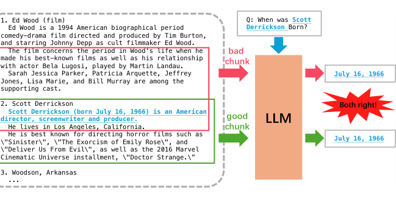
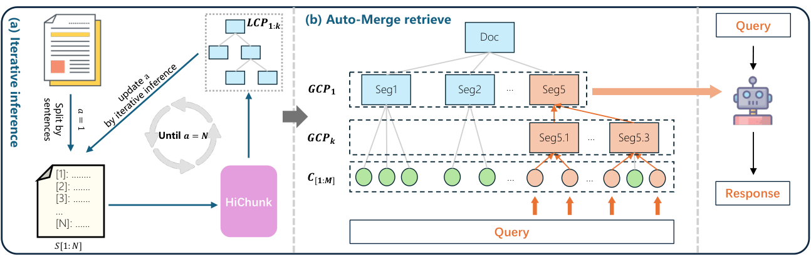
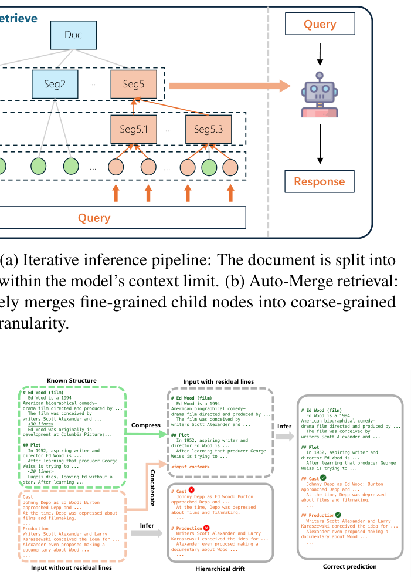
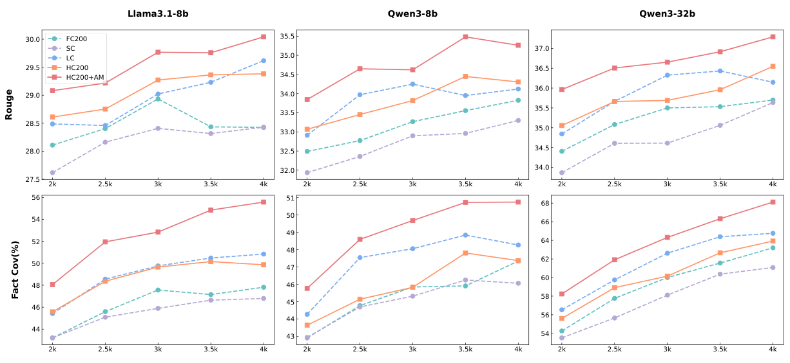
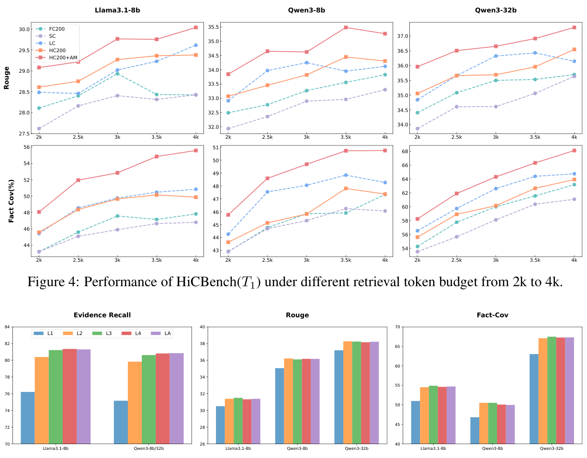
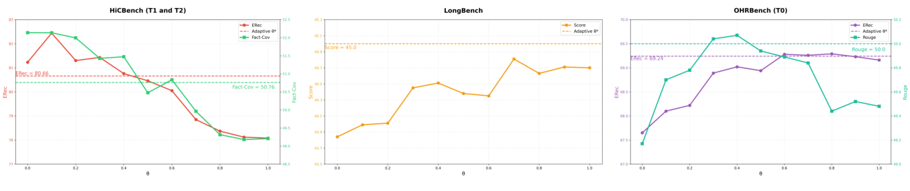
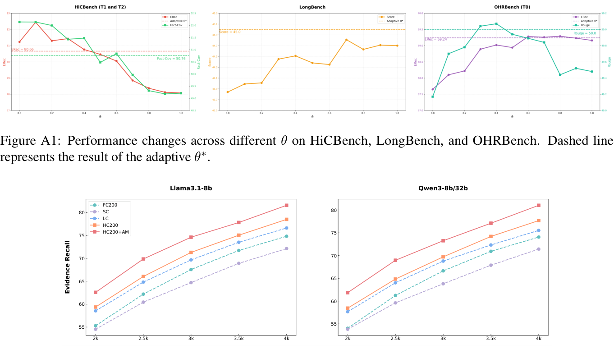

# HiChunk：通过层次切分评估并增强检索增强生成

原题：HiChunk: Evaluating and Enhancing Retrieval Augmented Generation with Hierarchical Chunking。

作者：Wensheng Lu、Keyu Chen（共同第一作者）、Zhifeng Shen、Ruizhi Qiao（通信作者）、Xing Sun。单位：腾讯优图实验室。邮箱：{vincentwslu,yolochen,billsshen,ruizhiqiao,winfredsun}@tencent.com。

出处：ACL 2026 长文集，第 29738–29753 页，2026 年 7 月 2–7 日。[论文页面](https://aclanthology.org/2026.acl-long.1372/)、[PDF](https://aclanthology.org/2026.acl-long.1372.pdf)。©2026 ACL，[CC BY 4.0](https://creativecommons.org/licenses/by/4.0/)。本文件为非官方中文翻译及排版改编，作者未为译文背书。译文日期：2026-09-21。

翻译包含正文、局限性、附录 A.1–A.7、9 张表、7 幅图图注及文字对应、4 个提示词和 2 个算法。参考文献保留英文书目信息以便检索。chunk 译为“文本块”，hierarchy level 译为“层级”，证据召回与事实覆盖分开表述。数字和原文不一致处不擅自改正。

## 摘要

检索增强生成（RAG）通过整合外部知识增强语言模型响应能力。但作为重要环节的文档切分，往往缺少有效评估工具。本文首先分析现有 RAG 基准为何不适合评估切分质量，特别指出证据稀疏问题。由此提出 HiCBench，包含人工标注的多层级切分点、合成的证据密集问答及相应证据来源。

我们还提出 HiChunk：利用微调 LLM 进行文档层次结构化，并结合 Auto-Merge 检索算法提高检索质量。实验表明 HiCBench 能有效评估不同切分对整个 RAG 流程的影响。HiChunk 在合理耗时内取得更好的切分质量，进而改善整体表现。代码：https://github.com/TencentCloudADP/hichunk。

## 1 引言

RAG 灵活整合外部知识，将相关内容块作为提示，提升模型对训练语料之外问题的回答质量（Lewis et al., 2020），有助减少幻觉（Chen et al., 2024b；Zhang et al., 2025），尤其适用于实时信息（He et al., 2022）和专业知识（Wang et al., 2023；Li et al., 2023）。切分显著影响检索知识和最终回答质量：不良切分可能割裂连续片段而丢失信息，或混合无关内容而增加检索难度。Bhat et al.（2025）指出，不同数据集的最优块长差异显著。

现有 RAG 基准（Bai et al., 2024；Dasigi et al., 2021；Duarte et al., 2024；Zhang et al., 2024；Yang et al., 2018b；Kočiský et al., 2018；Pang et al., 2021）主要评估检索器能力或回答模型推理能力，缺乏对切分的有效评估。分析证据平均词数和句数发现，很多基准只有少数句子与查询相关，存在证据稀疏（见表 1 和图 1）。这种情况下，好坏切分可能得到相同答案。实际用户任务可能需要枚举、总结等证据密集操作，要求完整切出语义连续片段，因此需要能有效评估切分的基准。

我们提出层次切分基准 HiCBench，用于评估切分器、检索器和回答模型。原文档来自 OHRBench，筛选适当长度，人工标注多层级切点；标注既用于评估切分，也辅助构建 QA。再利用 LLM 和文档结构生成证据密集问答，抽取证据句并过滤不合要求的样本。

现有切分大多只考虑线性结构（Duarte et al., 2024；Xiao et al., 2024；Zhao et al., 2025；Wang et al., 2025），难以应对不同查询所需的语义粒度。因此 HiChunk 用微调模型进行层次结构化，并通过迭代推理适应极长文档；Auto-Merge 根据查询自适应调整检索块粒度，以提高检索质量。

主要贡献：（1）HiCBench 提供多层级切点、证据来源及事实答案，评估切分对各环节的影响；（2）HiChunk 构建文档层次表示，使检索粒度可动态调整；（3）在多个公开数据集与 HiCBench 上，从切分、检索、回答三个维度综合评估。

### 表 1：已有基准统计

| 指标 | Qasper | OHRBench | GutenQA |
|---|---:|---:|---:|
| 文档数 | 416 | 1261 | 100 |
| 每文档平均句数 | 164 | 176 | 5,373 |
| 每文档平均词数 | 4.2k | 5.4k | 146.5k |
| QA 数 | 1,372 | 8,498 | 3,000 |
| 问题平均词数 | 8.9 | 20.6 | 16.0 |
| 答案平均词数 | 16.0 | 5.6 | 26.0 |
| 证据平均词数 | 239.4 | 36.5 | 39.3 |
| 证据平均句数 | 10.5 | 1.7 | 1.7 |



**图 1：不同切分方法得到相同答案。** 混合文档依次介绍《艾德·伍德》、Scott Derrickson 和 Woodson, Arkansas。问题为“Scott Derrickson 何时出生？”好块和坏块都能回答“1966 年 7 月 16 日”，因而都正确。图中示例原文的中文对应：①《艾德·伍德》是蒂姆·伯顿导演并制作的 1994 年美国传记时代喜剧剧情片，约翰尼·德普饰演邪典导演 Ed Wood；影片讲述其著名电影创作时期以及与马丁·兰道饰演的 Bela Lugosi 的关系；配角包括 Sarah Jessica Parker、Patricia Arquette、Jeffrey Jones、Lisa Marie、Bill Murray。②Scott Derrickson 生于 1966 年 7 月 16 日，是美国导演、编剧、制片人，居住在加州洛杉矶，因《险恶》《驱魔》《驱魔警探》及 2016 年漫威电影《奇异博士》知名。③Woodson, Arkansas（阿肯色州伍德森）……。原图省略号照原样表示。

## 2 相关工作

**传统文本切分。** 文本切分把连续文本分成句子、短语、词等有意义单元；本文关注句子级切分。Cho et al.（2022）结合层次表示、行列式点过程与抽取式摘要以减少冗余；Liu et al.（2021）结合主题切分与层次摘要；Zhang et al.（2021）使用语音 embedding 和自适应滑窗处理 ASR 转写。但基于 LSTM／BERT（Devlin et al., 2019）的方法受限于较短上下文和单层切分能力。

**面向 RAG 的文档切分。** LumberChunker 用 LLM 识别语义变化，但可能遗漏层次关系；PIC 用文档摘要产生的伪指令指导切分，但单层表示可能过度简化结构；AutoChunker 使用树，却主要关注去噪，而非多层粒度；Late Chunking 先编码整篇再切，以保留全局上下文，但输出仍是平面块列表；LongRefiner 提供两层切分，但受模型输入长度及幻觉限制。HiChunk 从粗章节到细段落建立多层表示，使系统在合适抽象层次检索，连接碎片化知识。

**现有切分基准的不足。** Wiki-727k、VT-SSum、NewsNet 通常是平面段落／句子序列，未捕捉章节、子章节、段落的多层组织，难评估利用文档层次的方法。Qasper、HotpotQA、GutenQA 虽面向 RAG，却未专门提供切分效能机制或指标，主要通过端到端检索和生成间接衡量，因此难以独立比较切分器。本工作同时提出多层切分方法及从切分角度构建的基准。

## 3 HiCBench 构建

在 OHRBench（Zhang et al., 2024）文档语料上新增层次标注及用于评价切分质量的 QA，领域涵盖学术、金融、法律、手册等。过滤少于 4,000 词及超过 50 页的文档；对保留文档人工标层次，用来辅助 QA 生成及评估切分准确性。

**任务准则。** 每个 QA 的证据应广泛分布于一个完整语义块；若不能完整召回，便会缺少证据并影响回答。要求：（1）证据完整且密集：包含全面而必要的相关证据，并占上下文较大比例；（2）事实一致：在提供完整上下文时，生成回复应与答案一致，问题应可回答。

**任务定义。** T0 是证据稀疏问答，证据仅一两句；T1 是单块证据密集问答，证据覆盖一个完整语义块的大部分内容，块长为 512～4096 tokens；T2 是多块证据密集问答，证据分布在多个完整语义块，块长为 256～2048 tokens。

**问答构建。** 使用 DeepSeek-R1-0528 生成候选 QA，再过滤：

1. 对人工层次标注的文档 D 生成章节摘要 S←LLM_s(D)，让模型建立整体理解。
2. 从符合要求的片段随机选一或两个块作为 C，结合 S 生成 (Q,A)←LLM_qa(S,C)。
3. 参考 Friel et al.（2024），提取证据 E←LLM_er(C,Q,A)。重复 5 次，仅保留至少出现 4 次的句子以缓解幻觉；证据占上下文少于 10% 的样本删除。
4. 用 Fact-Cov（Xiang et al., 2025）检查事实一致：从答案提取事实 F←LLM_fe(Q,A)，将原构建上下文 C 提供给回答模型得到 R′←LLM_r(Q,C)，计算 LLM_fc(F,R′)。重复 5 次，平均事实覆盖超过 80% 才保留，否则视为不可回答。

构建提示词见附录 A.7；事实评估工具引用 https://github.com/GraphRAG-Bench/GraphRAG-Benchmark。

## 4 HiChunk 框架

图 2 展示整体框架。让微调 LLM 理解文档层次，并将文档组织为树，包含切点识别和层级确定两个子任务，通过提示词转成文本生成。用 Gov-report、Qasper、Wiki-727k 中显式文档结构构造训练指令；随机打乱章节、删除内容增强训练数据。

推理时把文档 D 分成带唯一 ID 的句子序列 S=[s₁,…,sₙ]，输出分层切点，使其划分为不重叠且语义完整的块。切点写作 (id,level)，表示在该位置发生特定层级的语义中断。

语义切分虽保持完整性，但块长不均会导致粒度差异并影响检索。因此继续对 HiChunk 结果做固定大小切分，得到 C[1:M]，再利用 Auto-Merge 平衡粒度与完整性。

### 迭代推理

对超过模型输入限制 L 的文档使用滑窗：每轮贪心选择从当前起点开始、能放进 L 的最长片段，预测局部切点，再合并到全局结构。

但缺少完整文档结构会造成“层次漂移”：模型可能错误地将本轮第一个切点判为一级，导致局部层级错位。为缓解，用已知结构构造残留文本行，压缩已预测的文档结构并带入后续推理，维持模型对全局的感知（图 3）。完整过程见算法 1。

### Auto-Merge 检索

按查询相关性遍历已排序块，N 记录已召回节点。第 i 步先记已有预算 T_used=Σₙ∈N len(n)，加入当前块，其父节点记为 p，满足以下条件时向上合并：

1. **连贯性 Cond1：** 已召回至少两个同父子节点，|N∩children(p)|≥2。
2. **实质覆盖 Cond2：** 已召回子节点总长度覆盖父文本足够比例，Σ len(n)≥θ*·len(p)，其中

$$\theta^*(T_{used},p)=\frac{1}{3}\left(1+\frac{T_{used}}{T_{max}}\right).$$

预算越满，阈值越高；较高排名块在预算少时更积极合并，优先保障重要内容完整性。

3. **可行性 Cond3：** 用父节点替换已召回子节点后，剩余 token 预算足够。

完整过程见算法 2。



**图 2：HiChunk 框架。** （a）句子化文档，在模型窗口内迭代预测层次切点；（b）在层次块上，自适应将细粒度子块合并为粗粒度父块，以平衡完整性与检索粒度。Doc＝文档；Split by sentences＝按句切分；Query＝查询；Response＝回答；GCP＝全局切点；LCP＝局部切点；Seg＝片段。原图表达最长片段满足输入预算 L，并迭代更新起点 a，直到处理到末尾。



**图 3：残留行如何避免层次漂移。** 已知结构为一级“Ed Wood (film)”及二级“Plot”。没有残留行时，新窗口里的 Cast、Production 被误判为一级；带入压缩后的已知结构时，两者正确预测为二级。Known Structure＝已知结构；Compress＝压缩；Concatenate＝拼接；Infer＝推理；Input without/with residual lines＝不带／带残留行输入；Hierarchical drift＝层次漂移；Correct prediction＝正确预测。示例文本对应：“《艾德·伍德》是蒂姆·伯顿导演并制作的 1994 年美国传记喜剧剧情片……影片构想来自编剧 Scott Alexander 和……”“1952 年，有抱负的编剧兼导演 Ed Wood……得知制片人 George Weiss 尝试……”“《艾德·伍德》最初由 Columbia Pictures 开发……”“Lugosi 去世，Ed 失去了主演，得知……”“演员：Johnny Depp 饰 Ed Wood；Burton 联系了 Depp……当时 Depp 对电影和制作感到沮丧……”“制作：Scott Alexander 与 Larry Karaszewski 构想……Alexander 甚至提议拍摄关于 Wood 的纪录片……”。<30 lines>/<20 lines> 表示压缩省略的 30／20 行，非本译文遗漏。

## 5 实验

### 5.1 数据集与指标

Gov-report、Qasper 测试子集用于切点准确率；Gov-report 仅保留超过 5k 词的文档。F1_L1、F1_L2 分别衡量一级、二级切点；F1_Lall 忽略层级。Qasper、GutenQA、OHRBench 含证据标注，用于检索评估。

完整 RAG 流程使用 LongBench、Qasper、GutenQA、OHRBench，回答以 F1、ROUGE 评价，实验在 LongBench 代码库进行。HiCBench 综合评价切点、证据召回和回答质量；为避免稀疏文本质量指标偏差，使用 Fact-Cov，并重复 5 次取均值。数据统计见附录表 A1。

### 5.2 比较方法

FC200：先按句切分，再按固定大小 200 合并。SC：用 bge-large-en-v1.5 计算相邻段落相似度。LC：LumberChunker，用 DeepSeek-R1-0528 预测切点，temperature=0.1。HC200：HiChunk 后继续固定大小 200 切分。HC200+AM：再加入 Auto-Merge 检索。

> 译者注：这里的 200 不应解释为你们的“200 个中文字符”。实验整体以模型 token 预算约束检索；具体固定块长单位应在复现实现中一并确认。

### 5.3 实验设置

以 Qwen3-4B 为骨干，用 Gov-report、Qasper、Wiki-727k 训练，学习率 1e-5、batch size 64；训练和推理最大长度分别 8192、16384 tokens。每句限制在 100 characters 内。

因为语义块长度不同，为公平比较，限制召回 token 数而非块数，默认最大 4096 tokens，并在 5.6 节比较其他预算。检索统一用 BGE-m3；回答模型用 Llama3.1-8B、Qwen3-8B、Qwen3-32B。

### 5.4 切分准确率

在两套公开数据和 HiCBench 上评价语义切分。SC、LC 只有单层，所以只评一级和忽略层级的 F1。表 2 显示，HC 在域内 Qasper、Gov-report 上明显优于 SC、LC，在域外 HiCBench 上也改善准确率。作者认为专门微调切分任务增强了模型能力，5.5 节进一步显示其能改善检索证据和回答。

> 译者注：原文称域外“更显著”的改善，但不能把它理解成每个数值增幅都大于域内。表 2 保留原始结果。

### 5.5 RAG 流程评估

表 3 比较 LongBench、Qasper、GutenQA、OHRBench、HiCBench。HC200+AM 在多数 LongBench 子集取得最优或次优，平均分方面 LumberChunker 仍是强基线。

GutenQA、OHRBench 证据仅少数句，切分方案间证据召回和回答差异小。例如 Qwen3-32B 在 GutenQA 上，FC200 与 HC200+AM 的证据召回为 64.50、65.53，ROUGE 为 44.86、44.94。OHRBench 上 FC200、LC、HC200、HC200+AM 也接近。

Qasper 与 HiCBench 证据更密集，更好的切分带来更高召回和回答质量。Qwen3-32B 在 HiCBench T1 上，FC200 与 HC200+AM 的证据召回为 74.06、81.03，Fact-Cov 为 63.20、68.12，ROUGE 为 35.70、37.29。因此 HiCBench 的证据密集 QA 更适于评价切分，并帮助识别 RAG 瓶颈。

### 5.6 检索 token 预算影响

在 HiCBench T1 上比较 2k、2.5k、3k、3.5k、4k 预算，计算 ROUGE 和 Fact-Cov，见图 4。预算增加通常提升回答质量，因此不同方法必须在相同召回 token 预算下比较。HC200+AM 在各预算下持续表现更好。证据召回曲线见附录 A.4。



**图 4：不同检索预算下的 HiCBench T1 表现。** 横轴 2k～4k；上排 ROUGE，下排事实覆盖率；三列分别是 Llama3.1-8B、Qwen3-8B、Qwen3-32B；图例为 FC200、SC、LC、HC200、HC200+AM。

### 5.7 最大层级的影响

限制结构最大层级为 1～4（L1～L4），LA 不限制。图 5 显示，L1 过粗，Auto-Merge 会降低表现；从 L1 增加到 L3，证据召回逐步提高，之后基本不变，说明层次结构的重要性。



**图 5：HiCBench T1/T2 上最大层级的影响。** 三个面板分别显示证据召回、ROUGE、Fact-Cov，比较 L1/L2/L3/L4/LA；横轴为回答模型。图注虽只称证据召回，原图实际还包含两个回答指标。

### 5.8 Auto-Merge 消融

以 Qwen3-8B 回答，对合并条件消融，见表 4。只保留预算 Cond3 时，HiCBench 证据密集任务最优，ERec=81.43、ROUGE=36.33、Fact-Cov=51.35，但稀疏任务下降，LongBench=43.25，OHRBench ERec=66.72，显示单一规则泛化不足。

加入 Cond1 后，Qasper 和 OHRBench ERec 分别增加 0.81、1.46，可缓解无意义合并。再加 Cond2，跨数据集表现更均衡：LongBench 升至 44.41（比仅 Cond3 增加 1.16），HiCBench ERec 仅降 0.57。多项互补规则帮助兼顾密集／稀疏任务，阈值敏感性见 A.3。

### 5.9 平面与层次切分上的 Auto-Merge

为区分收益来自层次结构还是 AM 启发式，在 SC、LC、仅一级 HCL1 及完整 HC 上应用 AM，以 Llama3.1-8B 在 HiCBench 评估（表 5）。平面方案增益很小或没有增益；完整 HC+AM 的证据召回增加 2.67，多个指标明显改善。结果说明结构化和合并的协同作用重要，不能单独把收益归因于合并规则。

### 5.10 Few-shot 提示实验

为验证微调必要性，用相同骨干 Qwen3-4B 在 HiCBench 做 1-shot、3-shot，与微调 HiChunk 比较，回答器为 Qwen3-8B（表 6）。增加示例并未改善切分与端到端表现，各 few-shot 方案明显落后于微调。作者认为，这证明高质量 HiChunk 层次切分需要微调。

> 译者注：该结论限于论文所测模型、提示词与数据，不证明所有更大模型或所有 few-shot 配置都必须微调。

## 6 结论

本文分析了 RAG 基准的证据稀疏问题，指出其不适合区分切分方法，提出面向层次切分的 HiCBench 评估切分对整个流程的影响；提出 HiChunk，并结合 Auto-Merge，较基线提升切分、检索和回答质量。

## 7 局限性

理论上 HiChunk 支持超过三层，但实际收益边际递减，主要受所有层次方法共同的挑战约束：（1）具有较深层次的公开训练数据稀缺；（2）漏斗效应：深层建模依赖较浅层预测，层次越深准确性保障越弱。

这不代表不能处理深层结构。在不限制层数 LA 下，HC200+AM 仍优于其他基线（表 3），作者据此认为超过三层结构不会否定层次设计的核心价值。更高效地建模深层结构是未来方向。

## 附录 A.1：数据集统计

表 A1 给出实际实验文档、QA 与证据的统计：文档数、平均句数和词数、QA 总数、问题／答案词数、证据词数和句数。灰色行在此用指标名称对应。注意正文表 1 的 OHRBench 是另一统计范围，不能和实验筛选后的表 A1 混用。

## 附录 A.2：结合 Late Chunking

为验证与其他优化的互补性，在 HiCBench 上将各方法与 Late Chunking 结合。遵循 Günther et al.（2024），embedding 换为 jina-embeddings-v3，结果见表 A2。Late Chunking 普遍提高 ERec 和 Fact-Cov；无论是否加入，HC200+AM 在所评设置中持续最好，支持与其他 RAG 优化结合。

## 附录 A.3：Cond2 阈值 θ* 敏感性

θ* 表示召回子节点长度占父节点的最低比例，控制合并粒度。用 Qwen3-8B 回答，把固定 θ 从 0.0 以 0.1 间隔扫到 1.0，比较三个数据集（图 A1）。

θ=0.1～0.6 时，HiCBench ERec 均高于 80.05%，OHRBench ROUGE 高于 49.89%，显示一定鲁棒性。θ 增加时密集任务下降，θ=1.0 时 ERec=78.08%；稀疏任务在 θ>0.5 时改善，体现粒度需求差异。自适应 θ* 取得跨任务平衡：HiCBench ERec=80.66%、LongBench=45.00、OHRBench ROUGE=50.00。作者认为动态阈值比固定值更鲁棒，不需人工按任务调参。



**图 A1：三个数据集随 θ 的性能变化。** 虚线为自适应阈值 θ* 的结果。数值与曲线以原图为准。

> 译者注：本段自适应结果与正文表 4 的相应值不完全相同，原文未在此充分解释，译文分别保留。

## 附录 A.4：不同 token 预算的证据召回

图 A2 给出 2k～4k 检索上下文预算下的证据召回曲线。HC200+AM 始终优于其他所比较方法。



**图 A2：HiCBench T1 的预算与证据召回。** 左侧 Llama3.1-8B，右侧 Qwen3-8B/32B；横轴为预算，纵轴为 Evidence Recall（证据召回）；图例与图 4 相同。

## 附录 A.5：切分耗时

切分需要满足时效性。表 A3 比较语义切分的时间成本。SC 最快，但质量在多数据集上落后；LC 效果较好却更慢，限制应用。HC 在可接受耗时内获得较高切分质量，更适合真实场景。

## 附录 A.6：HiCBench 标注

语料来自 OHRBench，包含学术、金融、行政等领域，选择超过 4,000 词的文档。标注者阅读并理解语义结构，按 HiChunk 训练格式标出各层切点。关键标准是“语义独立性”，保证每个单元能独立表达完整含义；层级由从属关系确定。每篇至少标注两次，只保留切点位置一致率超过 80% 的标注，以保证一致性。

## 附录 A.7：使用的提示词

以下翻译全部自然语言说明，保留字段名、标签和变量便于与代码对照。

### 清单 A1：章节摘要提示词

```text
任务：
分析给出的文档章节及其层次结构。为每个章节和子章节生成一段简洁、信息充分的内容描述。
指令：
1. 每个章节使用 === SECTION xxx === 标识，例如 === SECTION 1 ===、=== SECTION 2.1 ===。
2. 为每个章节及子章节写简短、清楚、信息充分的摘要，不得遗漏。
3. 输出 JSON：
{
  "SECTION 1": "第 1 节内容描述",
  "SECTION 1.1": "第 1.1 节内容描述",
  ...
  "SECTION n.m": "第 n.m 节内容描述"
}
4. 键必须与章节标识完全一致，如 "SECTION 2.1.3"，不得添加输入中不存在的章节。
5. JSON 外不添加评论或解释。
文档片段：
```

### 清单 A2：问答构建提示词

```text
给你一份文档的详细章节／子章节结构及各节描述，同时提供少数选定章节的完整内容。
请创建一个有效概括所选章节要点的问答对，最后提取答案提到的事实。
<生成问答类型：依赖密集证据的理解任务>
理解任务：要求回答者从文档提取信息，答案可直接在文档找到，不需推理。
依赖密集证据：与问题有关的事实广泛分布在检索章节的各个部分。
<准则>
- 问题必须具体，明确基于文档信息。
- 问题必须包含至少一个实体。
- 不得用“他”“她”“它”“该报告”“该论文”“该文档”等含糊指代，必须使用完整名称。
- 所依据的上下文句必须包含实体名称。例如不能用“他在 4×100 米接力中获得铜牌”，
  可以用“Nils Sandstrom 是参加过 1920 年夏季奥运会的瑞典短跑运动员”。
- 最重要的是密集证据依赖：问题必须要求理解全部所选章节，绝不能仅基于孤立的少数句子。
  即有关事实应广泛分布在所检索章节的各部分。
<输出格式>
{
  "question": "生成的问题",
  "answer": "生成的答案"
}
<文档结构和描述>
{section_description}
<检索章节及其内容>
{section_content}
```

> 译者注：原指令提到提取事实，但展示的 JSON 只有 question/answer；此处保留这一差异，不新增事实字段。

### 清单 A3：证据检索提示词

```text
任务：分析上下文句与答案句的关系。
指令：
1. 你获得：
   - 按 [编号]: 上下文句内容 编号的上下文片段；
   - 问题和对应答案，答案句按 <编号>: 答案句内容 编号。
2. 对每个答案句，找出提供构造该答案句所需信息的上下文句。
3. 输出 JSON：
{
  "<answer_sentence_id_1>": "[context_sentence_id_1], ... , [context_sentence_id_n]",
  "<answer_sentence_id_2>": "[context_sentence_id_1], ... , [context_sentence_id_m]",
  ...
  "<answer_sentence_id_i>": "[context_sentence_id_1], ... , [context_sentence_id_j]"
}
注意：
- 只包含有上下文证据支持的答案句。
- 如果答案句没有上下文来源，不要输出它。
- 上下文句和答案句都只使用编号，不输出完整句子。
- 若多个上下文句支持一个答案句，逗号分隔列出全部编号。
上下文句：
{context_sentence_list}
问题：
{question}
答案句：
{answer_sentence_list}
```

### 清单 A4：模型训练提示词

```text
你擅长阅读、整理文档，也善于区分文档上下文中句子的语义和逻辑关系。
下文已经切成句子，每行格式为“{行号} @ {句子内容}”。
请按语义与格式进行分段，分段具有多层粒度，层级数字越大粒度越细。
确保每个一级片段在语义上完整；一级可包含多个二级片段，依此类推。
按顺序输出各层片段的起始行号，确定层级，以及起始句是否可作为片段标题。
最终输出列表，每个元素为“{行号}, {片段层级}, {是否为标题}”。
>>> 输入文本：
```

> 译者注：正文简写切点为二元组，训练提示词实际还输出“是否为标题”的第三项。

### 算法 1：迭代推理

```text
输入：文档 D；输入长度 L
输出：各层全局切点 GCP[1:k]
S[1:N] ← SentTokenize(D)
a ← 1
b ← 能使 S[a:b] 不超过 L 的最大终点
res_lines ← None
GCP[1:k] ← k 个空列表
当 1 ≤ a < b ≤ N：
  LCP[1:k] ← HiChunk(S[a:b], res_lines)
  GCP[1:k] ← Merge(GCP[1:k], LCP[1:k])
  若一级局部切点数 len(LCP[1]) ≥ 2：
    a ← 最后一个一级局部切点
    res_lines ← None
  否则：
    a ← b
    res_lines ← ResLines(GCP[1:k])
  更新 b，使从新 a 开始的片段尽可能长且不超过 L
返回 GCP[1:k]
```

### 算法 2：检索

```text
输入：token 预算 T；块 C[1:M]；查询 q
输出：检索上下文 ctx
C_sorted ← 根据 q 对块排序
N ← 空列表；T_used ← 0
对 i 从 1 到 M：
  将当前块加入 N
  ctx, T_used ← Context(N)
  p ← 当前块的父节点
  当 Cond1、Cond2、Cond3 满足：
    若 T_used ≥ T：退出本循环
    N ← Merge(N,p)
    ctx, T_used ← Context(N)
    p ← p 的父节点
  若 T_used ≥ T：退出遍历
返回 ctx[:T]
```

> 译者注：上述按原伪代码表达；具体 token 计数、重复节点去重、最后一次截断是否保留完整结构，仍需由实际实现核实，不能由伪代码自动推得。

## 全部补充数值表（表 1 已在正文）

### 表 2：切点准确率

HC 为未经固定大小细分的 HiChunk；— 表示没有相应多层结果。

| 数据集 | 指标 | SC | LC | HC |
| --- | --- | --- | --- | --- |
| Qasper | F1_L1 | 0.0759 | 0.5481 | 0.6742 |
| Qasper | F1_L2 | — | — | 0.5169 |
| Qasper | F1_Lall | 0.1007 | 0.6657 | 0.9441 |
| Gov-Report | F1_L1 | 0.0298 | 0.1795 | 0.9505 |
| Gov-Report | F1_L2 | — | — | 0.8895 |
| Gov-Report | F1_Lall | 0.0616 | 0.5631 | 0.9882 |
| HiCBench | F1_L1 | 0.0487 | 0.2849 | 0.4841 |
| HiCBench | F1_L2 | — | — | 0.3140 |
| HiCBench | F1_Lall | 0.1507 | 0.4858 | 0.5450 |


### 表 3：端到端 RAG 评估

ERec＝证据召回；Fact-Cov＝事实覆盖。+AM 指 HC200+AM。为避免跨栏错位，按回答模型拆成三张表，所有数值照录。

#### Llama3.1-8B

| 方法 | LongBench Score | Qasper ERec | Qasper F1 | GutenQA ERec | GutenQA ROUGE | OHRBench T0 ERec | OHRBench T0 ROUGE | HiCBench T1 ERec | T1 Fact-Cov | T1 ROUGE | HiCBench T2 ERec | T2 Fact-Cov | T2 ROUGE |
| --- | --- | --- | --- | --- | --- | --- | --- | --- | --- | --- | --- | --- | --- |
| FC200 | 42.49 | 84.08 | 47.26 | 64.43 | 30.03 | 67.03 | 51.01 | 74.84 | 47.82 | 28.43 | 74.61 | 46.79 | 30.97 |
| SC | 42.12 | 82.08 | 47.47 | 58.30 | 28.58 | 62.65 | 49.10 | 72.14 | 46.80 | 28.43 | 73.49 | 45.28 | 30.92 |
| LC | 42.73 | 87.08 | 48.20 | 63.67 | 30.22 | 68.42 | 51.85 | 76.64 | 50.84 | 29.62 | 76.12 | 49.12 | 32.01 |
| HC200 | 43.17 | 86.16 | 48.09 | 65.13 | 29.95 | 68.25 | 51.33 | 78.52 | 49.87 | 29.38 | 78.76 | 49.11 | 31.80 |
| +AM | 42.90 | 87.49 | 48.95 | 65.47 | 30.33 | 67.84 | 51.92 | 81.59 | 55.58 | 30.04 | 80.96 | 53.66 | 33.04 |


#### Qwen3-8B

| 方法 | LongBench Score | Qasper ERec | Qasper F1 | GutenQA ERec | GutenQA ROUGE | OHRBench T0 ERec | OHRBench T0 ROUGE | HiCBench T1 ERec | T1 Fact-Cov | T1 ROUGE | HiCBench T2 ERec | T2 Fact-Cov | T2 ROUGE |
| --- | --- | --- | --- | --- | --- | --- | --- | --- | --- | --- | --- | --- | --- |
| FC200 | 43.95 | 84.32 | 45.10 | 64.50 | 33.47 | 67.07 | 48.18 | 74.06 | 47.35 | 33.83 | 72.95 | 43.45 | 35.27 |
| SC | 43.54 | 82.22 | 44.55 | 58.37 | 32.71 | 62.18 | 46.79 | 71.42 | 46.07 | 33.30 | 72.36 | 42.97 | 34.76 |
| LC | 44.83 | 87.43 | 46.05 | 63.67 | 33.87 | 68.79 | 49.28 | 75.53 | 48.27 | 34.12 | 75.14 | 46.80 | 35.93 |
| HC200 | 43.90 | 86.49 | 45.95 | 65.20 | 33.89 | 68.57 | 49.06 | 77.68 | 47.37 | 34.30 | 78.10 | 46.20 | 36.32 |
| +AM | 44.41 | 87.85 | 45.82 | 65.53 | 34.15 | 68.31 | 49.61 | 81.03 | 50.75 | 35.26 | 80.65 | 49.02 | 37.28 |


#### Qwen3-32B

| 方法 | LongBench Score | Qasper ERec | Qasper F1 | GutenQA ERec | GutenQA ROUGE | OHRBench T0 ERec | OHRBench T0 ROUGE | HiCBench T1 ERec | T1 Fact-Cov | T1 ROUGE | HiCBench T2 ERec | T2 Fact-Cov | T2 ROUGE |
| --- | --- | --- | --- | --- | --- | --- | --- | --- | --- | --- | --- | --- | --- |
| FC200 | 46.33 | 84.32 | 46.49 | 64.50 | 44.86 | 67.07 | 46.89 | 74.06 | 63.20 | 35.70 | 72.95 | 60.87 | 37.17 |
| SC | 46.29 | 82.22 | 46.39 | 58.37 | 43.59 | 62.18 | 45.43 | 71.26 | 61.09 | 35.64 | 72.36 | 59.23 | 37.09 |
| LC | 47.43 | 87.43 | 46.82 | 63.67 | 44.45 | 68.79 | 47.92 | 75.53 | 64.76 | 36.15 | 75.14 | 62.75 | 38.02 |
| HC200 | 46.71 | 86.49 | 46.99 | 65.20 | 44.83 | 68.57 | 47.71 | 77.68 | 63.93 | 36.55 | 78.10 | 62.51 | 38.26 |
| +AM | 46.92 | 87.85 | 47.25 | 65.53 | 44.94 | 68.31 | 47.89 | 81.03 | 68.12 | 37.29 | 80.65 | 66.36 | 39.37 |


### 表 4：Auto-Merge 条件消融

| 数据集 | 指标 | 仅 Cond3 | Cond1+3 | Cond1+2+3 |
| --- | --- | --- | --- | --- |
| HiCBench | ERec | 81.43 | 80.55 | 80.86 |
| HiCBench | ROUGE | 36.33 | 36.08 | 36.17 |
| HiCBench | Fact-Cov | 51.35 | 50.70 | 49.97 |
| LongBench | Score | 43.25 | 43.80 | 44.41 |
| Qasper | ERec | 86.73 | 87.54 | 87.85 |
| Qasper | F1 | 45.29 | 45.83 | 45.82 |
| OHRBench | ERec | 66.72 | 68.18 | 68.31 |
| OHRBench | ROUGE | 48.78 | 49.56 | 49.61 |


### 表 5：平面与层次切分上的 Auto-Merge

Llama3.1-8B，HiCBench；Δ 为相对未加 AM 的变化。

| 方法 | ERec | Δ | ROUGE | Δ | Fact-Cov | Δ |
| --- | --- | --- | --- | --- | --- | --- |
| SC+AM | 73.35 | +0.60 | 29.48 | -0.07 | 45.92 | -0.19 |
| LC+AM | 76.86 | +0.46 | 30.81 | +0.10 | 50.21 | +0.16 |
| HCL1+AM | 77.66 | +0.96 | 30.45 | +0.05 | 49.68 | +0.42 |
| HC+AM | 81.30 | +2.67 | 31.41 | +0.94 | 54.70 | +5.17 |


### 表 6：Few-shot 与微调比较

| 评价设置 | 指标 | HC 1-shot | HC 3-shot | HC 微调 |
| --- | --- | --- | --- | --- |
| 切点准确率 | F1_L1 | 0.1784 | 0.2500 | 0.4841 |
| 切点准确率 | F1_L2 | 0.1128 | 0.1203 | 0.3140 |
| 切点准确率 | F1_ALL | 0.2328 | 0.2199 | 0.5450 |
| 不含 AM | ERec | 72.35 | 72.26 | 77.87 |
| 不含 AM | ROUGE | 33.14 | 33.08 | 35.21 |
| 不含 AM | Fact-Cov | 44.02 | 43.97 | 46.84 |
| 包含 AM | ERec | 73.47 | 73.05 | 80.86 |
| 包含 AM | ROUGE | 34.53 | 34.04 | 36.17 |
| 包含 AM | Fact-Cov | 46.62 | 46.55 | 49.97 |


### 表 A1：实际实验数据统计

HiCBench 括号内顺序为 T1、T2。

| 指标 | Qasper | GutenQA | OHRBench T0 | HiCBench T1/T2 |
| --- | --- | --- | --- | --- |
| 文档数 | 416 | 100 | 214 | 130 |
| 平均句数／文档 | 164 | 5,373 | 886 | 298 |
| 平均词数／文档 | 4.2k | 146.5k | 26.8k | 8.5k |
| QA 数 | 1,372 | 3,000 | 4,702 | (659, 541) |
| 问题平均词数 | 8.9 | 16.0 | 22.2 | (31.0, 33.0) |
| 答案平均词数 | 16.0 | 26.0 | 4.8 | (130.1, 126.4) |
| 证据平均词数 | 239.4 | 39.3 | 39.1 | (561.5, 560.5) |
| 证据平均句数 | 10.5 | 1.7 | 1.7 | (20.5, 20.4) |


### 表 A2：结合 Late Chunking

HiCBench T1/T2，embedding 为 jina-embeddings-v3；C200 按原表命名。

| 方法 | 未使用 ERec | 未使用 ROUGE | 未使用 Fact-Cov | 使用后 ERec | 使用后 ROUGE | 使用后 Fact-Cov |
| --- | --- | --- | --- | --- | --- | --- |
| C200 | 75.59 | 34.19 | 46.71 | 78.04 | 34.33 | 49.12 |
| SC | 73.07 | 34.17 | 45.60 | 78.07 | 34.16 | 48.45 |
| LC | 77.89 | 34.84 | 49.16 | 79.93 | 35.16 | 50.65 |
| HC200 | 78.13 | 34.93 | 48.03 | 79.29 | 34.84 | 49.77 |
| HC200+AM | 80.87 | 36.34 | 51.49 | 81.20 | 36.00 | 52.71 |


### 表 A3：平均切分耗时

| 数据集 | 平均词数 | SC 秒 | SC 块数 | LC 秒 | LC 块数 | HC 秒 | HC 块数 |
| --- | --- | --- | --- | --- | --- | --- | --- |
| Qasper | 4,166 | 0.4867 | 43.83 | 5.4991 | 18.32 | 1.4993 | 15.08 |
| Gov-report | 13,153 | 1.3219 | 114.72 | 15.4321 | 40.89 | 4.3382 | 29.79 |
| OHRBench | 26,808 | 3.0943 | 249.14 | 37.3935 | 89.68 | 14.5776 | 92.23 |
| GutenQA | 146,507 | 16.5028 | 1,453.00 | 132.4900 | 393.52 | 60.1921 | 232.85 |
| HiCBench | 8,519 | 1.0169 | 80.12 | 13.4414 | 41.48 | 5.7506 | 51.35 |

