# 语义切分值得其计算成本吗？

*Is Semantic Chunking Worth the Computational Cost?* 全文中文翻译

- 作者：Renyi Qu、Ruixuan Tu、Forrest Bao（ACL 元数据为 Forrest Sheng Bao）。
- 单位与邮箱：Renyi Qu，Vectara, Inc.，renyi@vectara.com；Ruixuan Tu，威斯康星大学麦迪逊分校，turx2003@gmail.com；Forrest Bao，Vectara, Inc.，forrest@vectara.com。
- 出处：*Findings of the Association for Computational Linguistics: NAACL 2025*，第 2155–2177 页，2025 年 4 月 29 日至 5 月 4 日。© 2025 Association for Computational Linguistics。
- DOI：[10.18653/v1/2025.findings-naacl.114](https://doi.org/10.18653/v1/2025.findings-naacl.114)。[论文页面](https://aclanthology.org/2025.findings-naacl.114/)；[原始 PDF](https://aclanthology.org/2025.findings-naacl.114.pdf)。
- 授权：原文依据 [CC BY 4.0](https://creativecommons.org/licenses/by/4.0/) 发布。本文件为 AI 辅助中文翻译及排版改编，非作者或 ACL 官方译文；原作者未为本译文背书。原文图表版权归原权利人所有。
- 翻译日期：2026-09-20。范围：PDF 全部 23 页，含正文、局限性、参考文献、附录 A–E、23 张表和 7 幅图。

> **译文说明**：保留原章节和图表编号；“chunk”统一译为“文本块”，“chunking”译为“切分”，“chunker”译为“切分器”。表格数值按原文照录，不擅自订正。图像保留原图，图注、标签和图中示例文字另提供中文。参考文献保留作者姓名和可检索的出版标识，标题译为中文。所有“译者注”均为补充说明，不属于论文原文。图 6、图 7 的省略号是原图已有的截断，不是译文省略；重复句子的翻译通过句子索引与分块表完整对应。

## 摘要

检索增强生成（RAG）系统的近期进展推动了语义切分的普及。这种方法旨在把文档划分为语义连贯的片段，以改善检索性能。尽管其应用日益广泛，但与更简单的固定大小切分相比，它的实际收益仍不明确；后者把文档切分为连续、大小固定的片段。本研究通过三类常见的检索相关任务，系统评估语义切分的有效性：文档检索、证据检索，以及基于检索的答案生成。结果表明，语义切分带来的计算成本并未得到稳定性能提升的支撑。这些发现对以往关于语义切分的假设提出了挑战，也凸显了在 RAG 系统中寻找更高效切分策略的必要性。

## 1 引言

在检索增强生成（RAG）系统中，把文档切成称为“文本块”的较小单元，对检索和生成任务的质量都有关键影响（Chen et al., 2023；Wadhwa et al., 2024；Shi et al., 2023；Yu et al., 2023）。这些系统针对给定查询检索最相关的文本块，再将其输入生成式语言模型，以产生准确且符合上下文的答案。然而，要同时优化检索质量和计算效率，切分策略是否有效仍是一项重要挑战（Lewis et al., 2020；Finardi et al., 2024）。

传统切分方法把文档切为固定长度的文本块，例如每块 200 个 token，这种方法称为固定大小切分（Gao et al., 2023）。虽然计算简单，但它可能把语义相关的内容分散到多个文本块中，导致检索性能不够理想。近来，语义切分受到越来越多关注。这类方法根据语义相似度划分文档，一些业界应用显示出有希望的性能改进（LangChain, 2024；LlamaIndex, 2024；McCormick, 2024）。但目前没有系统证据表明，语义切分能够提升下游任务性能；即使能够提升，也没有证据证明其收益足够显著，能够抵偿相对于固定大小切分增加的计算开销。

由于缺乏能够直接比较切分策略的数据，开展这种系统评估并不容易。因此，我们设计了使用三个代理任务的间接评估：（1）文档检索，衡量识别相关文档的能力；（2）证据检索，衡量定位真实标注证据的能力；（3）答案生成，检验生成模型利用检索块产生的答案质量。我们的发现挑战了对语义切分收益的普遍假设：其优势高度依赖任务，且往往不足以抵偿增加的计算成本。这项研究为进一步探索更高效、更具适应性的 RAG 切分策略奠定了基础。

总体而言，我们的贡献如下：

- 提出一个新的大规模评估框架，在多种任务上比较语义切分与固定大小切分。
- 证明语义切分虽然在某些场景中存在收益，但这些收益并不稳定，而且往往不足以抵偿其计算成本。

## 2 切分策略

本文首先把文档拆成句子，再将句子组合为文本块。我们评估三种切分策略，后文称其为“切分器”。

### 图 1：三种切分器示意

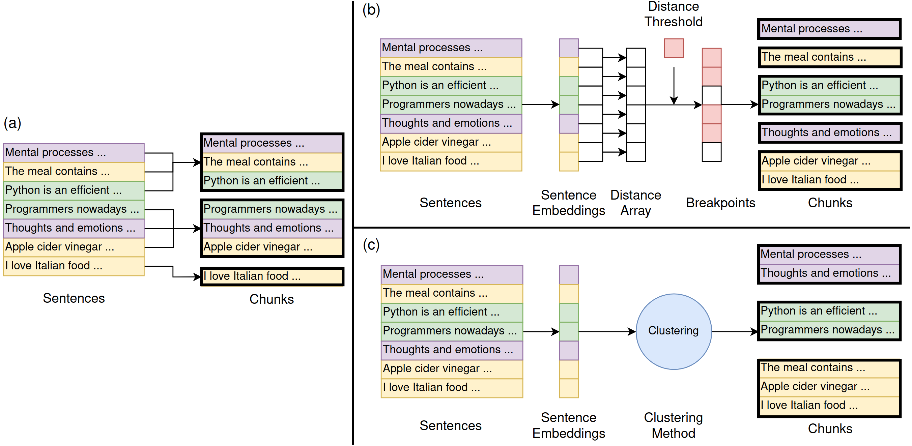

**图 1 图注译文**：本文测试的三种切分器。不同颜色表示示例文档中的不同主题：紫色为心理学，绿色为编程，黄色为食物。红色块表示切分断点。（a）固定大小切分器不考虑语义内容，将文档切成连续、大小一致的文本块。（b）基于断点的语义切分器通过检测相邻句子之间的语义距离阈值划分文本，以保持连贯性。（c）基于聚类的语义切分器把语义相似的句子分组，可能将不连续的文本组合为按主题组织的文本块。

图内标签译文：Sentences＝句子；Chunks＝文本块；Sentence Embeddings＝句子嵌入；Distance Array＝距离数组；Distance Threshold＝距离阈值；Breakpoints＝断点；Clustering＝聚类；Clustering Method＝聚类方法。

图内七个示例片段按输入顺序为：①心理过程……；②这顿饭包含……；③Python 是一种高效的……；④如今的程序员……；⑤思想和情绪……；⑥苹果醋……；⑦我喜欢意大利食物……。固定大小方法得到 `[①②③] [④⑤⑥] [⑦]`；断点方法得到 `[①] [②] [③④] [⑤] [⑥⑦]`；聚类方法得到 `[①⑤] [③④] [②⑥⑦]`。

### 固定大小切分器

这是我们的基线切分器。它根据预先定义或用户指定的每块句子数，按顺序把文档切成大小固定的文本块。

尽管这种方法简单、计算高效，但它可能拆开上下文相关的句子，从而使检索质量下降（Lewis et al., 2020；Finardi et al., 2024；Gao et al., 2023）。为了缓解这一问题，我们让相邻文本块包含重叠句子。这是一种常见做法，可以维持一定程度的上下文连续性。

### 基于断点的语义切分器

基于断点的切分器扫描句子序列，决定在何处插入断点，从而把断点前后的句子分为两个文本块。如果两个相邻句子的语义距离超过阈值，意味着出现了显著的主题变化，便插入一个断点。

我们测试了 LangChain（2024）提出的四种用于确定断点的相对阈值。此外，我们还测试了两种绝对阈值：用预先设定的数值确定文本块边界，从而减少计算开销。

但基于断点的切分器每次仅根据两个句子作出决策。这种策略可能具有局部贪心性。为了在更大范围内利用更多信息进行切分，我们接下来提出一种新的语义切分器。

### 基于聚类的语义切分器

这类切分器利用聚类算法，按语义把句子组合在一起，捕获全局关系，并允许不按原始顺序分组。然而，这可能丢失隐藏在句子邻近关系中的上下文信息。为缓解这一问题，我们定义了一种结合位置距离与语义距离的新距离度量。具体而言，我们对句子 $x_a$ 与 $x_b$ 的位置距离（即句子索引差）和余弦距离求加权和：

$$
d(x_a,x_b)=\lambda d_{\mathrm{pos}}(x_a,x_b)+(1-\lambda)d_{\mathrm{cos}}(x_a,x_b) \tag{1}
$$

$$
d_{\mathrm{pos}}(x_a,x_b)=\frac{|a-b|}{n} \tag{2}
$$

$$
d_{\mathrm{cos}}(x_a,x_b)=1-\max\bigl(\cos(\mathrm{emb}(x_a),\mathrm{emb}(x_b)),0\bigr) \tag{3}
$$

其中，$n$ 是文档的句子总数，$\mathrm{emb}(\cdot)$ 是嵌入函数，$\lambda$ 是超参数。当 $\lambda=0$ 时，切分器完全依据语义相似度工作；当 $\lambda=1$ 时，它对应于固定大小切分器。式（3）中，余弦相似度为 0 表示句子嵌入彼此正交，即不相关；负余弦相似度被视为 0，因为它们对检索或生成没有帮助。

在不失一般性的前提下，我们采用单链接凝聚聚类和 DBSCAN（Ester et al., 1996）作为聚类算法的代表。关于这些方法及实验中所作调整的更多细节，见附录 A。

> 译者注：上段关于 $\lambda=1$ 和负相似度的解释为作者原文观点。距离仅使用位置，并不在一般数学意义上保证所有聚类实现都与固定大小顺序切分完全等价。

## 3 实验

由于缺乏真实标注的文本块数据，我们设计了三个实验，间接评估各切分器的质量：文档检索、证据检索和答案生成。各实验采用不同的数据集和评估指标，以适应其具体任务需求。所有文档先使用 spaCy 的 `en_core_web_sm` 模型（Explosion, 2024）拆成句子，再进行嵌入编码和切分。我们根据 MTEB 排行榜（Muennighoff et al., 2022）的排名，选择了三种覆盖不同性能水平的嵌入模型进行测试。详见附录 E.2。

### 3.1 文档检索

本实验评估切分器针对给定查询检索相关文档的有效性。我们使用了表 1 和表 4 中的 10 个数据集。BEIR 基准（Thakur et al., 2021）中的大多数文档太短，难以体现切分的作用。为此，我们在六个文档过短的数据集中，将短文档拼接为较长的合成文档，详见附录 C。我们从每个数据集中随机抽取 100 个查询，检索前 $k$ 个文本块，其中 $k\in\{1,3,5,10\}$。每个检索块映射到其来源文档，再将检索出的文档与各查询的相关文档集合进行比较评估。

### 3.2 证据检索

本实验采用比前一实验更细的粒度，通过定位证据句子的能力来评估切分器。由于包含长文档及真实标注证据句子的数据集很少，我们从 RAGBench（Friel et al., 2024）额外选取了数据集，见表 2 和表 5。我们统计检索到的前 $k$ 个文本块中包含多少条真实标注的证据句子。

### 3.3 答案生成

本实验衡量切分器如何影响大语言模型生成答案的质量。我们使用 `gpt-4o-mini` 作为生成模型，将检索到的前 5 个文本块作为模型输入，并用语义相似度指标比较生成答案和真实标注答案。我们复用了第 3.2 节的数据集，因为它们同时包含长文档、证据和参考答案。

## 4 结果

### 4.1 性能的衡量与报告

如前所述，我们使用三个代理任务研究切分。由于缺乏文本块级别的真实标注，无法直接评估文本块级检索质量。因此，每个检索块都映射回来源文档或其包含的证据句子。

由于相关文档或证据句子的数量并不固定，而检索块数量 $k$ 是固定的，传统的 Recall@k 和 NDCG@k 等指标并不适用。在这种情况下，F1 能够同时考虑精确率和召回率，提供平衡的衡量。因此，我们使用 F1@5 作为指标。更多细节见附录 D。

> 译者注：这是作者针对本文评估设置的指标选择理由，并非 Recall 或 NDCG 的一般适用条件。相关项数量可变并不使这些指标在数学上失效；具体区别见配套解读报告。

对于每个数据集，我们报告各切分器在最佳超参数配置下的结果；最佳配置根据所有 $k$ 值的平均 F1 分数确定。下文所有结果均使用 `dunzhang/stella_en_1.5B_v5` 作为嵌入模型，因为它在所测试模型中表现最好。

下文加粗数值表示对应数据集上的最佳性能。答案生成结果与证据检索结果非常接近，附录 E.1 对此进行了讨论。附录 B 提供了进一步的超参数分析，附录 E.4 检查了不同切分器的输出。

> 译者注：为避免四舍五入后相同数字的加粗产生歧义，译文数据表统一保留数值，不复刻原表的粗体胜者标记。附录 B 实际列出超参数，性能变化分析主要在附录 E.3。

### 4.2 文档检索

表 1 显示各切分器的性能有所不同：固定大小切分器在未拼接数据集上表现突出，语义切分器在拼接数据集上表现更好。

**表 1：文档检索 F1@5（%）。带 `*` 的数据集经过拼接。为便于比较，按拼接前每篇文档的平均句子数升序排列。**

| 数据集 | 固定大小 | 断点语义 | 聚类语义 |
|---|---:|---:|---:|
| Miracl* | 69.45 | 81.89 | 67.35 |
| NQ* | 43.79 | 63.93 | 41.01 |
| Scidocs* | 16.82 | 17.60 | 19.87 |
| Scifact* | 35.27 | 36.27 | 35.70 |
| BioASQ* | 61.86 | 61.87 | 62.49 |
| NFCorpus* | 21.36 | 21.07 | 22.12 |
| HotpotQA | 90.59 | 87.37 | 84.79 |
| MSMARCO | 93.58 | 92.23 | 93.18 |
| ConditionalQA | 68.11 | 64.44 | 65.94 |
| Qasper | 90.99 | 89.27 | 90.77 |

如附录 C 所述，平均包含 100 个句子的拼接文档，是将 Miracl 和 NQ 等数据集中较短的文档（少于 10 个句子）组合而成的，因此具有很高的主题多样性。在这种情况下，基于断点的语义切分器优于其他方法，因为它能更好地保持主题完整性：根据语义差异切分句子，形成与原始文档相似的文本块。相较之下，固定大小和基于聚类的切分器经常混合来自不同文档的句子，增加噪声，降低检索质量。

随着文档长度增加，拼接所需的文档数量减少，主题多样性随之降低。这削弱了基于断点的语义切分器的优势，而基于聚类的语义切分器的表现有所改善。语义切分器与固定大小切分器之间的差距缩小；固定大小切分器受益于更高的主题完整性。

这些结果表明，现实文档的主题可能不像我们人为制造噪声的拼接数据那样多样，因此在现实场景中，语义切分器未必优于固定大小切分器。

### 4.3 证据检索

如表 2 所示，固定大小切分器在 5 个数据集中的 3 个上表现最好，表明其在捕获核心证据句子方面略有优势。但固定大小切分器与两种语义切分器之间的性能差异很小，说明没有哪一种切分策略具有明确优势。更多细节见附录 B。

进一步检查发现，尽管切分方法不同，检索到的前 $k$ 个文本块往往包含相同的证据句子，这解释了为何性能差异较小。这表明引入语义信息并未显著提升性能：当句子位置已经能够覆盖核心证据时，语义分组的收益往往是冗余的。这些发现说明，切分器的性能主要取决于嵌入模型能否有效捕获单个句子的丰富语义，而非切分策略本身。

**表 2：证据检索 F1@5（%）。为便于比较，按每篇文档平均句子数升序排列。**

| 数据集 | 固定大小 | 断点语义 | 聚类语义 |
|---|---:|---:|---:|
| ExpertQA | 47.11 | 47.08 | 46.87 |
| DelucionQA | 43.05 | 43.24 | 43.36 |
| TechQA | 28.98 | 28.49 | 27.96 |
| ConditionalQA | 18.23 | 19.83 | 19.14 |
| Qasper | 8.66 | 8.16 | 8.50 |

### 4.4 答案生成结果

如表 3 所示，按照 BERTScore，语义切分器略优于固定大小切分器，但差异很小，难以得出明确结论。

**表 3：答案生成的 BERTScore。**

| 数据集 | 固定大小 | 断点语义 | 聚类语义 |
|---|---:|---:|---:|
| ExpertQA | 0.65 | 0.65 | 0.65 |
| DelucionQA | 0.76 | 0.76 | 0.76 |
| TechQA | 0.68 | 0.68 | 0.68 |
| ConditionalQA | 0.42 | 0.43 | 0.43 |
| Qasper | 0.49 | 0.49 | 0.50 |

## 5 结论

本文在文档检索、证据检索和答案生成三个任务上，评估了 RAG 系统中的语义切分和固定大小切分策略。语义切分偶尔能够改善性能，尤其是在主题高度多样的拼接数据集上。但这些收益高度依赖具体场景，未能持续证明额外计算成本的合理性。在更贴近真实文档的非合成数据集上，固定大小切分往往表现更好。

总体而言，我们的结果表明，对于实际 RAG 应用，固定大小切分仍然是更高效、更可靠的选择。切分策略的影响往往被嵌入质量等其他因素所掩盖，尤其是在计算资源有限或处理标准文档结构时。

## 局限性

### 句子级切分

本研究聚焦于句子级切分：先把文档拆为独立句子，再将每个句子作为分组单元。这种方法产生的句子嵌入缺少上下文信息。虽然我们通过固定大小切分器中的句子重叠，以及全局语义切分器中的位置距离，尝试缓解这一问题，但嵌入本身仍然不包含上下文。在对语义切分的局限作出确定结论之前，需要进一步探索具有上下文信息的嵌入。

### 缺乏文本块质量度量

如第 4 节所述，不同方法产生的文本块有所差异，但各切分器的检索和生成表现却相近。除了嵌入模型的影响，缺乏直接衡量文本块质量的指标，也可能是造成这一现象的原因。若能获得真实标注的“查询—文本块”相关性分数，就能比仅依靠文档或证据映射进行更准确的评估。

### 缺乏合适的数据集

尽管我们测试了多个数据集，选择仍受到综合性数据集不足的限制。理想的数据集应包含能够代表真实使用场景的长文档、多样的查询类型、人工撰写的答案、查询—文档相关性分数，以及人工标注的证据句子。由于随机拼接，我们的合成文档具有人工制造的高主题多样性，可能导致结果不够可靠。此外，RAGBench（Friel et al., 2024）的答案集合由大语言模型生成，未必能够准确评估文本块质量。要更全面地评估切分策略，需要一个包含上述全部要素的数据集。

## 参考文献

> 译者注：以下按原文顺序保留全部 35 项参考文献。标题为中文译名，模型名、数据集名、人名、会议缩写和 arXiv 编号保留，以便定位原文。原文使用“et al.”的条目译为“等”。

1. Valeriia Bolotova-Baranova, Vladislav Blinov, Sofya Filippova, Falk Scholer, Mark Sanderson. 2023. **WikiHowQA：面向多文档非事实型问答的综合基准。** 第 61 届 ACL 年会论文集，第 1 卷：长论文，5291–5314 页。
2. Vera Boteva, Demian Gholipour, Artem Sokolov, Stefan Riezler. 2016. **用于医学信息检索的全文学习排序数据集。**《信息检索进展：第 38 届欧洲信息检索研究会议 ECIR 2016》，意大利帕多瓦，2016 年 3 月 20–23 日，会议论文集 38，716–722 页。Springer。
3. Vittorio Castelli, Rishav Chakravarti, Saswati Dana, Anthony Ferritto, Radu Florian, Martin Franz, Dinesh Garg, Dinesh Khandelwal, Scott McCarley, Mike McCawley 等. 2019. **TechQA 数据集。** arXiv 预印本，arXiv:1911.02984。
4. Jianlv Chen, Shitao Xiao, Peitian Zhang, Kun Luo, Defu Lian, Zheng Liu. 2024. **BGE M3-Embedding：通过自知识蒸馏实现多语言、多功能、多粒度文本嵌入。** arXiv 预印本，arXiv:2402.03216。
5. Tong Chen, Hongwei Wang, Sihao Chen, Wenhao Yu, Kaixin Ma, Xinran Zhao, Dong Yu, Hongming Zhang. 2023. **Dense X Retrieval：我们应使用什么检索粒度？** arXiv 预印本，arXiv:2312.06648。
6. Arman Cohan, Sergey Feldman, Iz Beltagy, Doug Downey, Daniel S. Weld. 2020. **SPECTER：利用引文信息 Transformer 进行文档级表示学习。** arXiv 预印本，arXiv:2004.07180。
7. Pradeep Dasigi, Kyle Lo, Iz Beltagy, Arman Cohan, Noah A. Smith, Matt Gardner. 2021. **基于研究论文的信息寻求型问答数据集。** arXiv 预印本，arXiv:2105.03011。
8. Martin Ester, Hans-Peter Kriegel, Jörg Sander, Xiaowei Xu 等. 1996. **一种在含噪声大型空间数据库中发现簇的密度算法。** KDD，第 96 卷，226–231 页。
9. Explosion. 2024. **英语：spaCy 模型文档。**
10. Paulo Finardi, Leonardo Avila, Rodrigo Castaldoni, Pedro Gengo, Celio Larcher, Marcos Piau, Pablo Costa, Vinicius Caridá. 2024. **RAG 纪事：检索器、文本块与生成器。** arXiv 预印本，arXiv:2401.07883。
11. Robert Friel, Masha Belyi, Atindriyo Sanyal. 2024. **RAGBench：面向检索增强生成系统的可解释基准。** arXiv 预印本，arXiv:2407.11005。
12. Yunfan Gao, Yun Xiong, Xinyu Gao, Kangxiang Jia, Jinliu Pan, Yuxi Bi, Yi Dai, Jiawei Sun, Haofen Wang. 2023. **面向大语言模型的检索增强生成：综述。** arXiv 预印本，arXiv:2312.10997。
13. Greg Kamradt. 2024. **文本切分的五个层次。**
14. Tom Kwiatkowski, Jennimaria Palomaki, Olivia Redfield, Michael Collins, Ankur Parikh, Chris Alberti, Danielle Epstein, Illia Polosukhin, Jacob Devlin, Kenton Lee 等. 2019. **Natural Questions：面向问答研究的基准。**《计算语言学协会汇刊》（TACL），7:453–466。
15. LangChain. 2024. **如何根据语义相似度切分文本。**
16. Patrick Lewis, Ethan Perez, Aleksandra Piktus, Fabio Petroni, Vladimir Karpukhin, Naman Goyal, Heinrich Küttler, Mike Lewis, Wen-tau Yih, Tim Rocktäschel 等. 2020. **面向知识密集型自然语言处理任务的检索增强生成。**《神经信息处理系统进展》，33:9459–9474。
17. LlamaIndex. 2024. **语义切分器。**
18. Chaitanya Malaviya, Subin Lee, Sihao Chen, Elizabeth Sieber, Mark Yatskar, Dan Roth. 2023. **ExpertQA：专家策划的问题与附有出处的答案。** arXiv 预印本，arXiv:2309.07852。
19. Zach McCormick. 2024. **解决 RAG 中文本块脱离上下文的问题。**
20. Niklas Muennighoff, Nouamane Tazi, Loïc Magne, Nils Reimers. 2022. **MTEB：大规模文本嵌入基准。** arXiv 预印本，arXiv:2210.07316。
21. T. Nguyen. 2016. **MS MARCO：人工生成的机器阅读理解数据集。** arXiv 预印本，arXiv:1611.09268。
22. Mobashir Sadat, Zhengyu Zhou, Lukas Lange, Jun Araki, Arsalan Gundroo, Bingqing Wang, Rakesh R. Menon, Md Rizwan Parvez, Zhe Feng. 2023. **DelucionQA：检测领域专用问答中的幻觉。** arXiv 预印本，arXiv:2312.05200。
23. Freda Shi, Xinyun Chen, Kanishka Misra, Nathan Scales, David Dohan, Ed H. Chi, Nathanael Schärli, Denny Zhou. 2023. **大语言模型容易受到无关上下文干扰。** 国际机器学习大会（ICML），31210–31227 页。PMLR。
24. Kaitao Song, Xu Tan, Tao Qin, Jianfeng Lu, Tie-Yan Liu. 2020. **MPNet：用于语言理解的掩码与置换预训练。**《神经信息处理系统进展》，33:16857–16867。
25. Haitian Sun, William W. Cohen, Ruslan Salakhutdinov. 2021. **ConditionalQA：包含条件式答案的复杂阅读理解数据集。** arXiv 预印本，arXiv:2110.06884。
26. Nandan Thakur, Nils Reimers, Andreas Rücklé, Abhishek Srivastava, Iryna Gurevych. 2021. **BEIR：用于信息检索模型零样本评估的异构基准。** arXiv 预印本，arXiv:2104.08663。
27. George Tsatsaronis, Michael Schroeder, Georgios Paliouras, Yannis Almirantis, Ion Androutsopoulos, Eric Gaussier, Patrick Gallinari, Thierry Artieres, Michael R. Alvers, Matthias Zschunke 等. 2012. **BioASQ：大规模生物医学语义索引与问答挑战。** 2012 年 AAAI 秋季研讨会系列。
28. David Wadden, Shanchuan Lin, Kyle Lo, Lucy Lu Wang, Madeleine van Zuylen, Arman Cohan, Hannaneh Hajishirzi. 2020. **事实还是虚构：验证科学论断。** arXiv 预印本，arXiv:2004.14974。
29. Hitesh Wadhwa, Rahul Seetharaman, Somyaa Aggarwal, Reshmi Ghosh, Samyadeep Basu, Soundararajan Srinivasan, Wenlong Zhao, Shreyas Chaudhari, Ehsan Aghazadeh. 2024. **从 RAG 到丰富参数：探究语言模型在事实查询中如何使用外部知识与参数内信息。** arXiv 预印本，arXiv:2406.12824。
30. Zhilin Yang, Peng Qi, Saizheng Zhang, Yoshua Bengio, William W. Cohen, Ruslan Salakhutdinov, Christopher D. Manning. 2018. **HotpotQA：面向多样化、可解释多跳问答的数据集。** arXiv 预印本，arXiv:1809.09600。
31. Wenhao Yu, Hongming Zhang, Xiaoman Pan, Kaixin Ma, Hongwei Wang, Dong Yu. 2023. **Chain-of-Note：增强检索增强语言模型的鲁棒性。** arXiv 预印本，arXiv:2311.09210。
32. Dun Zhang. 2024. **Stella。**
33. Tianyi Zhang, Varsha Kishore, Felix Wu, Kilian Q. Weinberger, Yoav Artzi. 2019. **BERTScore：使用 BERT 评估文本生成。** arXiv 预印本，arXiv:1904.09675。
34. Xinyu Zhang, Nandan Thakur, Odunayo Ogundepo, Ehsan Kamalloo, David Alfonso-Hermelo, Xiaoguang Li, Qun Liu, Mehdi Rezagholizadeh, Jimmy Lin. 2023. **MIRACL：覆盖 18 种不同语言的多语言检索数据集。**《计算语言学协会汇刊》（TACL），11:1114–1131。
35. Andrew Zhu, Alyssa Hwang, Liam Dugan, Chris Callison-Burch. 2024. **FanOutQA：面向大语言模型的多跳、多文档问答基准。** 第 62 届 ACL 年会论文集，第 2 卷：短论文，18–37 页。

## 附录 A：基于聚类的语义切分器所用的聚类方法

我们分两个阶段，对句子嵌入应用单链接凝聚聚类。首先计算距离矩阵，矩阵中的每个元素表示文档中一对句子的距离。然后，迭代合并距离最小的句子对以形成簇，同时确保合并后的簇不超过预设的最大文本块大小。这个过程持续到所有距离都处理完毕，随后对合并后的簇重新编号。

为解决实验中遇到的问题，我们进行了以下调整。

**文本块大小约束。** 如果不限制大小，该切分器往往形成一个很大的文本块，同时把少量孤立句子各自留成单独的块。为避免这一情况，我们施加了最大文本块大小阈值，该阈值直接取决于文本块数量和输入文档的句子总数。

**停止聚类的距离阈值。** 为避免随意把孤立句子组合起来，我们引入了距离阈值。一旦超过此阈值，聚类便停止，剩余句子保持未分组状态。本文将该阈值设为 0.5。

单链接方法的一项局限是需要指定簇数，而没有先验知识时，这很难确定。为缓解这一问题，我们还实验了基于密度的 DBSCAN 方法（Ester et al., 1996）：根据句子嵌入的密度动态调整簇数。DBSCAN 的初始步骤与单链接聚类相同，但用基于密度的聚类替代合并过程。

## 附录 B：超参数

### 固定大小切分器

我们测试两个超参数：文本块数量，以及相邻文本块之间重叠的句子数。文本块数量测试 2 至 10 的整数，以观察不同块大小下的性能变化。重叠句子数测试 0 和 1 两种设置：设为 1 时，相邻文本块有一个句子重叠；设为 0 时没有重叠。

### 基于断点的语义切分器

我们测试两个超参数：断点阈值类型与阈值大小。当相邻句子的距离超过预设阈值时，将句子分到不同文本块。我们评估了 Kamradt（2024）中的四种相对阈值类型：

- **百分位数（Percentile）**：对距离数组进行线性插值得到的第 $n$ 百分位数。测试值为 `[10, 30, 50, 70, 90]`。
- **标准差（Standard deviation）**：线性插值的均值加上一定倍数的标准差。测试值为 `[1, 1.5, 2, 2.5, 3]`。
- **四分位距（Interquartile）**：线性插值的均值加上一定倍数的四分位距。测试值为 `[0.5, 0.75, 1, 1.25, 1.5]`。
- **梯度（Gradient）**：距离数组的二阶精度差分的第 $n$ 百分位数。测试值为 `[10, 30, 50, 70, 90]`。

此外，我们测试了“百分位数”和“梯度”的两个绝对阈值版本：

- **距离（Distance）**：余弦距离的阈值。根据经验距离值，测试 `[0.1, 0.2, 0.3, 0.4, 0.5]`。
- **梯度（Gradient）**：基于二阶精度差分的阈值。根据经验梯度值，测试 `[0.01, 0.05, 0.1, 0.15, 0.2]`。

注意，基于断点的语义切分器不能直接调节文本块数量或文本块大小。

> 译者注：“second-order accurate difference”指具有二阶精度的差分近似，不应直接译成“二阶导数”。以上阈值公式的文字表述按原文保留。

### 基于聚类的语义切分器

对于单链接切分器，我们测试两个超参数：控制总体距离计算中位置距离权重的 $\lambda$，以及与固定大小切分器相同的文本块数量。$\lambda$ 测试 `[0, 0.25, 0.5, 0.75, 1]`。

对于 DBSCAN 切分器，我们评估三个超参数：与单链接方法相同的 $\lambda$；EPS，即两个样本被视为处于同一邻域所允许的最大距离；以及 `min_samples`，即一个点被判定为核心点时，其邻域内所需的最少样本数。EPS 测试 `[0.1, 0.2, 0.3, 0.4, 0.5]`；`min_samples` 测试 `[1, 2, 3, 4, 5]`。

## 附录 C：文档拼接与数据集选择

**表 4：文档检索数据集。`#D` 为选出的长文档数量；`S/D` 为拼接前每篇文档的平均句子数；`S/D(*)` 为拼接后每篇长文档的平均句子数；`D/Q` 为每个查询平均相关长文档数。合成数据集标为“合成”（原表单元格使用 Stitched，即“拼接”）。**

| 数据集 | 类型 | 划分 | #D | S/D(*) | S/D | D/Q |
|---|---|---|---:|---:|---:|---:|
| Miracl（Zhang et al., 2023） | 拼接 | 训练集 | 1184 | 102 | 4 | 3 |
| NQ（Kwiatkowski et al., 2019） | 拼接 | 测试集 | 488 | 88 | 5 | 1 |
| Scidocs（Cohan et al., 2020） | 拼接 | 测试集 | 1692 | 88 | 8 | 5 |
| Scifact（Wadden et al., 2020） | 拼接 | 测试集 | 420 | 99 | 8 | 1 |
| BioASQ（Tsatsaronis et al., 2012） | 拼接 | 训练集 | 2368 | 93 | 9 | 6 |
| NFCorpus（Boteva et al., 2016） | 拼接 | 测试集 | 364 | 118 | 12 | 37 |
| HotpotQA（Yang et al., 2018） | 原始 | 测试集 | 800 | 20 | 20 | 2 |
| MSMARCO（Nguyen, 2016） | 原始 | 开发集 | 398 | 64 | 64 | 1 |
| ConditionalQA（Sun et al., 2021） | 原始 | 开发集 | 652 | 120 | 120 | 1 |
| Qasper（Dasigi et al., 2021） | 原始 | 测试集 | 416 | 130 | 130 | 1 |

**表 5：证据检索与答案生成数据集。`#D` 为选出的长文档数量；`S/D` 为每篇长文档平均句子数；`E/Q` 为每个查询平均证据句子数。**

| 数据集 | 划分 | #D | S/D | E/Q |
|---|---|---:|---:|---:|
| ExpertQA（Malaviya et al., 2023） | 测试集 | 777 | 20 | 12 |
| DelucionQA（Sadat et al., 2023） | 测试集 | 235 | 23 | 9 |
| TechQA（Castelli et al., 2019） | 测试集 | 648 | 49 | 15 |
| ConditionalQA（Sun et al., 2021） | 开发集 | 652 | 120 | 5 |
| Qasper（Dasigi et al., 2021） | 测试集 | 416 | 130 | 4 |

**表 6：实验使用的嵌入模型。“排名”为模型在 MTEB 排行榜（Muennighoff et al., 2022）上的名次；“模型规模”为参数量，以百万为单位。**

| 名称 | 排名 | 模型规模（百万参数） |
|---|---:|---:|
| dunzhang/stella_en_1.5B_v5（Zhang, 2024） | 3 | 1543 |
| BAAI/bge-large-en-v1.5（Chen et al., 2024） | 36 | 335 |
| all-mpnet-base-v2（Song et al., 2020） | 105 | 110 |

> 译者注：表中排名是论文所用的历史排名，并非当前排名。

大多数文档检索数据集由短文档组成，每篇不到 20 个句子，不足以有效评估切分器。最初，我们在 BEIR（Thakur et al., 2021）的数据集上开展实验，但文档过短，没有显示出切分带来的性能改善。短文档缺乏足够复杂性，无法评估切分器如何在更长文本跨度中处理上下文和语义连贯性。

为克服这一限制，我们将现有数据集中的短文档拼接为长文档。每个拼接文档约含 100 个句子，以更好地反映现实长文档检索场景。在这一设置中，只要一篇短文档与查询相关，其所属的拼接长文档就被视为相关。这让文档检索的评价粒度变粗，也促使我们增加证据检索实验，以进行更细粒度的评估。

我们根据文档主题和查询类型的多样性选择数据集。特定关键词查询往往有利于词法检索，这可能削弱语义检索方法的表现。文档检索任务采用表 4 所列数据集，其中包括来自 BEIR（Thakur et al., 2021）的 NFCorpus、NQ、HotpotQA、Scidocs 和 Scifact。

证据检索与答案生成使用表 5 所列数据集，未使用拼接文档。

## 附录 D：评估指标的选择

### 文档检索

检索可以看作分类与排序两个任务。本文中，只要检索到了某篇文档的任一文本块，就认为该文档已被检索到，不考虑查询与该文本块的相关性分数。这种做法把重点从查询—文本块相关性转向查询—文档评估，减弱了 NDCG、MAP、MRR 等排序指标的作用。

- **Recall@k**：前 $k$ 个文本块所覆盖的相关文档数，占全部相关文档数的比例。
- **Precision@k**：前 $k$ 个文本块所覆盖的相关文档数，占所有检索到的文档数的比例。
- **F1@k**：精确率与召回率的调和平均数。

典型检索实验往往以召回率为主。但我们的设置需要在召回率、精确率和 F1 之间取得平衡。由于检索块数固定，而检索文档数会变化，因此精确率和 F1 很重要。例如，对一个只有一篇相关文档的查询，检索出五个文本块：如果五块均来自该文档，召回率和精确率都是 100%；如果只有一个块相关，其余块来自不相关文档，召回率仍为 100%，但精确率下降，检索质量便有所不同。在这种情况下，F1 通过平衡召回率与精确率，更好地刻画了这一权衡。

### 证据检索

在证据检索中，单独考察召回率或精确率时，它们都对文本块大小敏感。较大的文本块更可能包含证据句子，因此通常召回率更高；但它们也可能包含更多无关句子，因此精确率更低。较大文本块往往并不理想，因为会引入更多噪声。例如，“不切分”方法把整篇文档作为一个文本块，因此始终具有最高召回率和最低精确率。F1 有助于平衡这些偏差，更好地反映切分器能否生成大小适当、能够捕获相关证据的文本块。因此，我们的分析重点是 F1。

- **Recall@k**：检索到的证据句子数，占全部证据句子数的比例。
- **Precision@k**：检索到的证据句子数，占全部检索句子数的比例。
- **F1@k**：精确率与召回率的调和平均数。

> 译者注：“不切分始终具有最高召回率和最低精确率”是原文的概括性表述。实际更改检索单元也可能改变排序与召回到的文档，因而并非对任意系统都成立的定理。

### 答案生成

我们使用 BERTScore 衡量生成答案与真实答案的语义相似度，并计算查询与生成答案之间的余弦相似度。

- **BERTScore（Zhang et al., 2019）**：使用上下文化嵌入衡量生成答案与参考答案的语义相似度。我们使用最佳模型 `microsoft/deberta-xlarge-mnli` 计算该分数。
- **QA Similarity**：查询与生成答案之间的余弦相似度，用于衡量答案相对于原始查询的一致性与正确性。

> 译者注：“最佳模型”和 QA Similarity 的作用为原文表述；问题与答案语义相近并不直接证明答案事实正确或获得证据支持。

## 附录 E：补充结果与分析

本节给出第 4 节未报告的完整结果及分析。文档检索在全部 $k$ 值下的 F1 见表 20；证据检索在全部 $k$ 值下的 F1 见表 21。

### E.1 答案生成结果

如表 7 所示，按照问答余弦相似度，语义切分器略优于固定大小切分器。但差异非常小，难以从结果中得出明确结论。

**表 7：答案生成的问答余弦相似度。**

| 数据集 | 固定大小 | 断点语义 | 聚类语义 |
|---|---:|---:|---:|
| ExpertQA | 0.81 | 0.82 | 0.81 |
| DelucionQA | 0.82 | 0.82 | 0.82 |
| TechQA | 0.89 | 0.88 | 0.89 |
| ConditionalQA | 0.36 | 0.36 | 0.36 |
| Qasper | 0.44 | 0.44 | 0.44 |

### E.2 嵌入模型的影响

嵌入模型的选择显著影响检索性能，所测试模型见表 6。在证据检索实验中，`BAAI/bge-large-en-v1.5` 的 F1@1 比 `all-mpnet-base-v2` 高 1.06%，F1@10 高 1.32%，两者均在 5% 水平上达到统计显著性。`dunzhang/stella_en_1.5B_v5` 相对于 `BAAI/bge-large-en-v1.5`，在全部 F1 值上的平均提升为 7.44%。这一结果具有统计显著性，$p=1.59\times10^{-5}$，凸显了嵌入模型在检索任务中的关键作用。三种嵌入模型在证据检索中的完整 F1 结果见表 21–23。

> 译者注：这里保留原文的百分号；原文此处没有明确区分相对提升百分比与绝对百分点，故不将其自行改写为“百分点”。

### E.3 超参数分析

图 2–5 中的所有分数都经过归一化，并在数据集和 $k$ 值之间求平均。我们的目标是找出能在不同数据集和 $k$ 值下表现良好的切分器配置，因此对结果取平均是合理的。每行图的标题指出正在分析的切分器和实验，每个子图的标题给出固定的超参数。纵轴是指标分数，横轴是正在分析的超参数。蓝线表示召回率，橙线表示精确率，绿线表示 F1。

**基于聚类的语义切分器：单链接。** 随着 `n_clusters` 增加，平均文本块大小下降。这对文档检索的影响较小，因为不论大小如何，文本块都会映射到来源文档。但图 2 显示，文本块变小时，召回率保持稳定，精确率却显著上升；即使在 $\lambda=1$，即固定大小切分器的情况下也是如此。这是因为检索到了更多来自同一文档的小块，导致检索出的文档总数下降。

对于 $\lambda$，没有观察到明确趋势，表明调整语义与位置信息之间的权重，并不会显著影响文档检索。这提示两种可能：（1）位置接近的句子通常也在语义上相似；（2）由不连续但语义相似的句子组成的文本块，并不能改善文档检索。

图 2 中，证据检索表现出相反趋势。块大小下降时，检索到的句子数量减少，检索到证据句子的机会降低，召回率因而急剧下降。因此，F1 相对保持不变。

此外，图 2 显示，随着 $\lambda$ 接近 1（代表固定大小切分器），F1 分数（绿线）逐渐上升。这说明位置信息对检索性能的贡献大于语义相似度，可能是因为核心证据句子通常彼此接近。

**基于聚类的语义切分器：DBSCAN。** 随着 EPS 增大，将样本划入同一簇的条件放宽，平均文本块大小随之增大。如图 3 所示，这分别导致文档检索精确率下降和证据检索召回率上升，与单链接情况相似。

**基于断点的语义切分器。** 随着相邻句子间的距离阈值增大，断点数量减少，文本块变大。无论采用哪种阈值，它最终都会影响块大小。图 4 中可以观察到与图 2、图 3 相似的趋势：块大小增加时，两项检索任务的精确率均下降，而证据检索的召回率迅速增加。标准差阈值对应的上升趋势是预期之内的，因为基于标准差得到的阈值通常高于基于百分位数或四分位距得到的阈值。

**固定大小切分器。** 图 5 给出其结果，趋势与其他切分器相似。在相邻块之间增加一个重叠句子，并未明显改善性能。这表明单个重叠句子不足以显著增强上下文连贯性。

### E.4 文本块检查

我们检查输出文本块，以：（1）确认不同切分器按预期工作；（2）探究性能差异的原因。由于文档长度适中，我们选择了 BEIR 的 HotpotQA 数据集（Thakur et al., 2021；Yang et al., 2018）。我们随机抽取五篇文档，将前四篇拼接为一篇文档（图 6），第五篇保留为普通文档（图 7）。文档 ID 为：

- 拼接文档：`44547136`、`14115210`、`5580754`、`54045118`。
- 普通文档：`30214079`。

**拼接文档的检查。** 图 6 中，文档 1 和文档 3 各有四个句子，文档 2 和文档 4 分别有三个和五个句子。固定大小切分器忽略语义关系和文档结构，经常把句子放错文本块，这种错误还会传播到后续文本块。例如，文档 3 的一个句子被附加到文档 2，体现了固定大小切分在包含多个短片段的拼接文档上的局限，也解释了其在这类条件下的较差表现。不过，只需在应用固定大小切分之前，先把文档按结构划分为章节，就可以解决这一问题。

相比之下，两种语义切分器在拼接文档上表现更好，但仍存在问题。基于聚类的切分器犯了一个错误：把句子 16（文档 4 的最后一句）分入文本块 2。原因在于，尽管位置距离很大，语义相似度却很高，导致该句被错误纳入。由于不像固定大小和基于断点的切分器那样考虑位置结构，基于聚类的切分器经常混合不同文档的句子。这在多文档任务中可能有用（Bolotova-Baranova et al., 2023；Zhu et al., 2024），但在这里会造成问题，使其在拼接大量短文档时表现较差。

基于断点的切分器也会出错。与固定大小切分器一样，它可能因为某句与邻近句子的语义相似度较低，将该句分到另一个块；例如句子 4 被移到文本块 2。这说明式（1）所用联合距离的优势：它帮助基于聚类的切分器避免了这一错误。此外，块大小很难控制：较高阈值会产生过大的块，较低阈值则产生缺少上下文的单句块，例如文本块 4 中没有独立意义的“名称绑定”短语。

**普通文档的检查。** 图 7 中，介绍“Interact 家用计算机”的文档自然分为四节，但这种结构没有提供给切分器。固定大小切分器重复了在拼接文档中出现的问题，有时将相邻章节的句子放进同一个块。只需预先按章节拆分文档，这种错误就能轻易修正。

虽然这个例子没有充分展现基于聚类的切分器的局限，但仍说明了仅依赖语义相似度的缺点。句子 8–9 虽属于文本块 3，却因语义相似度较高被分入文本块 2。这表明，即使加入位置信息，基于语义的切分仍可能把共享上下文的内容分错组；这些句子显然讨论的是 Interact 家用计算机的销售。

对于基于断点的切分器，在拼接文档中出现的错误更加明显。尽管对每种切分器使用了使错误最少的最佳配置，基于断点的切分器仍产生只包含一个句子的块，例如文本块 3 和文本块 5。此外，将都在讨论“Interact Electronics Inc”的句子 5 与句子 6 分开，是一个尤其不合理的决定。这些例子说明，单凭语义相似度并不能可靠地实现有效切分，其作用可能还不如直接使用位置信息。

### E.5 嵌入模型对文档检索和答案生成的影响

除 `dunzhang/stella_en_1.5B_v5` 外，我们还测试了 MTEB 基准中的两种嵌入模型：`BAAI/bge-large-en-v1.5` 和 `all-mpnet-base-v2`。三种切分策略分别标为固定大小、断点和聚类。

#### E.5.1 文档检索

我们报告另外两种嵌入模型在文档检索中的 F1@k 分数（%）。标为“拼接”的数据集原本包含短文档；我们将其拼接为较长文档，以增加测试集的多样性。

- **观察**：在原始文档较短、经我们拼接形成长文档的数据集上，基于断点的切分具有明显优势。相较之下，在原生长文档数据集上，固定大小切分表现更好。
- **解释**：我们拼接的短文档很可能属于不相关主题。因此，受到 LangChain 和 LlamaIndex 社区厚望的基于断点的切分，在原生长文档上并不具备优势。
- **建议**：实际应用中直接使用固定大小切分即可。

##### 使用 BAAI/bge-large-en-v1.5 作为嵌入模型

**表 8：F1@1（%）。**

| 数据集 | 固定大小 | 断点语义 | 聚类语义 |
|---|---:|---:|---:|
| Miracl （拼接） | 59.81 | 62.27 | 61.98 |
| NQ （拼接） | 81.59 | 85.62 | 81.60 |
| Scidocs （拼接） | 6.37 | 7.62 | 8.03 |
| Scifact （拼接） | 44.02 | 51.98 | 46.58 |
| BioASQ （拼接） | 48.36 | 52.56 | 45.83 |
| NFCorpus （拼接） | 10.35 | 11.02 | 11.43 |
| HotpotQA | 66.67 | 66.67 | 66.67 |
| MSMARCO | 95.00 | 95.00 | 95.00 |
| ConditionalQA | 76.38 | 74.54 | 76.01 |
| Qasper | 92.45 | 90.84 | 90.84 |

**表 9：F1@2（%）。**

| 数据集 | 固定大小 | 断点语义 | 聚类语义 |
|---|---:|---:|---:|
| Miracl （拼接） | 70.10 | 78.87 | 69.45 |
| NQ （拼接） | 55.03 | 66.53 | 52.36 |
| Scidocs （拼接） | 14.13 | 16.39 | 16.80 |
| Scifact （拼接） | 37.98 | 52.82 | 38.38 |
| BioASQ （拼接） | 61.82 | 62.26 | 61.53 |
| NFCorpus （拼接） | 16.36 | 17.56 | 18.53 |
| HotpotQA | 91.43 | 90.87 | 90.46 |
| MSMARCO | 93.26 | 93.56 | 92.64 |
| ConditionalQA | 70.75 | 68.78 | 67.83 |
| Qasper | 89.18 | 87.62 | 88.65 |

> 译者注：原 PDF 表 9 的标题确实是 F1@2，与第 3.1 节列出的 k＝1、3、5、10 不一致；此处照录原标注，不推断其实际 k 值。

**表 10：F1@5（%）。**

| 数据集 | 固定大小 | 断点语义 | 聚类语义 |
|---|---:|---:|---:|
| Miracl （拼接） | 63.78 | 76.72 | 60.96 |
| NQ （拼接） | 48.34 | 57.05 | 45.95 |
| Scidocs （拼接） | 18.06 | 18.47 | 20.49 |
| Scifact （拼接） | 29.24 | 45.00 | 30.36 |
| BioASQ （拼接） | 61.66 | 66.36 | 61.39 |
| NFCorpus （拼接） | 18.77 | 19.79 | 19.75 |
| HotpotQA | 87.36 | 76.05 | 78.18 |
| MSMARCO | 90.93 | 90.09 | 89.51 |
| ConditionalQA | 54.75 | 54.45 | 54.59 |
| Qasper | 81.03 | 76.33 | 77.15 |

**表 11：F1@10（%）。**

| 数据集 | 固定大小 | 断点语义 | 聚类语义 |
|---|---:|---:|---:|
| Miracl （拼接） | 45.19 | 61.50 | 41.94 |
| NQ （拼接） | 21.34 | 30.81 | 20.19 |
| Scidocs （拼接） | 17.19 | 19.89 | 19.52 |
| Scifact （拼接） | 19.57 | 31.27 | 19.91 |
| BioASQ （拼接） | 54.22 | 62.65 | 53.35 |
| NFCorpus （拼接） | 21.73 | 21.73 | 22.27 |
| HotpotQA | 54.24 | 43.43 | 43.80 |
| MSMARCO | 78.90 | 76.65 | 68.90 |
| ConditionalQA | 34.73 | 33.24 | 33.55 |
| Qasper | 58.67 | 46.86 | 42.97 |

##### 使用 SentenceBert/all-mpnet-base-v2 作为嵌入模型

**表 12：F1@1（%）。**

| 数据集 | 固定大小 | 断点语义 | 聚类语义 |
|---|---:|---:|---:|
| Miracl （拼接） | 60.13 | 62.97 | 61.08 |
| NQ （拼接） | 81.53 | 88.90 | 81.16 |
| Scidocs （拼接） | 5.40 | 5.00 | 5.33 |
| Scifact （拼接） | 42.68 | 50.70 | 45.36 |
| BioASQ （拼接） | 40.68 | 44.00 | 38.75 |
| NFCorpus （拼接） | 7.21 | 8.21 | 6.71 |
| HotpotQA | 62.67 | 62.00 | 62.67 |
| MSMARCO | 98.00 | 94.00 | 98.00 |
| ConditionalQA | 72.69 | 71.96 | 71.59 |
| Qasper | 88.95 | 85.98 | 87.60 |

**表 13：F1@3（%）。**

| 数据集 | 固定大小 | 断点语义 | 聚类语义 |
|---|---:|---:|---:|
| Miracl （拼接） | 64.61 | 73.95 | 67.21 |
| NQ （拼接） | 53.30 | 65.94 | 50.86 |
| Scidocs （拼接） | 13.97 | 14.36 | 16.42 |
| Scifact （拼接） | 36.18 | 51.07 | 36.59 |
| BioASQ （拼接） | 49.54 | 52.62 | 48.14 |
| NFCorpus （拼接） | 12.39 | 13.55 | 14.40 |
| HotpotQA | 78.69 | 76.53 | 75.40 |
| MSMARCO | 94.65 | 93.19 | 94.28 |
| ConditionalQA | 72.63 | 69.00 | 68.69 |
| Qasper | 87.75 | 85.25 | 86.97 |

**表 14：F1@5（%）。**

| 数据集 | 固定大小 | 断点语义 | 聚类语义 |
|---|---:|---:|---:|
| Miracl （拼接） | 60.20 | 69.93 | 59.72 |
| NQ （拼接） | 37.05 | 49.57 | 36.60 |
| Scidocs （拼接） | 15.18 | 15.68 | 17.85 |
| Scifact （拼接） | 27.74 | 43.76 | 28.99 |
| BioASQ （拼接） | 47.42 | 56.07 | 47.72 |
| NFCorpus （拼接） | 14.71 | 16.34 | 16.15 |
| HotpotQA | 71.73 | 65.09 | 65.84 |
| MSMARCO | 91.46 | 89.88 | 90.05 |
| ConditionalQA | 60.46 | 56.10 | 60.44 |
| Qasper | 79.47 | 78.99 | 79.46 |

**表 15：F1@10（%）。**

| 数据集 | 固定大小 | 断点语义 | 聚类语义 |
|---|---:|---:|---:|
| Miracl （拼接） | 43.07 | 51.27 | 41.25 |
| NQ （拼接） | 21.49 | 31.18 | 20.83 |
| Scidocs （拼接） | 16.82 | 18.96 | 19.50 |
| Scifact （拼接） | 18.48 | 29.28 | 18.78 |
| BioASQ （拼接） | 42.58 | 54.47 | 41.28 |
| NFCorpus （拼接） | 18.16 | 19.81 | 19.14 |
| HotpotQA | 47.21 | 40.56 | 40.06 |
| MSMARCO | 79.51 | 78.62 | 67.78 |
| ConditionalQA | 38.04 | 36.63 | 36.44 |
| Qasper | 61.31 | 47.64 | 51.62 |

#### E.5.2 答案生成

我们报告另外两种嵌入模型在答案生成中的 BERTScore 和问答相似度分数。

- **结论要点**：实际应用中直接使用固定大小切分即可。基于断点和基于聚类的方法没有优势。

##### 使用 BAAI/bge-large-en-v1.5 作为嵌入模型

**表 16：BERTScore。**

| 数据集 | 固定大小 | 断点语义 | 聚类语义 |
|---|---:|---:|---:|
| ExpertQA | 0.68 | 0.67 | 0.67 |
| DelucionQA | 0.76 | 0.78 | 0.76 |
| TechQA | 0.69 | 0.67 | 0.68 |
| ConditionalQA | 0.40 | 0.39 | 0.39 |
| Qasper | 0.50 | 0.50 | 0.49 |

**表 17：问答相似度。**

| 数据集 | 固定大小 | 断点语义 | 聚类语义 |
|---|---:|---:|---:|
| ExpertQA | 0.86 | 0.86 | 0.85 |
| DelucionQA | 0.82 | 0.83 | 0.83 |
| TechQA | 0.90 | 0.90 | 0.89 |
| ConditionalQA | 0.35 | 0.36 | 0.36 |
| Qasper | 0.46 | 0.46 | 0.45 |

##### 使用 SentenceBert/all-mpnet-base-v2 作为嵌入模型

**表 18：BERTScore。**

| 数据集 | 固定大小 | 断点语义 | 聚类语义 |
|---|---:|---:|---:|
| ExpertQA | 0.67 | 0.66 | 0.66 |
| DelucionQA | 0.76 | 0.76 | 0.76 |
| TechQA | 0.68 | 0.68 | 0.68 |
| ConditionalQA | 0.40 | 0.40 | 0.41 |
| Qasper | 0.50 | 0.50 | 0.50 |

**表 19：问答相似度。**

| 数据集 | 固定大小 | 断点语义 | 聚类语义 |
|---|---:|---:|---:|
| ExpertQA | 0.84 | 0.84 | 0.84 |
| DelucionQA | 0.81 | 0.82 | 0.83 |
| TechQA | 0.86 | 0.87 | 0.87 |
| ConditionalQA | 0.34 | 0.35 | 0.34 |
| Qasper | 0.45 | 0.41 | 0.40 |

### 附录补充数据表：所有 k 值的结果

> 译者排版说明：原表 20–23 为横向宽表。下文转为“数据集 × k”逐行排列，全部数值保留。列名“固定大小／断点语义／聚类语义”分别对应 Fixed-size／Breakpoint／Clustering。

**表 20：文档检索在所有 k 值下的 F1（%）。带 * 的数据集为拼接数据集，按拼接前平均句子数升序排列。**

| 数据集 | k | 固定大小 | 断点语义 | 聚类语义 |
|---|---:|---:|---:|---:|
| Miracl* | 1 | 67.55 | 69.73 | 68.61 |
| Miracl* | 3 | 76.03 | 83.55 | 75.24 |
| Miracl* | 5 | 69.45 | 81.89 | 67.35 |
| Miracl* | 10 | 49.89 | 67.83 | 46.59 |
| NQ* | 1 | 92.92 | 92.36 | 88.63 |
| NQ* | 3 | 62.29 | 83.37 | 60.29 |
| NQ* | 5 | 43.79 | 63.93 | 41.01 |
| NQ* | 10 | 24.02 | 36.18 | 22.56 |
| Scidocs* | 1 | 7.60 | 7.73 | 10.40 |
| Scidocs* | 3 | 15.16 | 14.92 | 18.93 |
| Scidocs* | 5 | 16.82 | 16.60 | 19.87 |
| Scidocs* | 10 | 16.96 | 16.88 | 19.94 |
| Scifact* | 1 | 55.07 | 53.38 | 55.09 |
| Scifact* | 3 | 43.97 | 52.91 | 46.60 |
| Scifact* | 5 | 35.27 | 36.27 | 35.70 |
| Scifact* | 10 | 22.33 | 27.59 | 22.32 |
| BioASQ* | 1 | 53.09 | 55.95 | 53.14 |
| BioASQ* | 3 | 61.92 | 70.74 | 61.84 |
| BioASQ* | 5 | 61.86 | 61.87 | 62.49 |
| BioASQ* | 10 | 54.37 | 56.82 | 55.44 |
| NFCorpus* | 1 | 11.41 | 12.49 | 11.42 |
| NFCorpus* | 3 | 19.00 | 19.10 | 20.24 |
| NFCorpus* | 5 | 21.36 | 21.07 | 22.12 |
| NFCorpus* | 10 | 22.95 | 23.48 | 24.09 |
| HotpotQA | 1 | 66.00 | 66.00 | 66.67 |
| HotpotQA | 3 | 92.06 | 91.83 | 92.33 |
| HotpotQA | 5 | 90.59 | 87.37 | 84.79 |
| HotpotQA | 10 | 61.34 | 52.22 | 51.30 |
| MSMARCO | 1 | 99.00 | 97.00 | 98.00 |
| MSMARCO | 3 | 95.35 | 94.92 | 94.73 |
| MSMARCO | 5 | 93.58 | 92.23 | 93.18 |
| MSMARCO | 10 | 85.75 | 84.34 | 77.57 |
| ConditionalQA | 1 | 83.03 | 79.70 | 79.34 |
| ConditionalQA | 3 | 78.67 | 74.63 | 76.09 |
| ConditionalQA | 5 | 68.11 | 64.44 | 65.94 |
| ConditionalQA | 10 | 44.66 | 40.37 | 39.35 |
| Qasper | 1 | 96.50 | 93.53 | 95.96 |
| Qasper | 3 | 95.21 | 92.20 | 95.14 |
| Qasper | 5 | 90.99 | 89.27 | 90.77 |
| Qasper | 10 | 68.86 | 69.59 | 62.41 |

> 译者注：Scidocs* 的断点方法 F1@5 在本表为 **16.60**，而正文表 1 为 **17.60**。两处均按原文保留，未经作者确认不能判定哪个值正确。

**表 21：证据检索在所有 k 值下的 F1（%），嵌入模型为 dunzhang/stella_en_1.5B_v5。**

| 数据集 | k | 固定大小 | 断点语义 | 聚类语义 |
|---|---:|---:|---:|---:|
| ExpertQA | 1 | 42.43 | 35.25 | 40.83 |
| ExpertQA | 3 | 48.67 | 48.49 | 48.73 |
| ExpertQA | 5 | 47.11 | 47.08 | 46.87 |
| ExpertQA | 10 | 33.18 | 36.53 | 33.92 |
| DelucionQA | 1 | 39.40 | 28.12 | 34.60 |
| DelucionQA | 3 | 44.18 | 45.43 | 44.05 |
| DelucionQA | 5 | 43.05 | 43.24 | 43.36 |
| DelucionQA | 10 | 37.29 | 36.16 | 36.32 |
| TechQA | 1 | 39.38 | 29.27 | 31.68 |
| TechQA | 3 | 28.98 | 28.49 | 27.96 |
| TechQA | 5 | 28.98 | 28.49 | 27.96 |
| TechQA | 10 | 16.92 | 16.76 | 14.51 |
| ConditionalQA | 1 | 23.14 | 23.61 | 22.15 |
| ConditionalQA | 3 | 19.81 | 22.01 | 17.32 |
| ConditionalQA | 5 | 18.23 | 19.83 | 19.14 |
| ConditionalQA | 10 | 14.56 | 15.41 | 15.25 |
| Qasper | 1 | 8.22 | 8.58 | 8.36 |
| Qasper | 3 | 9.67 | 8.83 | 8.75 |
| Qasper | 5 | 8.66 | 8.16 | 8.50 |
| Qasper | 10 | 6.99 | 6.78 | 6.52 |

> 译者注：原表 TechQA 在 k＝3 与 k＝5 下的三项数值完全相同，此处照录，不据此判断是巧合还是排版问题。

**表 22：证据检索在所有 k 值下的 F1（%），嵌入模型为 BAAI/bge-large-en-v1.5。**

| 数据集 | k | 固定大小 | 断点语义 | 聚类语义 |
|---|---:|---:|---:|---:|
| ExpertQA | 1 | 40.34 | 33.39 | 38.31 |
| ExpertQA | 3 | 44.60 | 43.71 | 44.36 |
| ExpertQA | 5 | 42.25 | 41.46 | 43.03 |
| ExpertQA | 10 | 29.54 | 31.89 | 29.28 |
| DelucionQA | 1 | 33.88 | 27.02 | 32.73 |
| DelucionQA | 3 | 42.10 | 43.58 | 40.79 |
| DelucionQA | 5 | 40.85 | 40.89 | 41.22 |
| DelucionQA | 10 | 37.29 | 36.16 | 35.99 |
| TechQA | 1 | 34.90 | 28.25 | 29.57 |
| TechQA | 3 | 23.09 | 23.92 | 22.24 |
| TechQA | 5 | 19.82 | 20.90 | 19.27 |
| TechQA | 10 | 13.00 | 13.25 | 12.92 |
| ConditionalQA | 1 | 20.09 | 20.09 | 19.40 |
| ConditionalQA | 3 | 18.24 | 16.93 | 14.27 |
| ConditionalQA | 5 | 14.83 | 13.89 | 10.73 |
| ConditionalQA | 10 | 10.72 | 9.24 | 6.39 |
| Qasper | 1 | 7.80 | 6.20 | 5.34 |
| Qasper | 3 | 6.88 | 6.83 | 6.76 |
| Qasper | 5 | 6.59 | 6.43 | 5.70 |
| Qasper | 10 | 4.99 | 4.71 | 4.34 |

**表 23：证据检索在所有 k 值下的 F1（%），嵌入模型为 all-mpnet-base-v2。**

| 数据集 | k | 固定大小 | 断点语义 | 聚类语义 |
|---|---:|---:|---:|---:|
| ExpertQA | 1 | 40.96 | 32.75 | 38.83 |
| ExpertQA | 3 | 42.76 | 43.39 | 43.38 |
| ExpertQA | 5 | 41.78 | 41.56 | 42.07 |
| ExpertQA | 10 | 31.82 | 29.64 | 31.37 |
| DelucionQA | 1 | 38.02 | 32.22 | 31.67 |
| DelucionQA | 3 | 39.78 | 42.22 | 39.68 |
| DelucionQA | 5 | 41.31 | 35.34 | 41.04 |
| DelucionQA | 10 | 35.94 | 27.77 | 36.11 |
| TechQA | 1 | 31.04 | 23.30 | 27.24 |
| TechQA | 3 | 24.62 | 23.41 | 24.60 |
| TechQA | 5 | 19.42 | 21.24 | 19.56 |
| TechQA | 10 | 16.56 | 14.07 | 12.21 |
| ConditionalQA | 1 | 18.01 | 20.87 | 17.73 |
| ConditionalQA | 3 | 14.73 | 18.65 | 14.24 |
| ConditionalQA | 5 | 11.67 | 16.09 | 11.05 |
| ConditionalQA | 10 | 7.25 | 12.95 | 7.11 |
| Qasper | 1 | 8.09 | 6.92 | 6.98 |
| Qasper | 3 | 6.97 | 6.23 | 6.67 |
| Qasper | 5 | 6.56 | 5.98 | 6.24 |
| Qasper | 10 | 4.23 | 4.12 | 3.62 |

### 附录图 2–5：超参数与性能

> 图内通用译名：Document Retrieval Performance＝文档检索性能；Evidence Retrieval Performance＝证据检索性能；Recall＝召回率；Precision＝精确率；F1 Score＝F1 分数；lambda＝位置距离权重 λ；amount＝阈值参数值。下列每幅图的两张面板分别对应原图左、右两列，数值和曲线保持原样。

#### 图 2：单链接聚类

| 文档检索（原图左列） | 证据检索（原图右列） |
|---|---|
| 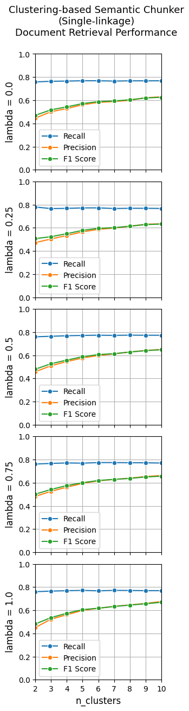 | 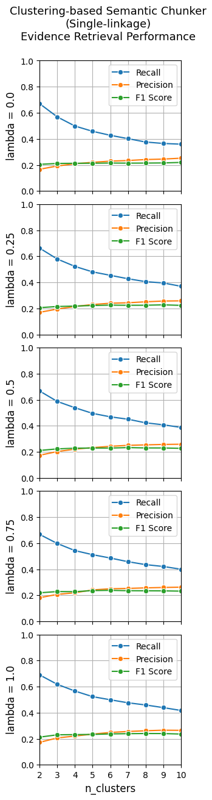 |

**图 2 图注译文**：基于聚类的语义切分器（单链接）在不同超参数取值下的性能。左：文档检索；右：证据检索。横轴表示 `n_clusters`，纵轴表示指标值。每个子图的纵轴标签标明固定超参数值，λ 从上到下增大。

图内标题：基于聚类的语义切分器（单链接）。`n_clusters`＝簇数，取值为 2–10；λ 从上到下为 0、0.25、0.5、0.75、1。

#### 图 3：DBSCAN 聚类

| 文档检索（原图左列） | 证据检索（原图右列） |
|---|---|
| 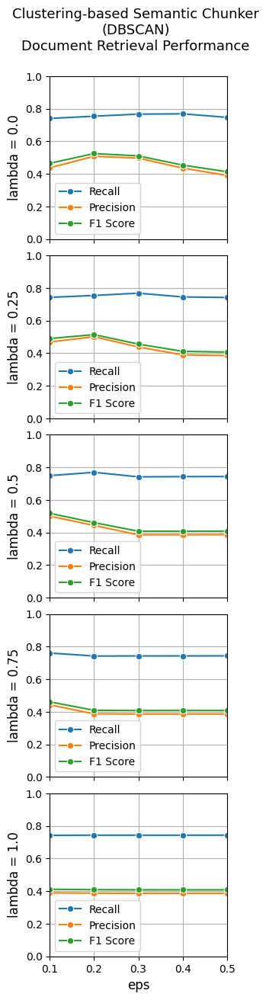 | 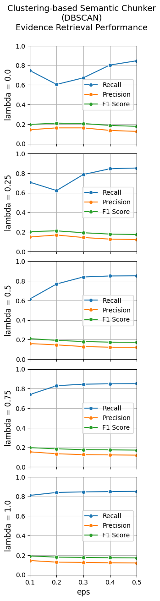 |

**图 3 图注译文**：基于聚类的语义切分器（DBSCAN）在不同超参数取值下的性能。左：文档检索；右：证据检索。横轴表示 `eps`，纵轴表示指标值。每个子图的纵轴标签标明固定超参数值，λ 从上到下增大。

图内标题：基于聚类的语义切分器（DBSCAN）。`eps`＝邻域距离阈值，横轴取值为 0.1、0.2、0.3、0.4、0.5；λ 从上到下为 0、0.25、0.5、0.75、1。

#### 图 4：基于断点的语义切分

| 文档检索（原图左列） | 证据检索（原图右列） |
|---|---|
| 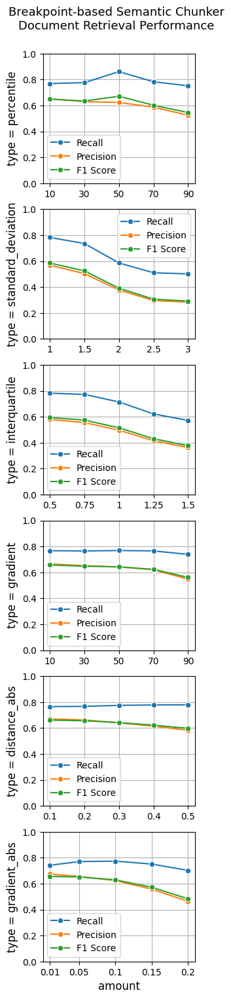 | 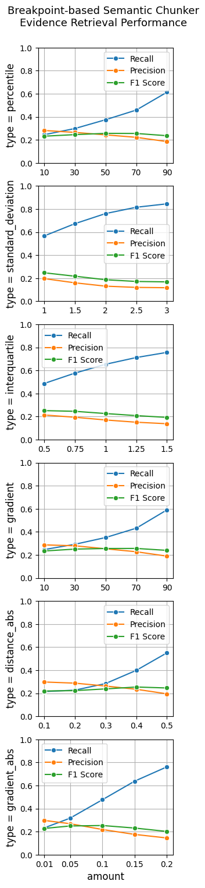 |

**图 4 图注译文**：基于断点的语义切分器在不同超参数取值下的性能。左：文档检索；右：证据检索。横轴表示 `n_clusters`，纵轴表示指标值。每个子图的纵轴标签表示断点阈值类型。

> 译者注：原图注写作 `n_clusters`，但图中实际横轴标为 `amount`，即阈值参数值。此处保留原图注，并指出其与图像不一致。

图内标题：基于断点的语义切分器。六行阈值类型依次为：`percentile`＝百分位数；`standard_deviation`＝标准差；`interquartile`＝四分位距；`gradient`＝梯度百分位数；`distance_abs`＝绝对距离；`gradient_abs`＝绝对梯度。对应横轴参数范围见附录 B。

#### 图 5：固定大小切分

| 文档检索（原图左列） | 证据检索（原图右列） |
|---|---|
| 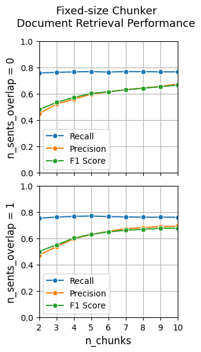 | 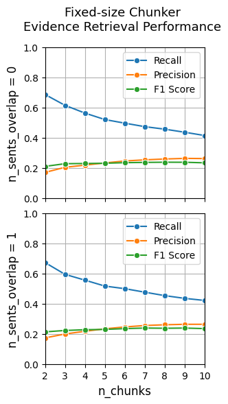 |

**图 5 图注译文**：固定大小切分器在不同超参数取值下的性能。左：文档检索；右：证据检索。横轴表示 `n_chunks`，纵轴表示指标值。每个子图的纵轴标签标明固定超参数值，`n_sents_overlap` 从上到下增大。

图内标题：固定大小切分器。`n_chunks`＝文本块数量，取值为 2–10；`n_sents_overlap`＝重叠句子数，上行为 0，下行为 1。

### 图 6：拼接文档切分示例

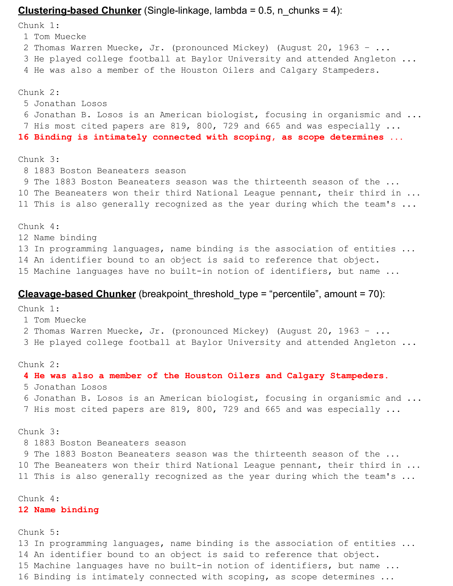

**图 6 图注译文**：使用不同切分器对拼接文档进行切分的示例。每行显示一个句子及其在文档中的原始索引。红色加粗行表示句子被错误分配到文本块的情况。切分器名称旁的配置，是使错误最少的最佳配置。

#### 图 6 原始示例全文译文

> 原图本身将较长句子的后半部分写为“...”；下表保留这一截断。原图中的 Document＝文档，Stitched Document＝拼接文档，Chunk＝文本块。

| 文档 | 句子索引 | 图中可见文字的中文译文 |
|---|---:|---|
| 文档 1 | 1 | 汤姆·米克（Tom Muecke） |
| 文档 1 | 2 | 小托马斯·沃伦·米克（Thomas Warren Muecke, Jr.，读音同 Mickey）（1963 年 8 月 20 日—…… |
| 文档 1 | 3 | 他曾在贝勒大学参加大学橄榄球比赛，并曾就读于安格尔顿…… |
| 文档 1 | 4 | 他也曾是休斯敦油人队和卡尔加里牛仔队的成员。 |
| 文档 2 | 5 | 乔纳森·洛索斯（Jonathan Losos） |
| 文档 2 | 6 | 乔纳森·B. 洛索斯是一位美国生物学家，主要研究个体生物学及…… |
| 文档 2 | 7 | 他被引用最多的论文的引用次数为 819、800、729 和 665，并且尤其…… |
| 文档 3 | 8 | 波士顿食豆人队的 1883 赛季 |
| 文档 3 | 9 | 波士顿食豆人队的 1883 赛季是该队的第十三个…… |
| 文档 3 | 10 | 食豆人队赢得了队史第三个国家联盟冠军，也是其在……中的第三个…… |
| 文档 3 | 11 | 这一年也普遍被认为是该队的…… |
| 文档 4 | 12 | 名称绑定 |
| 文档 4 | 13 | 在编程语言中，名称绑定是实体之间的关联…… |
| 文档 4 | 14 | 绑定到某个对象的标识符，被称为引用该对象。 |
| 文档 4 | 15 | 机器语言没有内建的标识符概念，但名称…… |
| 文档 4 | 16 | 绑定与作用域密切相关，因为作用域决定…… |

#### 图 6 各切分器输出的完整对应关系

以下每个索引对应上表已翻译的同一句话；按索引顺序连接，即得到原图该文本块的全部可见文字。**加粗索引**对应原图红色加粗错误行。

| 切分器与配置 | 块 1 | 块 2 | 块 3 | 块 4 | 块 5 |
|---|---|---|---|---|---|
| 固定大小；`n_sents_per_chunk=4`（每块 4 句） | 1、2、3、4 | 5、6、7、**8** | 9、10、11、**12** | 13、14、15、16 | 无 |
| 聚类；单链接，`lambda=0.5, n_chunks=4` | 1、2、3、4 | 5、6、7、**16** | 8、9、10、11 | 12、13、14、15 | 无 |
| 断点；`breakpoint_threshold_type="percentile", amount=70`（第 70 百分位数） | 1、2、3 | **4**、5、6、7 | 8、9、10、11 | **12** | 13、14、15、16 |

> 译者注：原图将断点切分器写作“Cleavage-based Chunker”，正文写作“Breakpoint-based Chunker”。此处统一译为“断点切分器”，保留原图以供核对。

### 图 7：普通文档切分示例

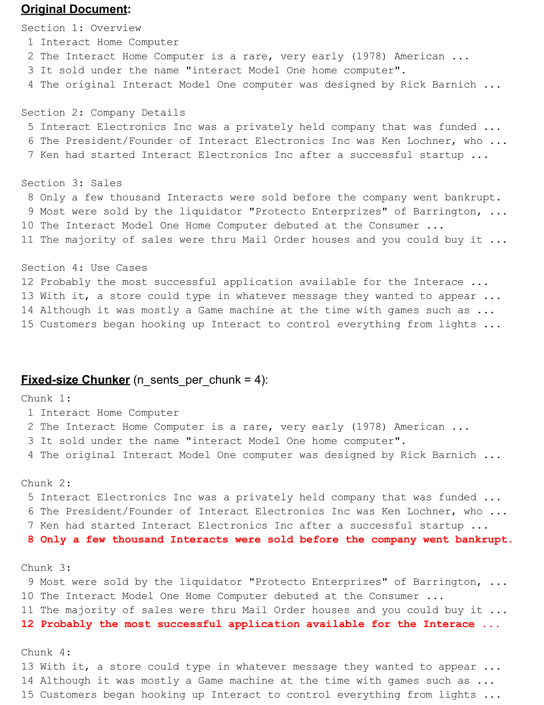

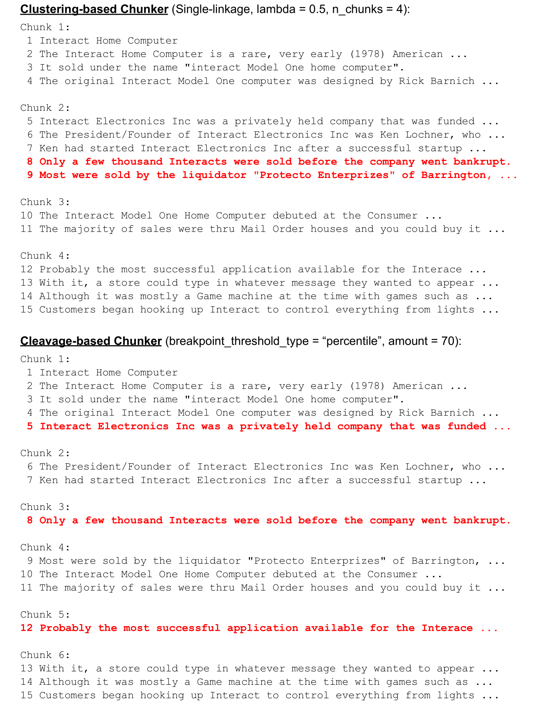

**图 7 图注译文**：使用不同切分器对普通文档进行切分的示例。每行显示一个句子及其在文档中的原始索引。红色加粗行表示句子被错误分配到文本块的情况。切分器名称旁的配置，是使错误最少的最佳配置。

#### 图 7 原始示例全文译文

图内标签：Original Document＝原始文档；Section 1: Overview＝第 1 节：概述；Section 2: Company Details＝第 2 节：公司详情；Section 3: Sales＝第 3 节：销售；Section 4: Use Cases＝第 4 节：使用场景。

| 章节 | 句子索引 | 图中可见文字的中文译文 |
|---|---:|---|
| 第 1 节：概述 | 1 | Interact 家用计算机 |
| 第 1 节：概述 | 2 | Interact 家用计算机是一款罕见的、非常早期（1978 年）的美国…… |
| 第 1 节：概述 | 3 | 它以“interact Model One 家用计算机”的名称销售。 |
| 第 1 节：概述 | 4 | 最初的 Interact Model One 计算机由 Rick Barnich 设计…… |
| 第 2 节：公司详情 | 5 | Interact Electronics Inc 是一家获得……资助的私营公司…… |
| 第 2 节：公司详情 | 6 | Interact Electronics Inc 的总裁兼创始人是 Ken Lochner，他…… |
| 第 2 节：公司详情 | 7 | Ken 在一次成功的创业之后创办了 Interact Electronics Inc…… |
| 第 3 节：销售 | 8 | 公司破产前，只售出了几千台 Interact 计算机。 |
| 第 3 节：销售 | 9 | 其中大多数由位于巴灵顿的清算商“Protecto Enterprises”售出，…… |
| 第 3 节：销售 | 10 | Interact Model One 家用计算机在 Consumer……首次亮相。 |
| 第 3 节：销售 | 11 | 大部分销售通过邮购商完成，你可以购买它…… |
| 第 4 节：使用场景 | 12 | 可能是 Interface 上最成功的应用程序…… |
| 第 4 节：使用场景 | 13 | 使用它，商店可以输入任何希望显示的消息…… |
| 第 4 节：使用场景 | 14 | 尽管它当时主要是一台游戏机，可以玩诸如……的游戏…… |
| 第 4 节：使用场景 | 15 | 用户开始连接 Interact，用它控制从灯光……到各种事物。 |

> 译者注：第 12 句原图拼作“Interface”，其余多处为“Interact”，这里不擅自统一。第 10 句在“Consumer”处已由原图截断，故没有自行补全展会名称。

#### 图 7 各切分器输出的完整对应关系

以下索引对应上表译文，**加粗索引**对应原图红色加粗错误行。

| 切分器与配置 | 块 1 | 块 2 | 块 3 | 块 4 | 块 5 | 块 6 |
|---|---|---|---|---|---|---|
| 固定大小；`n_sents_per_chunk=4`（每块 4 句） | 1、2、3、4 | 5、6、7、**8** | 9、10、11、**12** | 13、14、15 | 无 | 无 |
| 聚类；单链接，`lambda=0.5, n_chunks=4` | 1、2、3、4 | 5、6、7、**8**、**9** | 10、11 | 12、13、14、15 | 无 | 无 |
| 断点；`breakpoint_threshold_type="percentile", amount=70`（第 70 百分位数） | 1、2、3、4、**5** | 6、7 | **8** | 9、10、11 | **12** | 13、14、15 |

---

## 译者附记：原文中需要注意的对应关系

本节为译者添加，不属于论文原文。

1. **表 1 与表 20 的 Scidocs\* 数值冲突**：断点方法 F1@5 分别为 17.60 与 16.60；均照录。
2. **表 9 的 k 标注冲突**：表题写 F1@2，实验设置列的是 1、3、5、10；未擅自改为 F1@3。
3. **图 4 横轴说明冲突**：图注写 `n_clusters`，图内实际为阈值 `amount`。
4. **附录 B 与 E.3 的交叉引用**：正文若干处把分析指向附录 B；B 实际主要给出参数范围，性能分析在 E.3。
5. **固定大小的含义**：第 2 节按每块句子数描述，附录 B 扫描每篇文档的目标块数 2–10。它不是统一的 256 字符或 256 token 基线。
6. **图示名称差异**：图 6–7 的 Cleavage-based 与正文的 Breakpoint-based 对应；图 7 第 12 句的 Interface 拼法保留。

### 页码覆盖索引

| 原 PDF 页 | 原出版页码 | 本译文对应内容 |
|---|---|---|
| 1–4 | 2155–2158 | 摘要、第 1–5 节、公式 1–3、图 1、表 1–3 |
| 5–6 | 2159–2160 | 局限性、全部 35 项参考文献 |
| 7 | 2161 | 附录 A–B |
| 8–9 | 2162–2163 | 附录 C–D、表 4–6 |
| 10–11 | 2164–2165 | 附录 E.1–E.4、表 7 |
| 12–13 | 2166–2167 | 附录 E.5、表 8–19 |
| 14–15 | 2168–2169 | 表 20–23 |
| 16–19 | 2170–2173 | 图 2–5、图注、标签说明 |
| 20–21 | 2174–2175 | 图 6、图注、全部可见示例文字及切分对应关系 |
| 22–23 | 2176–2177 | 图 7、图注、全部可见示例文字及切分对应关系 |
