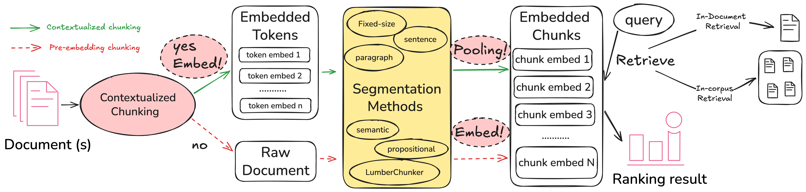
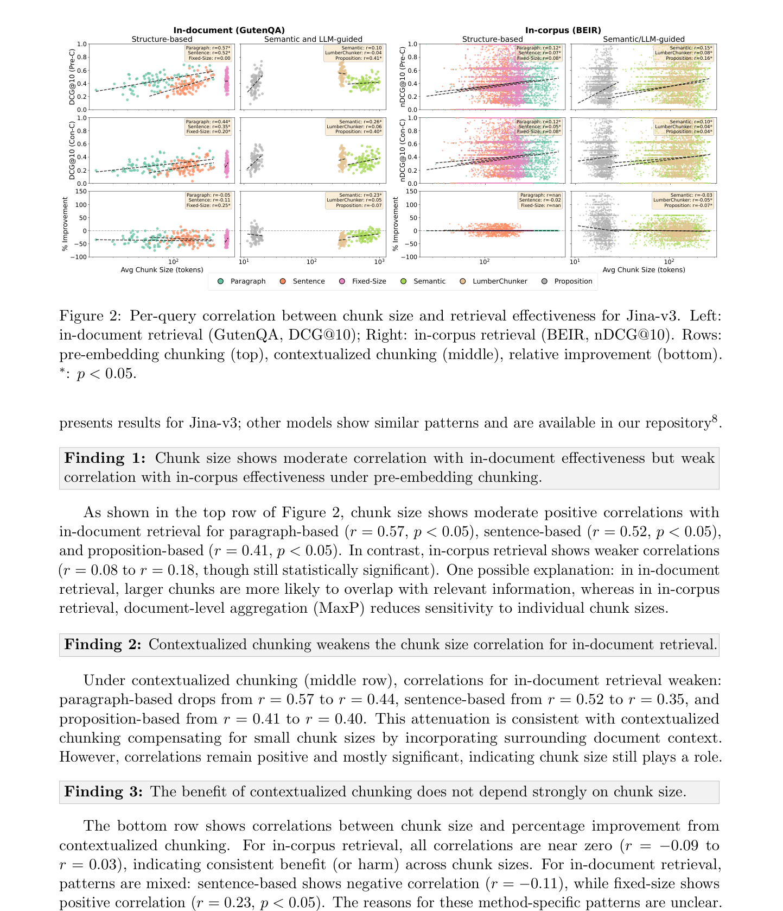

# 超越"先切分后嵌入":面向信息检索的文档切分策略综合分类与评测

*Beyond Chunk-Then-Embed: A Comprehensive Taxonomy and Evaluation of Document Chunking Strategies for Information Retrieval* 全文中文翻译

- 作者:Yongjie Zhou(昆士兰大学)¹\*、Shuai Wang(昆士兰大学)¹\*†、Bevan Koopman(昆士兰大学/CSIRO)¹²、Guido Zuccon(昆士兰大学/Google)¹³。\*共同贡献,†通讯作者。
- 单位:¹ 昆士兰大学(澳大利亚);² 澳大利亚联邦科学与工业研究组织(CSIRO);³ Google。
- 出处:arXiv:2602.16974v1 [cs.IR],2026 年 2 月 19 日。正式发表版收录于 SIGIR 2026([ACM DOI:10.1145/3805712.3808575](https://dl.acm.org/doi/10.1145/3805712.3808575));本翻译依据 arXiv v1 预印本 PDF,该版本中代码与基准链接为匿名评审占位("Anonymoused for review")。
- 授权:原文依据 [CC BY-SA 4.0](https://creativecommons.org/licenses/by-sa/4.0/) 发布(见 PDF 元数据)。本译文为 AI 辅助翻译的演绎作品,依同一协议共享;非作者或 SIGIR 官方译文,原作者未为本译文背书。
- 翻译日期:2026-09-20。范围:PDF 全部 16 页,含正文 5 节、14 条参考文献、5 张表、2 幅图及全部脚注。

> **译文说明**:保留原章节、公式、图表编号。"chunk"统一译为"文本块","chunking"译为"切分","segmentation method"译为"分割方法"。两条嵌入路线记号照原文:**Pre-C**(pre-embedding chunking,嵌入前切分)与 **Con-C**(contextualized chunking,上下文化切分,即 late chunking/后期切分)。任务轴:in-document retrieval 译"文档内检索",in-corpus retrieval 译"语料库内检索"。表格数值按原文照录,不擅自订正;表 2 的粗体按表注"Pre-C 与 Con-C 中较高者"由数值比较标出,表 3/表 5 的粗体(每模型-数据集最优)与下划线(最差)按表注由列内最大/最小值标出,上标 ᵃ/ᵇ 为原文显著性标记(ᵃ=与最优差异显著,ᵇ=与最差差异显著,p<0.05,配对 t 检验)。图 2 底行相关系数与正文叙述在原文中存在不一致,见对应译者注。所有"译者注"均为补充说明,不属于论文原文。

## 摘要

文档切分是稠密检索系统中关键的预处理步骤,但切分策略的设计空间仍缺乏系统理解。近期研究提出了多条并行路线:LLM 引导方法(如 DenseX 与 LumberChunker),以及上下文化策略(如 Late Chunking)——后者在分割之前生成嵌入以保留上下文信息。然而,这些方法各自独立出现,评测所用基准几乎不重叠,难以直接比较。

本文复现了文档切分领域的先前研究,并提出一个统一既有策略的系统框架,沿两个关键维度展开:(1)分割方法,包括结构化方法(固定大小、句子、段落)以及语义感知与 LLM 引导方法;(2)嵌入范式,决定切分相对于嵌入的时机(嵌入前切分 vs. 上下文化切分)。我们的复现与扩展在先前工作确立的两种检索设定下评估这些方法:文档内检索(大海捞针)与语料库内检索(标准信息检索任务)。

综合评测表明,最优切分策略依赖于任务:语料库内检索中,简单结构化方法优于 LLM 引导方法;而 LumberChunker 在文档内检索中表现最佳。上下文化切分提升语料库内效果,但损害文档内检索。我们还发现,块大小与文档内效果中等相关、与语料库内效果仅弱相关,说明分割方法之间的差异并非纯粹由块大小驱动。我们的代码与评测基准公开可得(评审期间匿名化)。

## 1 引言

稠密检索系统把查询和文档表示为低维向量,支撑从网页搜索引擎到检索增强生成(RAG)框架的各类应用 [Li et al.(2024), Zuccon et al.(2025), Rau et al.(2025)]。然而,嵌入模型的输入窗口大小固定,长文档必须被划分为较小的片段:这一过程称为文档切分(document chunking)。切分方法的选择显著影响检索效果:过小的文本块可能缺乏足够上下文来匹配相关查询;过大的文本块会用无关内容稀释相关信息;而把连贯的相关内容切分开的块,可能对下游任务高度有害。

文档切分研究沿两个维度快速演进:分割方法,以及嵌入与切分的先后顺序。分割方法决定文档如何被划分为块;嵌入范式决定切分发生在嵌入之前还是之后(例如先切分再编码,或先编码再切分)。在分割方法上,结构化方法使用固定窗口或段落等语言学边界 [Karpukhin et al.(2020)];近期工作引入了语义感知方法,如基于命题的 DenseX 切分 [Chen et al.(2024)],以及 LLM 引导方法,如利用大语言模型识别篇章感知边界的 LumberChunker [Duarte et al.(2024)]。嵌入与切分的顺序有两种做法:一方面,传统的**嵌入前切分**先分割文档,再对每个块独立嵌入;另一方面,**嵌入后切分**(也称上下文化切分)[Günther et al.(2024)] 先用长上下文嵌入模型编码整篇文档(从而在各块表示中保留全局上下文),再对 token 嵌入做池化得到最终嵌入。

尽管有上述研究,进展仍是碎片化的,因为这些方法各自在被隔离的条件下评测。例如,LumberChunker [Duarte et al.(2024)] 证明了相对命题切分(DenseX [Chen et al.(2024)])与传统固定大小分割更高的检索效果,但它只在文档内检索(在单篇长文档内定位相关信息)上、用单一商用嵌入模型(OpenAI text-embedding-ada-002)评测,既未涉及语料库内检索(在文档集合中找出相关文档),也未考虑上下文化切分的潜力。反过来,基于 Late Chunking [Günther et al.(2024)] 的嵌入后切分确立了上下文化切分的收益,但分析仅限于简单分割方法(固定大小、句子)与标准语料库内基准(BEIR),没有探索高级分割方法与上下文化切分的交互。这种缺乏统一性的状况,使得难以判断已报告的收益究竟来自切分策略本身,还是来自特定实验变量,如数据集构成或嵌入模型选择。

为填补这些空白,我们开展一项可复现性研究,把先前工作统一到共同评测框架下,延续稠密检索领域可复现性研究的传统 [Wang and Zuccon(2023)]。我们首先复现 LumberChunker [Duarte et al.(2024)] 与 Late Chunking [Günther et al.(2024)] 的核心发现,以验证实现并建立基线。在此基础上,我们研究以下研究问题:

**RQ1 不同分割方法在标准语料库内检索中表现如何?** 我们在标准 BEIR 基准上,以嵌入前切分评估固定大小、句子、段落、语义与 LLM 引导等分割方法。

**RQ2 分割方法能否跨检索任务泛化?** 我们把同一批分割方法应用于文档内检索,检验在语料库内检索中观察到的相对优劣,在检索被限制在单篇文档内时是否仍然成立。

**RQ3 上下文化切分是否在所有配置下提供一致改进?** 我们把上下文化切分应用于 RQ1 的全部分割方法,并覆盖两种检索任务,判断它是否具有普适收益。

**RQ4 块大小如何影响检索效果?** 不同分割方法产生大小不一的块,先前工作未控制这一变量。这就引出一个直接的问题:效果差异反映的是分割质量,还是仅仅块大小?一个极端是,把整篇文档当作单个块,在文档内设定下必然命中(相关信息一定在块内),人为抬高效果。另一个极端是,非常大的块会缩小上下文化切分与嵌入前切分的差距,因为可纳入的周围上下文所剩无几;当块大小接近模型上下文窗口时尤其如此。我们考察块大小效应,以把这些伪影与真正的分割质量区分开。

通过这些研究问题,我们:(1)确认先前发现可复现(第 4.1 节);(2)建立语料库内检索各分割方法的基线(第 4.2 节);(3)识别哪些分割方法能跨检索任务泛化(第 4.3 节);(4)评估上下文化切分是否带来普适改进(第 4.4 节);(5)考察观察到的改进有多大比例可归因于块大小(第 4.5 节)。

## 2 文档切分策略

文档切分把原始文本变换为稠密检索系统使用的可检索块。为系统比较种类繁多的现有方法,我们沿两个维度组织它们:(1)**分割方法**,定义文本边界如何识别;(2)**嵌入-切分顺序**,决定切分发生在嵌入之前还是之后。该框架为我们的实验提供结构化基础,也厘清了不同技术之间的关系。图 1 概述了本节涵盖的各项技术。

### 图 1:统一评测框架

**图 1 图注译文**:跨检索任务评测文档切分策略的统一框架。

图内结构说明(译者依原图整理):该图是从左到右的流水线。左上角图例区分两条嵌入路线——绿色实线箭头为上下文化切分(Con-C),红色虚线箭头为嵌入前切分(Pre-C)。输入文档先经过分割方法层,分为两族:结构化方法(固定大小、句子、段落)与语义/LLM 引导方法(语义分割、命题、LumberChunker);分割产生的文本块进入嵌入模型层(需支持池化),最后面向两种检索任务:文档内检索(GutenQA)与语料库内检索(BEIR)。

### 2.1 分割方法分类

我们把分割方法分为两族:依赖文档显式版式的**结构化方法**,以及借助语言理解识别逻辑切分的**语义感知方法**。我们的分类合并了 LumberChunker 与 Late Chunking 两项研究的方法 [Duarte et al.(2024), Günther et al.(2024)]。¹

#### 2.1.1 结构化方法

这类方法使用可观察的文本特征定义块边界。因计算高效、简单且确定性,在实践中被广泛采用。我们评估三种常见方法:

- **段落(Paragraph)**:在换行符处切分文档并去除空块。它以零额外处理成本尊重作者预期的结构,对组织良好的文本(如新闻文章)往往有效。
- **固定大小(Fixed-size)**:把文本切为恒定 token 长度的块(如 512 token),通常无重叠。虽然高度高效,但它可能任意切断连贯的句子或概念,潜在损害嵌入质量 [Karpukhin et al.(2020)]。
- **句子(Sentence)**:使用基于正则表达式的分割器识别句子边界,通常每块组合多个句子。这样产生的块在粒度与上下文保留之间取得平衡,适合答案可能跨越多个句子的任务。

#### 2.1.2 语义与 LLM 引导方法

这类方法借助模型分析文本含义,识别更自然的断点,目标是产生内部连贯、更利于检索的块。

- **语义(Semantic)**:用嵌入计算相邻句子之间的语义相似度;当相似度低于预设阈值(提示主题转移)时插入边界 [Kamradt(5)]。这使分割能够适应文档的内容流转。
- **命题(Proposition)**:用 LLM 把文本分解为原子事实或"命题" [Chen et al.(2024)]。每条命题作为独立块,形成高度特异的单元,适合事实型检索。但该方式显著增加块总数,且 LLM 推理带来高计算成本。
- **LumberChunker**:直接提示 LLM 对文档分割,在检测到主题转移的段落之间插入断点 [Duarte et al.(2024)]。它善于捕捉篇章结构,但受限于 LLM 推理的时延与成本。

值得注意的是,语义感知与 LLM 引导方法往往构建在结构化方法之上。例如,语义分割需要先做句子级处理,而命题方法与 LumberChunker 通常在已识别的段落上操作。

### 2.2 嵌入-切分顺序

框架的第二维是**嵌入-切分顺序**,定义切分与嵌入操作的先后。**嵌入前切分**是最常见的范式:先分割文档,再对每个块孤立嵌入。该方式简单且可扩展,但忽略了块边界之间可能存在的上下文信息。

相反,**上下文化切分**(也称后期切分,late chunking)逆转这一顺序:长上下文嵌入模型先处理整篇文档,生成包含全局上下文的 token 级嵌入 [Günther et al.(2024), Rau et al.(2025)];随后把分割边界应用于这些感知上下文的表示,对每块的 token 嵌入做池化(如取平均)得到最终嵌入。该方式保留了跨块关系,但附加上下文可能降低同一文档内各块之间的可区分性。

### 2.3 检索任务

针对梳理先前工作时发现的可比性问题,我们在两种检索任务下评测切分策略:

- **文档内检索**:常称"大海捞针",要求在单篇长文档内定位特定信息,评测方法在狭窄范围内识别相关内容的能力。
- **语料库内检索**:要求在大型集合中找出最相关的文档,如 BEIR 基准 [Thakur et al.(2021)],评测检索跨多个不同领域文档时的效果。

通过在两种任务上、用一致的嵌入模型集合评测每种方法,本研究分离出切分策略本身对检索效果的影响。

## 3 实验设置

我们按第 2 节所述框架评测每种切分策略。下面详述实验中采用的具体实现、数据集与评测流程。

### 3.1 分割方法

我们在所有数据集上对每种分割方法使用一致的实现。

**结构化方法**方面:段落分割在换行符处切分文档并去除空块;固定大小分割把文档切成 256 token 的均匀块,无重叠;句子分割用基于正则的分割器识别句子边界,默认每块 5 句。所有结构化方法遵循 Late Chunking [Günther et al.(2024)] 确立的默认协议与超参数。

**语义与 LLM 引导方法**方面:语义分割计算相邻句子嵌入的余弦相似度,在相似度低于指定分位阈值(默认第 95 百分位)处插入分割边界。我们的实现使用 LlamaIndex 语义节点解析器²,配合 jina-embeddings-v2-small-en 模型,遵循 Late Chunking [Günther et al.(2024)]。命题分割用 LLM 把文本分解为原子事实单元(提示词细节见补充材料)。LumberChunker 分析较长的文本片段,为每个块识别最优断点。命题分割与 LumberChunker 均使用 Gemini-2.5-Flash。³ 所有 LLM 引导方法的生成温度设为 T = 0.0,以确保确定性与可复现输出。

### 3.2 嵌入模型

为考察不同分割方法与嵌入架构的交互,我们依据检索效果与架构兼容性选择四个嵌入模型。由于上下文化切分需要在池化之前访问 token 级表示,选择范围限于 MTEB 榜单上表现良好且采用均值池化的模型。我们评估:

- **jina-embeddings-v2-small-en(Jina-v2)** [Günther et al.(2023)]:33M 参数模型,在效率优化的同时保持有竞争力的效果;是原 Late Chunking 研究 [Günther et al.(2024)] 的主要基线。
- **jina-embeddings-v3(Jina-v3)** [Günther et al.(2023)]:570M 参数模型,多语言能力增强,同样是上下文化切分评测的核心。
- **nomic-embed-text-v1(Nomic)** [Nussbaum et al.(2024)]:137M 参数模型,在多种基准上效果强劲,先前工作曾用于评测上下文化切分。
- **multilingual-e5-large(E5-large)** [Wang et al.(2024)]:560M 参数多语言模型,是检索研究的标准基线。加入它是为检验不同切分策略的效果能否推广到先前工作评测过的模型之外。

前三个模型在原 Late Chunking 工作 [Günther et al.(2024)] 中已被评测;我们另加入 E5-large 以检验跨模型族的泛化。

所有模型都在两种嵌入-切分顺序下评测。嵌入前切分:先分割文档,每块孤立嵌入。上下文化(嵌入后)切分:送入模型上下文窗口内可容纳的最大文本序列(如 8,192 token);若文档超过该限制,则划分为最少必要数量的窗口,在尽可能宽的上下文内生成 token 级嵌入,再按分割边界池化。

### 3.3 数据集与评测

我们的评测考察切分策略跨两种检索任务的泛化能力。

#### 3.3.1 文档内检索

文档内检索使用 **GutenQA** 数据集 [Duarte et al.(2024)],包含 100 部经典文学作品与 3,000 个问答对。问题针对单本书内的特定细节,评测系统在长文档内定位信息的能力。

GutenQA 的真值标注位于段落级。为兼容可能跨越多个段落或仅与真值部分重叠的块,我们定义:检索块与任一真值段落有任何重叠即算相关。遵循 LumberChunker [Duarte et al.(2024)],我们报告排名第 10 位的折扣累积增益(DCG@10):

DCG@10 = Σi=1..10 (2rel_i − 1) / log₂(i + 1) (1)

其中 rel_i 表示排名第 i 位结果的相关度得分。

#### 3.3.2 语料库内检索

语料库内检索使用 **BEIR** 基准 [Thakur et al.(2021)] 的六个数据集:FiQA、ArguAna、SciDocs、TREC-COVID、SciFact 与 NFCorpus。这扩展了 Late Chunking 测试的四个数据集(SciFact、NFCorpus、FiQA、TREC-COVID)。选择依据两条标准:其一,领域覆盖多样,从金融、科学文本到生物医学文献;其二,语料规模足够紧凑,使计算密集的 LLM 引导方法的评测可行。

语料库内检索的相关度标注在文档级。遵循既有做法 [Dai and Callan(2019)],我们从文档内得分最高的块导出文档级相关度得分。这一最大池化(MaxP)策略广泛用于把块级证据聚合为文档排序。

所有 BEIR 数据集报告第 10 位的归一化折扣累积增益(nDCG@10);该指标把 DCG@10 相对理想排序归一化,取值在 0 到 1 之间。

## 4 结果

### 4.1 可复现性分析

我们首先在原始论文各自的原始评测语境内验证其主要论断。这一步在我们把分析扩展到新检索任务之前验证我们的实现。

**表 1:在 GutenQA 上使用 text-embedding-ada-002 复现 LumberChunker 评测(DCG@10)。**

| 分割方法 | 原文报告 | 本文复现 |
|---|---:|---:|
| 段落 | 0.4772 | 0.4879 |
| 语义(Jina-v2) | 0.4314 | 0.4457 |
| 命题 | 0.4565 | 0.4687 |
| LumberChunker | 0.6099 | 0.5953 |

**原始论断**:在长文档内定位特定信息(文档内检索)时,LumberChunker 显著优于结构化方法(如固定大小、句子)[Duarte et al.(2024)]。

**我们的复现**:表 1 在文档内检索上、用原始嵌入模型(text-embedding-ada-002)比较各分割方法。绝对值与原文略有差异,可能源于 OpenAI 嵌入 API 的非确定性,以及我们用 Gemini-2.5-Flash 替代已弃用的 Gemini-1.0-Pro 执行 LLM 引导分割。但相对排序得以保持:LumberChunker 在所有方法中取得最高效果,确认了原始发现。

**原始论断**:上下文化切分(先嵌入文档再分割)保留全局上下文,因此在标准语料库内基准上优于孤立嵌入各块 [Günther et al.(2024)]。

**我们的复现**:表 2 用原研究的主力模型 Jina-v2⁴,比较上下文化切分(Con-C)与嵌入前切分(Pre-C)。总体上,复现确认了原始发现:跨数据集与分割方法,上下文化切分一致优于嵌入前切分。唯一例外是语义分割,它在 FiQA 与 TREC-COVID 上结果不一致。我们推测该差异可能来自 LlamaIndex SemanticSplitterNodeParser 实现的版本差异⁵,因为这是唯一依赖外部库、行为随版本变化的分割方法。

**表 2:在 BEIR 数据集上使用 Jina-v2 复现 Late Chunking 评测(nDCG@10)。Pre-C:嵌入前切分;Con-C:上下文化切分。粗体为 Pre-C 与 Con-C 中较高者。**

| 数据集 | 分割方法 | 原文 Pre-C | 原文 Con-C | 复现 Pre-C | 复现 Con-C |
|---|---|---:|---:|---:|---:|
| scifact | 固定大小 | 0.642 | **0.661** | 0.638 | **0.652** |
| 〃 | 句子 | 0.647 | **0.652** | 0.655 | **0.660** |
| 〃 | 语义 | 0.643 | **0.650** | 0.645 | **0.650** |
| nfcorpus | 固定大小 | 0.235 | **0.300** | 0.226 | **0.304** |
| 〃 | 句子 | 0.283 | **0.300** | 0.285 | **0.302** |
| 〃 | 语义 | 0.274 | **0.293** | 0.275 | **0.293** |
| fiqa | 固定大小 | 0.333 | **0.338** | 0.331 | **0.337** |
| 〃 | 句子 | 0.304 | **0.339** | 0.310 | **0.341** |
| 〃 | 语义 | 0.303 | **0.337** | **0.303** | 0.223 |
| trec-covid | 固定大小 | 0.634 | **0.647** | 0.626 | **0.647** |
| 〃 | 句子 | 0.665 | **0.666** | **0.667** | 0.665 |
| 〃 | 语义 | 0.662 | **0.663** | **0.662** | 0.625 |

**小结**:在确认 LumberChunker 在文档内检索的效果优势与 Late Chunking 对语料库内检索的收益均可复现之后,我们继续研究四个研究问题。以下小节通过在两种检索任务上评测全部分割方法(RQ1–RQ2)、考察分割方法与嵌入-切分顺序的交互(RQ3)以及分析块大小的混杂效应(RQ4)来扩展这些发现。

### 4.2 RQ1:分割方法对语料库内检索的影响

为建立各分割方法在语料库内检索上的基线效果,我们在六个 BEIR 数据集上、用四个嵌入模型、以嵌入前切分评估六种分割方法。表 3 给出该分析的结果。

**发现 1:结构化方法优于语义/LLM 引导方法,且结构化方法彼此差异极小。**

在全部四个嵌入模型下,结构化方法(段落、固定大小、句子)的平均效果高于 LLM 引导方法(LumberChunker、命题)与语义分割。段落分割在三个模型上取得最高平均 nDCG@10(Jina-v2:0.4303;Jina-v3:0.4948;E5-large:0.4997),Nomic 上则是固定大小最高(0.4801)。结构化方法之间的效果差距很小,通常在 1–3% 以内。例如 Jina-v3 下,段落(0.4948)仅比固定大小(0.4849)高 2%,比句子(0.4723)高 5%。这表明:对语料库内检索而言,统一、可预测的块边界比在每篇文档内寻找语义"最优"边界更重要。对使用嵌入前切分的从业者,结构化方法是明确的首选,且它们之间的差异可以忽略。

**发现 2:命题分割在语料库内检索中一致劣于所有其他分割方法。**

命题分割在所有模型上平均 nDCG@10 最低(0.3484–0.3937),相对段落分割有 15–27% 的效果损失。损失在 ArguAna 上尤其严重(0.29–0.36,损失 35–50%),FiQA 次之(0.21–0.28,损失 30–40%)。其原因很可能在于:命题分割把文本分解为原子事实,产生很小的块,丢失了周围文档的主题(上下文)信息。该假设在 RQ3 中得到支持:上下文化切分把周围文档上下文纳入块嵌入,显著改善了命题分割的效果。

**发现 3:LumberChunker 的效果在 不同领域数据集之间方差很大。**

与命题分割不同,LumberChunker 的效果随数据集大幅波动,而非一致偏低。它在 TREC-COVID 上取得或接近最好结果(Jina-v2:0.6890;Nomic:0.7762;E5-large:0.6952),但在 ArguAna 与 FiQA 上落入后半区。这种方差可能反映其设计:LumberChunker 识别文档内的主题转移,与结构化的科学摘要(TREC-COVID)契合,而与主题边界不明确的论辩或对话文本契合度差。对从业者而言,若语料由主题边界清晰、结构良好的文档组成,LumberChunker 值得考虑。但即便在最好情况下,LumberChunker 也只能追平而未超过结构化方法的效果,同时需要多得多的计算(处理速度:LumberChunker 1.11 篇/秒 vs. 段落 1,854 篇/秒⁶)。鉴于段落分割以极小成本达到相当效果,LumberChunker 对语料库内检索几乎没有实用优势。

**表 3:嵌入前切分(Pre-C)下跨模型、分割方法与数据集的效果。GutenQA 为 DCG@10(文档内);BEIR 数据集为 nDCG@10(语料库内)。粗体:每模型-数据集最优;下划线:最差。上标:a=与最优差异显著(p<0.05,配对 t 检验);b=与最差差异显著。**

| 分割方法 | GutenQA | fiqa | nfcorpus | scifact | trec-covid | arguana | scidocs | 平均 |
|---|---|---|---|---|---|---|---|---|
| **Jina-v2** | | | | | | | | |
| 段落 | 0.3892ᵃᵇ | **0.3347ᵇ** | 0.3042ᵇ | 0.6389 | 0.6518ᵇ | 0.4682ᵃᵇ | **0.1843ᵇ** | 0.4303 |
| 句子 | <u>0.3261ᵃ</u> | 0.3096ᵃᵇ | 0.2847ᵃᵇ | 0.6548 | 0.6674ᵇ | 0.4675ᵃᵇ | 0.1732ᵃᵇ | 0.4262 |
| 固定大小 | 0.3479ᵃᵇ | 0.3313ᵇ | <u>0.2262ᵃ</u> | <u>0.6377ᵃ</u> | 0.6256ᵃᵇ | **0.4803ᵇ** | 0.1807ᵃᵇ | 0.4136 |
| 语义 | 0.3859ᵃᵇ | 0.3030ᵃᵇ | 0.2746ᵃᵇ | 0.6445 | 0.6618ᵇ | 0.4022ᵃᵇ | 0.1760ᵃᵇ | 0.4104 |
| LumberChunker | **0.4659ᵇ** | 0.3044ᵃᵇ | 0.2849ᵃᵇ | **0.6630ᵇ** | **0.6890ᵇ** | 0.4472ᵃᵇ | 0.1735ᵃᵇ | 0.4270 |
| 命题 | 0.4214ᵃᵇ | <u>0.2105ᵃ</u> | **0.3058ᵇ** | 0.6410 | <u>0.4375ᵃ</u> | <u>0.3589ᵃ</u> | <u>0.1367ᵃ</u> | 0.3484 |
| 平均 | 0.3894 | 0.2989 | 0.2801 | 0.6467 | 0.6222 | 0.4374 | 0.1707 | 0.4093 |
| **Jina-v3** | | | | | | | | |
| 段落 | 0.4574ᵃᵇ | **0.4747ᵇ** | **0.3663** | **0.7247ᵇ** | **0.7721ᵇ** | 0.4325ᵇ | **0.1984ᵇ** | 0.4948 |
| 句子 | <u>0.3877ᵃ</u> | 0.4333ᵃᵇ | 0.3566 | 0.7163 | 0.7135ᵃᵇ | 0.4256ᵃᵇ | 0.1888ᵃᵇ | 0.4723 |
| 固定大小 | 0.4350ᵃᵇ | 0.4680ᵇ | 0.3552 | 0.7169 | 0.7385ᵃᵇ | **0.4362ᵇ** | 0.1948ᵃᵇ | 0.4849 |
| 语义 | 0.4105ᵃᵇ | 0.4396ᵃᵇ | 0.3596 | 0.7103 | 0.7474ᵇ | 0.3894ᵃᵇ | 0.1890ᵃᵇ | 0.4726 |
| LumberChunker | **0.5640ᵇ** | 0.4308ᵃᵇ | 0.3590 | 0.7125 | 0.7081ᵃᵇ | 0.4152ᵃᵇ | 0.1881ᵃᵇ | 0.4690 |
| 命题 | 0.4182ᵃᵇ | <u>0.2808ᵃ</u> | <u>0.3524</u> | <u>0.6924ᵃ</u> | <u>0.5606ᵃ</u> | <u>0.2931ᵃ</u> | <u>0.1535ᵃ</u> | 0.3888 |
| 平均 | 0.4455 | 0.4212 | 0.3582 | 0.7122 | 0.7067 | 0.3987 | 0.1854 | 0.4637 |
| **Nomic** | | | | | | | | |
| 段落 | 0.4892ᵃᵇ | 0.3802ᵇ | **0.3509** | 0.7047 | 0.7652ᵇ | 0.4904ᵃᵇ | 0.1808ᵇ | 0.4787 |
| 句子 | <u>0.4146ᵃ</u> | 0.3620ᵃᵇ | 0.3502 | **0.7150** | 0.7472ᵇ | **0.5084ᵇ** | 0.1732ᵃᵇ | 0.4760 |
| 固定大小 | 0.4643ᵃᵇ | **0.3855ᵇ** | 0.3484 | 0.7029 | 0.7584ᵇ | 0.5042ᵇ | **0.1812ᵇ** | 0.4801 |
| 语义 | 0.4274ᵃ | 0.3562ᵃᵇ | 0.3506 | 0.7040 | 0.7431ᵇ | 0.4434ᵃᵇ | 0.1707ᵃᵇ | 0.4613 |
| LumberChunker | **0.6016ᵇ** | 0.3582ᵃᵇ | 0.3502 | 0.7047 | **0.7762ᵇ** | 0.4928ᵃᵇ | 0.1747ᵃᵇ | 0.4762 |
| 命题 | 0.4525ᵃᵇ | <u>0.2554ᵃ</u> | <u>0.3373</u> | <u>0.7025</u> | <u>0.5624ᵃ</u> | <u>0.3660ᵃ</u> | <u>0.1384ᵃ</u> | 0.3937 |
| 平均 | 0.4750 | 0.3496 | 0.3479 | 0.7056 | 0.7254 | 0.4675 | 0.1698 | 0.4610 |
| **E5-Large** | | | | | | | | |
| 段落 | 0.4663ᵃᵇ | **0.4617ᵇ** | 0.3566 | **0.7129ᵇ** | 0.6634 | **0.5999ᵇ** | **0.2038ᵇ** | 0.4997 |
| 句子 | 0.4063ᵃᵇ | 0.4315ᵃᵇ | **0.3583** | 0.6873 | 0.6712ᵇ | 0.5646ᵃᵇ | 0.1836ᵃᵇ | 0.4828 |
| 固定大小 | 0.4363ᵃᵇ | 0.4509ᵃᵇ | <u>0.3479</u> | 0.6740ᵃ | 0.6601 | 0.5905ᵃᵇ | 0.1940ᵃᵇ | 0.4863 |
| 语义 | <u>0.3186ᵃ</u> | 0.4173ᵃᵇ | **0.3583** | 0.6892ᵃ | 0.6784ᵇ | 0.5540ᵃᵇ | 0.1888ᵃᵇ | 0.4810 |
| LumberChunker | **0.5495ᵇ** | 0.4190ᵃᵇ | 0.3557 | 0.6884 | **0.6952ᵇ** | 0.5560ᵃᵇ | 0.1840ᵃᵇ | 0.4830 |
| 命题 | 0.4277ᵃᵇ | <u>0.2539ᵃ</u> | 0.3576 | <u>0.6705ᵃ</u> | <u>0.5939ᵃ</u> | <u>0.3030ᵃ</u> | <u>0.1509ᵃ</u> | 0.3883 |
| 平均 | 0.4341 | 0.4057 | 0.3557 | 0.6871 | 0.6604 | 0.5280 | 0.1842 | 0.4702 |

**小结**:对使用嵌入前切分的语料库内检索,用结构化方法。推荐段落或固定大小分割:快速、简单、效果稳定。LLM 引导方法尽管计算昂贵,却没有效果优势。

### 4.3 RQ2:分割方法能否跨检索任务泛化?

为确定语料库内检索观察到的效果排序能否泛化到文档内检索,我们在 GutenQA 上用同样四个嵌入模型评估全部六种分割方法。GutenQA 代表另一种检索挑战:在单篇长文档(书籍)内定位相关段落,而非在语料中识别相关文档。表 3 给出文档内检索结果(GutenQA 列)。

**发现 1:分割方法的效果排序在语料库内与文档内检索之间发生反转。**

在语料库内检索中排名第 2–4 的 LumberChunker,在 GutenQA 上于全部四个模型取得最高效果(Jina-v2:0.4659;Jina-v3:0.5640;Nomic:0.6016;E5-large:0.5495),超过段落分割 10–30%。反过来,在语料库内检索表现最好的段落分割,在文档内检索中跌至第 2–3 位。这印证了我们在 RQ1 中的假设:LumberChunker 的效果依赖文档结构。GutenQA 由叙事结构清晰的文学作品构成,与 LumberChunker 的主题转移检测高度契合。文档内检索要求把相关块与同文档内的其他块区分开,而 LumberChunker 的自适应边界使相关块比统一的段落边界更可区分。

**发现 2:命题分割仍然偏弱,但相对位次回升。**

命题分割在两种检索任务中效果都很差,但其相对排名从语料库内检索的一致最差,回升到 GutenQA 上有竞争力(第 2–4 名)。这种部分恢复表明:原子事实虽仍缺乏足够上下文,但文档内检索设定对这一局限的敏感度低于跨文档检索。

**小结**:分割方法不能跨检索任务泛化。文档内检索用 LumberChunker;语料库内检索用结构化方法(RQ1)。这确认了 LumberChunker 的效果依赖文档结构:它在内部组织清晰的文档(GutenQA 的文学作品、TREC-COVID 的科学摘要)上表现好,在结构较弱的文档组成的语料上表现差。

### 4.4 RQ3:上下文化切分的效果

为评估上下文化切分是否在分割方法与检索任务上提供一致改进,我们在两种任务上把它与嵌入前切分比较,覆盖全部分割方法。表 4 给出相对效果变化(百分比),表 5 给出上下文化切分下的绝对效果。

**表 4:从嵌入前切分(Pre-C)到上下文化切分(Con-C)的相对效果变化(%)。绿色:改进;红色:退化。∗:统计显著(p<0.05,配对 t 检验)。**

| 分割方法 | GutenQA | fiqa | nfcorpus | scifact | trec-covid | arguana | scidocs | 平均 |
|---|---|---|---|---|---|---|---|---|
| **Jina-v2** | | | | | | | | |
| 段落 | -10.76∗ | -0.02 | -0.16 | 0.00 | 0.00 | -0.21 | +0.73∗ | +0.06 |
| 句子 | -5.39∗ | +9.97∗ | +6.16∗ | +0.75 | -0.37 | +1.96∗ | +6.48∗ | +4.16 |
| 固定大小 | -2.85∗ | +2.00 | +34.41∗ | +2.30 | +3.38 | -1.06∗ | +2.18∗ | +7.20 |
| 语义 | +4.56∗ | -26.37∗ | +6.72∗ | +0.83 | -5.56 | +17.49∗ | +3.90∗ | -0.50 |
| LumberChunker | -10.45∗ | +10.76∗ | +6.75∗ | -0.62 | -1.54 | +6.40∗ | +6.32∗ | +4.68 |
| 命题 | -6.06∗ | +49.02∗ | +2.95 | +1.45 | +26.74∗ | +36.77∗ | +20.27∗ | +22.87 |
| 平均 | -5.16 | +7.56 | +9.47 | +0.78 | +3.78 | +10.22 | +6.65 | +6.41 |
| **Jina-v3** | | | | | | | | |
| 段落 | -37.88∗ | -0.00 | +0.00 | 0.00 | 0.00 | -0.01 | +0.49 | +0.08 |
| 句子 | -35.01∗ | +10.66∗ | +3.02 | +2.46∗ | +7.83∗ | -1.46 | +4.90∗ | +4.57 |
| 固定大小 | -35.20∗ | +2.25∗ | +3.67∗ | +1.86 | +3.66 | -2.31∗ | +1.84∗ | +1.83 |
| 语义 | -18.38∗ | -26.73∗ | +2.05 | +1.83 | -6.53 | +12.06∗ | +4.93∗ | -2.07 |
| LumberChunker | -35.19∗ | +9.84∗ | +2.04 | +1.37 | +8.06∗ | +1.49 | +6.02∗ | +4.80 |
| 命题 | -17.25∗ | +54.75∗ | +4.23 | +3.65∗ | +29.43∗ | +51.04∗ | +19.56∗ | +27.11 |
| 平均 | -29.82 | +8.46 | +2.50 | +1.86 | +7.08 | +10.13 | +6.29 | +6.05 |
| **Nomic** | | | | | | | | |
| 段落 | -62.47∗ | 0.00 | -0.05 | 0.00 | 0.00 | +0.00 | -0.10 | -0.03 |
| 句子 | -62.57∗ | +4.95∗ | +1.31 | -0.48 | +4.23∗ | -4.47∗ | +2.02 | +1.26 |
| 固定大小 | -63.23∗ | +0.37 | +0.70 | +0.56 | -1.17 | -3.31∗ | -0.97 | -0.64 |
| 语义 | -43.16∗ | -25.43∗ | +0.81 | +0.15 | -1.81 | +9.54∗ | +5.05∗ | -1.95 |
| LumberChunker | -61.66∗ | +6.45∗ | +1.14 | +1.31 | +2.46 | -1.58 | +4.75∗ | +2.42 |
| 命题 | -25.94∗ | +29.63∗ | +4.15∗ | +3.90∗ | +9.68∗ | +31.18∗ | +15.16∗ | +15.62 |
| 平均 | -53.17 | +2.66 | +1.34 | +0.91 | +2.23 | +5.23 | +4.32 | +2.78 |
| **E5-Large** | | | | | | | | |
| 段落 | -9.74∗ | +0.10 | -0.02 | -0.16 | +0.00 | -0.05 | +0.87∗ | +0.12 |
| 句子 | -10.95∗ | +6.78∗ | -0.94 | +2.08 | -2.84 | +5.30∗ | +11.82∗ | +3.70 |
| 固定大小 | +0.01 | +2.96∗ | +1.62 | +6.54∗ | +1.23 | +0.89 | +6.20∗ | +3.24 |
| 语义 | +1.95∗ | -23.56∗ | -1.33 | +1.28 | -7.04 | +6.99∗ | +8.44∗ | -2.54 |
| LumberChunker | -3.08∗ | +10.32∗ | -1.14 | +2.53 | -4.04 | +6.57∗ | +11.65∗ | +4.32 |
| 命题 | -1.18 | +62.80∗ | -2.99 | -3.94 | -2.18 | +83.30∗ | +24.65∗ | +26.94 |
| 平均 | -3.83 | +9.90 | -0.80 | +1.39 | -2.48 | +17.17 | +10.60 | +5.96 |

**发现 1:上下文化切分总体改进语料库内检索,LLM 引导方法获益最大。**

如表 4 所示,上下文化切分对多数分割方法改进语料库内检索效果。命题分割获益最大,平均改进 +22.87%(Jina-v2)、+27.11%(Jina-v3)、+15.62%(Nomic)、+26.94%(E5-large)。LumberChunker 也有稳定改进,平均 +2.42% 至 +4.80%。结构化方法获益较小,增益较小且时有正负混杂。这印证了 RQ1 的假设:命题分割在嵌入前切分下的糟糕表现源于丢失文档上下文,而上下文化切分把周围信息纳入块嵌入,恢复了这部分上下文。

**表 5:上下文化切分(Con-C)下跨模型、分割方法与数据集的效果。GutenQA 为 DCG@10(文档内);BEIR 数据集为 nDCG@10(语料库内)。粗体:每模型-数据集最优;下划线:最差。上标:a=与最优差异显著(p<0.05,配对 t 检验);b=与最差差异显著。**

| 分割方法 | GutenQA | fiqa | nfcorpus | scifact | trec-covid | arguana | scidocs | 平均 |
|---|---|---|---|---|---|---|---|---|
| **Jina-v2** | | | | | | | | |
| 段落 | 0.3473ᵃᵇ | 0.3346ᵇ | 0.3038ᵃᵇ | <u>0.6389ᵃ</u> | 0.6518ᵃᵇ | <u>0.4672ᵃ</u> | **0.1856ᵇ** | 0.4303 |
| 句子 | <u>0.3085ᵃ</u> | **0.3405ᵇ** | 0.3022ᵃᵇ | **0.6597ᵇ** | 0.6649ᵇ | 0.4767ᵇ | 0.1844ᵇ | 0.4381 |
| 固定大小 | 0.3380ᵃᵇ | 0.3379ᵇ | 0.3040ᵇ | 0.6524 | 0.6468ᵃᵇ | 0.4752ᵃᵇ | 0.1846ᵇ | 0.4335 |
| 语义 | 0.4035ᵃᵇ | <u>0.2231ᵃ</u> | <u>0.2931ᵃ</u> | 0.6498 | 0.6250ᵃᵇ | 0.4726ᵃ | 0.1829ᵇ | 0.4077 |
| LumberChunker | **0.4172ᵇ** | 0.3371ᵇ | 0.3041ᵇ | 0.6589ᵇ | **0.6784ᵇ** | 0.4758ᵃᵇ | 0.1844ᵇ | 0.4398 |
| 命题 | 0.3959ᵃᵇ | 0.3136ᵃᵇ | **0.3148ᵇ** | 0.6503 | <u>0.5545ᵃ</u> | **0.4909ᵇ** | <u>0.1644ᵃ</u> | 0.4148 |
| 平均 | 0.3684 | 0.3145 | 0.3037 | 0.6517 | 0.6369 | 0.4764 | 0.1811 | 0.4274 |
| **Jina-v3** | | | | | | | | |
| 段落 | 0.2842ᵃᵇ | 0.4747ᵃᵇ | <u>0.3663</u> | 0.7247 | **0.7721ᵇ** | 0.4325ᵇ | **0.1994ᵇ** | 0.4949 |
| 句子 | <u>0.2520ᵃ</u> | **0.4795ᵇ** | 0.3673 | **0.7340** | 0.7693ᵇ | <u>0.4194ᵃ</u> | 0.1980ᵇ | 0.4946 |
| 固定大小 | 0.2818ᵃᵇ | 0.4785ᵇ | **0.3682** | 0.7302 | 0.7656ᵇ | 0.4261ᵃᵇ | 0.1984ᵇ | 0.4945 |
| 语义 | 0.3350ᵃᵇ | <u>0.3221ᵃ</u> | 0.3670 | 0.7233ᵃ | <u>0.6986ᵃ</u> | 0.4364ᵇ | 0.1983ᵇ | 0.4576 |
| LumberChunker | **0.3655ᵇ** | 0.4732ᵃᵇ | <u>0.3663</u> | 0.7223ᵃ | 0.7652ᵇ | 0.4214ᵃ | **0.1994ᵇ** | 0.4913 |
| 命题 | 0.3460ᵃᵇ | 0.4345ᵃᵇ | 0.3673 | <u>0.7176</u> | 0.7256 | **0.4426ᵇ** | <u>0.1836ᵃ</u> | 0.4785 |
| 平均 | 0.3108 | 0.4438 | 0.3671 | 0.7253 | 0.7494 | 0.4297 | 0.1962 | 0.4853 |
| **Nomic** | | | | | | | | |
| 段落 | 0.1836ᵃᵇ | 0.3802ᵃᵇ | <u>0.3507</u> | <u>0.7047ᵃ</u> | 0.7652ᵇ | **0.4904** | 0.1806ᵇ | 0.4786 |
| 句子 | <u>0.1552ᵃ</u> | 0.3799ᵃᵇ | **0.3548** | 0.7115 | 0.7788ᵇ | 0.4857 | 0.1767ᵃᵇ | 0.4812 |
| 固定大小 | 0.1708ᵃᵇ | **0.3869ᵇ** | 0.3509 | 0.7069 | 0.7495ᵃᵇ | 0.4875 | 0.1794ᵇ | 0.4768 |
| 语义 | 0.2429ᵃᵇ | <u>0.2656ᵃ</u> | 0.3534 | 0.7050ᵃ | 0.7296ᵃᵇ | 0.4857 | 0.1793ᵃᵇ | 0.4531 |
| LumberChunker | 0.2307ᵃᵇ | 0.3813ᵇ | 0.3541 | 0.7140 | **0.7953ᵇ** | 0.4850 | **0.1830ᵇ** | 0.4855 |
| 命题 | **0.3351ᵇ** | 0.3311ᵃᵇ | 0.3513 | **0.7299ᵇ** | <u>0.6169ᵃ</u> | <u>0.4801</u> | <u>0.1594ᵃ</u> | 0.4448 |
| 平均 | 0.2197 | 0.3542 | 0.3525 | 0.7120 | 0.7392 | 0.4857 | 0.1764 | 0.4700 |
| **E5-Large** | | | | | | | | |
| 段落 | 0.4209ᵃᵇ | 0.4622ᵇ | **0.3565** | 0.7118ᵇ | 0.6634ᵇ | **0.5996ᵇ** | 0.2055ᵇ | 0.4998 |
| 句子 | 0.3618ᵃᵇ | 0.4607ᵇ | 0.3549 | 0.7016ᵃᵇ | 0.6522ᵇ | 0.5946ᵃᵇ | 0.2053ᵇ | 0.4949 |
| 固定大小 | 0.4364ᵃᵇ | **0.4643ᵇ** | 0.3536 | **0.7181ᵇ** | **0.6682ᵇ** | 0.5958ᵃᵇ | **0.2061ᵇ** | 0.5010 |
| 语义 | <u>0.3248ᵃ</u> | <u>0.3190ᵃ</u> | 0.3535 | 0.6980ᵃᵇ | 0.6307ᵃ | 0.5927ᵃᵇ | 0.2047ᵇ | 0.4664 |
| LumberChunker | **0.5326ᵇ** | 0.4622ᵇ | 0.3517 | 0.7058ᵃᵇ | 0.6671ᵇ | 0.5925ᵃᵇ | 0.2055ᵇ | 0.4975 |
| 命题 | 0.4227ᵃᵇ | 0.4133ᵃᵇ | <u>0.3469</u> | <u>0.6441ᵃ</u> | <u>0.5810ᵃ</u> | <u>0.5553ᵃ</u> | <u>0.1881ᵃ</u> | 0.4548 |
| 平均 | 0.4165 | 0.4303 | 0.3528 | 0.6966 | 0.6437 | 0.5884 | 0.2025 | 0.4857 |

**发现 2:大的相对增益不保证高的绝对效果。**

尽管命题分割从上下文化切分获得最大相对改进,它并未取得最高绝对效果。如表 5 所示,在多数配置下,命题方法在语料库内的绝对效果仍低于结构化方法与 LumberChunker。例如 Jina-v3 下,命题分割在上下文化切分下的平均 nDCG@10 为 0.4785,而段落为 0.4949,LumberChunker 为 0.4913。大的百分比改进反映的是从很低的嵌入前基线恢复,而非达到顶尖效果。对从业者而言,上下文化切分使命题分割"可用",但不"最优"。

**发现 3:上下文化切分在所有配置下都损害文档内检索。**

上下文化切分虽改进语料库内检索,却在 GutenQA 上一致降低文档内检索效果,覆盖全部分割方法与模型。严重程度随模型而异:Nomic 损失最重(平均 −53.17%),其次 Jina-v3(−29.82%),Jina-v2(−5.16%)与 E5-large(−3.83%)退化较温和。回忆 RQ2:文档内检索要求把相关块与同文档内其他块区分开。我们假设,上下文化切分产生的嵌入编码了更宽泛的文档主题而非块特有的细节,使同一文档内的块彼此更相似、因而更难区分。

**发现 4:上下化切分的效果随模型与数据集而变。**

上下文化切分的影响同时取决于嵌入模型与数据集。模型方面:Jina-v2、Jina-v3 与 Nomic 在语料库内检索上显示更一致的改进,而 E5-large 结果混杂,部分配置退化。这一差异可能源于上下文窗口大小:Jina-v2、Jina-v3 与 Nomic 支持长上下文输入(8,192 token),允许上下文化切分纳入大量周围文档信息;E5-large 的上下文上限为 512 token,可利用的额外上下文受限。数据集方面:FiQA 上语义分割在所有模型下都显著退化(Jina-v2 −26.37%、Jina-v3 −26.73%、Nomic −25.43%、E5-large −23.56%),尽管在其他数据集上有改进。回看表 3,语义分割在嵌入前切分下于 FiQA 上已落后于结构化方法,说明语义边界与这个金融论坛讨论语料并不契合;上下文化切分使其更糟:把定义不清的边界所产生的上下文纳入进来,进一步降低效果而非带来帮助。

**小结**:上下文化切分不是普适改进。它总体上有利于语料库内检索(尤其配合 LLM 引导分割),但增益随模型与数据集而变。更关键的是,它一致损害文档内检索。给从业者的建议:语料库内检索配合 LLM 引导分割时使用上下文化切分;文档内检索避免使用。

### 4.5 RQ4:块大小的影响

为考察块大小是否混杂了分割方法之间的效果差异,我们分析每查询层面块大小与检索效果的关系。对每个查询,我们计算相关文档(语料库内)或相关段落(文档内)的平均块大小(token 数⁷),并与检索效果求相关。图 2 给出 Jina-v3 的结果;其他模型模式类似,可在我们的代码库中获取⁸。

**图 2 图注译文**:Jina-v3 下块大小与检索效果的每查询相关。左:文档内检索(GutenQA,DCG@10);右:语料库内检索(BEIR,nDCG@10)。行:嵌入前切分(上)、上下文化切分(中)、相对改进(下)。∗:p<0.05。

图内标注的相关系数(依原图文字转录):横轴均为平均块大小(token,对数刻度),纵轴自上而下依次为 Pre-C 效果、Con-C 效果、Con-C 相对改进(%);每行按结构化方法(段落/句子/固定大小)与语义/LLM 引导方法(语义/LumberChunker/命题)分左右两组子图。

| 条件 | 段落 | 句子 | 固定大小 | 语义 | LumberChunker | 命题 |
|---|---|---:|---:|---:|---:|---:|---:|
| GutenQA,Pre-C | 0.57∗ | 0.52∗ | 0.00 | 0.10 | −0.04 | 0.41∗ |
| BEIR,Pre-C | 0.12∗ | 0.07∗ | 0.08∗ | 0.15∗ | 0.08∗ | 0.16∗ |
| GutenQA,Con-C | 0.44∗ | 0.35∗ | 0.20∗ | 0.26∗ | 0.06 | 0.40∗ |
| BEIR,Con-C | 0.12∗ | 0.05∗ | 0.08∗ | 0.10∗ | 0.04∗ | 0.04∗ |
| GutenQA,相对改进 | −0.05 | −0.11 | 0.25∗ | 0.23∗ | 0.05 | −0.07 |
| BEIR,相对改进 | nan | −0.02 | nan | −0.03 | −0.05∗ | −0.07∗ |

> **译者注(原文内部不一致)**:图 2 底行(相对改进行)的标注与正文叙述存在出入。正文"发现 3"称固定大小为"r = 0.23, p<0.05",而图中标注为 r=0.25∗;正文称语料库内"所有相关系数接近零(r = −0.09 至 0.03)",而图中 BEIR 底行实际标注为 nan/−0.02/nan/−0.03/−0.05∗/−0.07∗(段落与固定大小为 nan,相关系数无定义)。上表按 PDF 文字层逐字转录图中数值;两处正文数字均照原文翻译,未做订正。此外图中 GutenQA 底行"语义"标注为 0.23∗,与"固定大小"的 0.25∗ 接近,阅读时请以原图为准。

**发现 1:嵌入前切分下,块大小与文档内效果中等相关,与语料库内效果仅弱相关。**

如图 2 顶行所示,块大小与文档内检索呈中等正相关:段落 r = 0.57(p<0.05)、句子 r = 0.52(p<0.05)、命题 r = 0.41(p<0.05)。相比之下,语料库内检索的相关性较弱(r = 0.08 至 0.18,尽管仍统计显著)。一种可能的解释:文档内检索中,更大的块更可能与相关信息重叠;而语料库内检索的文档级聚合(MaxP)降低了对单块大小的敏感性。

**发现 2:上下文化切分削弱文档内检索的块大小相关性。**

在上下文化切分下(中行),文档内检索的相关性减弱:段落从 r = 0.57 降至 0.44,句子从 0.52 降至 0.35,命题从 0.41 降至 0.40。这一衰减与上下文化切分通过纳入周围文档上下文补偿小块的机制一致。但相关性仍为正且多数显著,说明块大小仍在起作用。

**发现 3:上下文化切分的收益不强烈依赖块大小。**

底行显示块大小与上下文化切分相对改进(百分比)的相关性。语料库内检索中,所有相关性接近零(r = −0.09 至 0.03),说明收益(或损害)在各块大小上一致。文档内检索中模式混杂:句子呈负相关(r = −0.11),固定大小呈正相关(r = 0.23,p<0.05)。这些方法特定模式的原因尚不清楚。

**小结**:块大小与文档内检索效果的关系强于与语料库内检索的关系。上下文化切分部分削弱了这一关系。对语料库内检索,弱相关性提示 RQ1 中的效果差异并非纯粹由块大小驱动,尽管块大小可能仍起次要作用。

## 5 结论

本研究复现并检验了面向稠密检索的文档切分策略,在语料库内与文档内两种检索任务上评估分割方法与嵌入范式。我们的发现表明,最优切分策略依赖于任务。语料库内检索中,结构化方法(段落、固定大小)一致优于 LLM 引导方法。文档内检索中,模式反转:LumberChunker 表现最佳,尤其在结构良好的文档上。上下文化切分改进了 LLM 引导方法在语料库内检索的效果,却在所有配置下损害文档内检索。我们将其归因于:上下化切分编码的是更宽泛的文档主题而非块特有细节,降低了同一文档内各块之间的可区分性。

给从业者的建议:语料库内检索使用结构化方法;文档内检索使用 LumberChunker;上下文化切分仅用于语料库内任务。为便于后续研究,我们在(评审期间匿名的)地址公开我们的实现。

## 参考文献

1. Tong Chen, Hongwei Wang, Sihao Chen, Wenhao Yu, Kaixin Ma, Xinran Zhao, Hongming Zhang, Dong Yu. 2024. Dense X Retrieval:我们应当使用什么检索粒度?(Dense X Retrieval: What Retrieval Granularity Should We Use?). In *Proceedings of the 2024 Conference on Empirical Methods in Natural Language Processing*(EMNLP 2024). 15159–15177.
2. Zhuyun Dai, Jamie Callan. 2019. 用上下文神经语言建模深化 IR 的文本理解(Deeper Text Understanding for IR with Contextual Neural Language Modeling). In *Proceedings of the 42nd International ACM SIGIR Conference*. 985–988.
3. André V Duarte, João DS Marques, Miguel Graça, Miguel Freire, Lei Li, Arlindo L Oliveira. 2024. LumberChunker:长篇叙事文档分割(LumberChunker: Long-form Narrative Document Segmentation). In *Findings of the Association for Computational Linguistics: EMNLP 2024*. 6473–6486.
4. Michael Günther, Louis Milliken, Jonathan Geuter, Georgios Mastrapas, Bo Wang, Han Xiao. 2023. Jina Embeddings:一组新的高性能句子嵌入模型(Jina Embeddings: A Novel Set of High-Performance Sentence Embedding Models). *arXiv:2307.11224*.
5. Michael Günther, Isabelle Mohr, Daniel James Williams, Bo Wang, Han Xiao. 2024. 后期切分:使用长上下文嵌入模型的上下文块嵌入(Late Chunking: Contextual Chunk Embeddings Using Long-Context Embedding Models). *arXiv:2409.04701*.
6. Greg Kamradt. 文本分割的层级(Levels of Text Splitting).(网络资料,原文引用未注年份)
7. Vladimir Karpukhin, Barlas Oguz, Sewon Min, Patrick SH Lewis, Ledell Wu, Sergey Edunov, Danqi Chen, Wen-tau Yih. 2020. 面向开放域问答的稠密段落检索(Dense Passage Retrieval for Open-Domain Question Answering). In *EMNLP (1)*. 6769–6781.
8. Yongqi Li, Xinyu Lin, Wenjie Wang, Fuli Feng, Liang Pang, Wenjie Li, Liqiang Nie, Xiangnan He, Tat-Seng Chua. 2024. 大语言模型时代的生成式搜索与推荐综述(A Survey of Generative Search and Recommendation in the Era of Large Language Models). *arXiv:2404.16924*.
9. Zach Nussbaum, John X Morris, Brandon Duderstadt, Andriy Mulyar. 2024. Nomic Embed:训练可复现的长上下文文本嵌入器(Nomic Embed: Training a Reproducible Long Context Text Embedder). *arXiv:2402.01613*.
10. David Rau, Shuai Wang, Hervé Déjean, Stéphane Clinchant, Jaap Kamps. 2025. 面向 RAG 高效答案生成的上下文嵌入(Context Embeddings for Efficient Answer Generation in Retrieval-Augmented Generation). In *Proceedings of the Eighteenth ACM International Conference on Web Search and Data Mining*(WSDM 2025). 493–502.
11. Nandan Thakur, Nils Reimers, Andreas Rücklé, Abhishek Srivastava, Iryna Gurevych. 2021. BEIR:信息检索模型零样本评测的异构基准(BEIR: A Heterogeneous Benchmark for Zero-shot Evaluation of Information Retrieval Models). In *Thirty-fifth Conference on Neural Information Processing Systems Datasets and Benchmarks Track (Round 2)*.
12. Liang Wang, Nan Yang, Xiaolong Huang, Linjun Yang, Rangan Majumder, Furu Wei. 2024. 多语言 E5 文本嵌入:技术报告(Multilingual E5 Text Embeddings: A Technical Report). *arXiv:2402.05672*.
13. Shuai Wang, Guido Zuccon. 2023. 面向有效稠密检索器的均衡主题感知采样:一项可复现性研究(Balanced Topic Aware Sampling for Effective Dense Retriever: A Reproducibility Study). In *Proceedings of the 46th International ACM SIGIR Conference*. 2542–2551.
14. Guido Zuccon, Shengyao Zhuang, Xueguang Ma. 2025. R2LLMs:用 LLM 做检索与排序(R2LLMs: Retrieval and Ranking with LLMs). In *Proceedings of the 48th International ACM SIGIR Conference*. 4106–4109.

## 脚注

1. 我们排除了 LumberChunker 论文中的 Recursive Chunking 与 HyDE,因为这些方法缺乏足以复现的实现细节。
2. SemanticSplitterNodeParser。
3. 原 LumberChunker 研究使用 Gemini-1.0-Pro;该模型已弃用且无法经 API 访问,我们以 Gemini-2.5-Flash 替代。
4. 原研究的所有其他模型呈现相同趋势;因页数限制,结果见我们的代码库。
5. 原研究未指定库版本;我们使用 LlamaIndex 0.13.6。
6. 吞吐量以 SciDocs 文档估算。
7. 以 Jina-v3 分词器估算。
8. 评审期间匿名。
